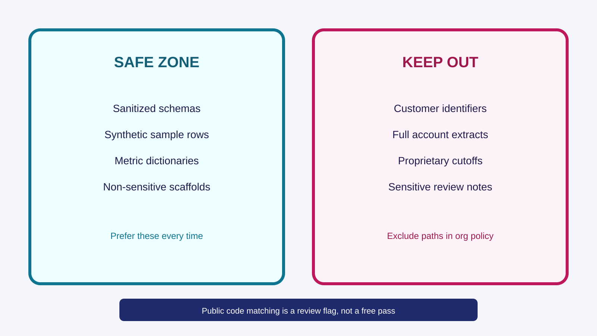

<!-- course-title: GitHub Copilot for Credit Analytics and Risk Modeling -->
<!-- course-theme: roi-theme -->

<!-- layout: title -->


GitHub Copilot for Credit Analytics and Risk Modeling

# Chapter 1: Copilot Fundamentals and Secure Context-Setting

---

# Chapter 1: Objectives

- Choose the Copilot surface for the task: web, apps, or VS Code
- Keep sensitive data out of prompts and treat public-code matches as review flags
- Select inline, Chat, or Agent, and constrain the prompt with scope, checks, and a stop
- Attach the smallest context that can succeed
- Store team defaults in `.github/copilot-instructions.md` and shared prompt files

---

<!-- layout: navigation -->
# Chapter 1

- **Surfaces, Demo, and Guardrails**
- Prompting in VS Code
- Context, Instructions, and Reuse

---

<!-- layout: 3-column -->
# Pick the Surface for the Job

### VS Code: finish the work
- Inline completions, Chat, and Agent mode
- Diffs, tests, and file-scoped edits
- This is where production changes land

### Web: orient, then leave
- [github.com/copilot](https://github.com/copilot) for a quick question
- Useful before you open the repo
- Not a place to merge code

### Apps: capture, then leave
- Desktop and mobile for a draft thought
- No test run, no diff, no approval
- Paste the idea into VS Code before you trust it

---

# Do Now: Same Question, Two Surfaces (5 minutes)

1. Open [github.com/copilot](https://github.com/copilot)
2. Ask: “What is the difference between Copilot Chat and inline suggestions in VS Code?”
3. Open VS Code Copilot Chat and ask the same question
4. Create `scratch.py`, type `def add(a, b):`, and pause for ghost text
5. Accept one suggestion. Undo, then reject or edit the next one

> [!NOTE]
> Ghost text requires Copilot completions enabled in VS Code. If nothing appears, check the Copilot status icon before debugging the prompt.

---

<!-- layout: title-image -->
# What May Enter a Prompt



---

<!-- layout: 2-column -->
# Risky Ask vs Safe Ask

### Risky
- “Analyze this account-level default extract and recommend cutoff scores.”
- Live rows, identifiers, and a policy decision in one paste
- No schema, no synthetic sample, no parameter for the cutoff

### Safe
- “Given this synthetic schema and 10 sample rows, draft helpers for feature prep and threshold evaluation.”
- “Leave cutoffs as parameters.”
- “List assumptions. Do not invent columns.”

---

# Public Code Matching Is a Review Flag

- Copilot can warn when a suggestion resembles public code
- Open the match. Rewrite the block if you cannot attribute it or your policy forbids it
- Do not disable the filter to get unstuck
- Org content exclusions still apply even when the match looks harmless

> [!WARNING]
> A suggestion with no warning is not a license review and not a correctness review.

---

# Accept Boilerplate. Reject Hidden Rules.

- Accept a completion that fills in syntax you already decided
- Reject a completion that invents a metric, a join, or a null rule
- Edit in place when the shape is right and one line is wrong

```python
def delinquency_rate(df):
    return df["dpd"].mean()  # reject: no denominator, no null rule
```

> [!IMPORTANT]
> If you cannot explain the suggestion to a reviewer, do not accept it.

---

<!-- layout: navigation -->
# Chapter 1

- Surfaces, Demo, and Guardrails
- **Prompting in VS Code**
- Context, Instructions, and Reuse

---

<!-- layout: title-image -->
# Inline, Chat, or Agent


---

<!-- layout: card-layout -->
# Three Slash Commands Worth Memorizing

### /explain
- Highlight the function and ask for assumptions, null behavior, and grain.

### /tests
- Name the cases: empty input, missing columns, and the denominator rule.

### /fix
- Paste the failure text and ask for a minimal diff, not a rewrite.

---

# What You Check After Each Command

| Command | Pass looks like | Send it back when |
| :--- | :--- | :--- |
| `/explain` | Names grain, nulls, and ambiguity | It restates the code with no assumptions |
| `/tests` | Covers the cases you named | It only tests the happy path |
| `/fix` | Changes the failing lines | It rewrites functions that were passing |

---

<!-- layout: 2-column -->
# Weak Prompt vs Strong Prompt

### Weak
- “Create SQL for delinquency trends.”
- No grain
- No denominator
- No check that the result is safe to use

### Strong
- “Monthly 30-day delinquency rate by risk_band.”
- “Exclude charged-off accounts from the denominator.”
- “Return a companion query that flags duplicate account-month keys.”

---

# File-Scoped Prompt You Will Reuse

```text
Task: Add a delinquency trend helper.
Use:
- #file src/analytics/delinquency.py
- #file tests/test_delinquency.py
Output:
- Edit only those two files.
- Add tests for an empty frame and a missing risk_band.
Stop:
- If grain is unclear, list assumptions and do not edit.
```

---

<!-- layout: 3-column -->
# When Another Prompt Will Not Help

### Missing definition
- Copilot is guessing the denominator.
- Write the rule yourself, then prompt again.

### Wrong context
- It edited a file you did not name.
- Resend with an explicit file list.

### Policy invention
- It recommended a cutoff or a decline rule.
- That decision stays with you.

---

<!-- layout: navigation -->
# Chapter 1

- Surfaces, Demo, and Guardrails
- Prompting in VS Code
- **Context, Instructions, and Reuse**

---

<!-- layout: title-image -->
# Start with the Smallest Useful Scope


---

# @workspace Touched Files You Did Not Name

- You asked for a null-rate helper. The diff also reformatted a monitoring job
- That happens when the prompt says `@workspace` and “clean this up”
- Resend with `#file` on the helper and its test, and “do not edit other files”
- Revert the extra edits before the next prompt so the diff stays reviewable

---

<!-- layout: 3-column -->
# Attach Three Kinds of Context, Not the Repo

### Code
- `#selection` or `#file`
- The matching test file when you want tests
- Skip unrelated modules

### Definitions
- Grain, denominator, and column meanings you already know
- “Do not invent columns”
- A short metric note beats a data dump

### Process
- “Edit only this file”
- “List assumptions first”
- “Stop after the tests”

---

<!-- layout: 2-column -->
# What Belongs in copilot-instructions.md

### Put in the file
- Explicit null handling for model inputs
- No bare `except` blocks
- Unit tests for denominator and segment logic
- Synthetic examples only in prompts

### Leave out of the file
- This month’s cutoff or champion strategy
- Customer, account, or application extracts
- One-off questions that belong in a single chat

> [!TIP]
> Keep the file short enough that a new teammate will actually read it. Instructions steer defaults. They do not replace review.

---

# Ask Whether the Instructions Actually Loaded

- Prompt: “What repo rules apply before you edit?”
- A useful reply names null handling, tests, and synthetic data without you pasting them
- A reply that invents a cutoff, or asks for a live extract, means the file is missing or ignored
- Fix `.github/copilot-instructions.md`. Do not keep compensating in every chat

---

<!-- layout: 2-column -->
# Instructions vs Prompt Files

### `.github/copilot-instructions.md`
- Defaults for every task in the repo
- Style, tests, and data-handling rules
- Loaded without you pasting them

### A shared prompt file
- One recurring workflow, such as “SQL plus a validation query”
- You attach it when that workflow starts
- Not a Cursor `.agents/skills/` folder, and not a skip for review

<!-- below-columns -->

> [!NOTE]
> Multi-file refactors use the plan-then-approve loop in Chapter 4. Do not ask Agent mode to “clean up the repo” from this chapter’s habits alone.

---

# Chapter 1 Hands-On Lab

- Lab: Effective Prompting and Context Engineering
- Time: 30 minutes

---

# What You Learned

- Chose the Copilot surface for the task: web, apps, or VS Code
- Kept sensitive data out of prompts and treated public-code matches as review flags
- Selected inline, Chat, or Agent, and constrained the prompt with scope, checks, and a stop
- Attached the smallest context that can succeed
- Stored team defaults in `.github/copilot-instructions.md` and shared prompt files

---

# Quiz 1 of 3

**A teammate pastes a full account-level extract into Copilot Chat and asks for cutoff scores. What should you recommend?**

- A. Switch to the mobile app so the extract is “less official”
- B. Replace the extract with a synthetic schema and leave cutoffs as parameters
- C. Disable public code matching so the answer is unrestricted
- D. Ask Copilot to delete the data from the chat afterward

---

# Quiz 1: Answer

**A teammate pastes a full account-level extract into Copilot Chat and asks for cutoff scores. What should you recommend?**

**Correct: B.** Sensitive rows do not belong in the prompt, and a cutoff is a human decision.

- A short synthetic schema is enough structure for a code draft
- Org content exclusions reduce accidents. They do not make a live extract safe
- Deleting a message is not a control you should plan on

---

# Quiz 2 of 3

**Which change most improves consistency across a team that already uses Copilot?**

- A. Require longer prompts from everyone
- B. Turn off inline completions
- C. Maintain `.github/copilot-instructions.md` plus a few shared prompt files with acceptance checks
- D. Start every chat with `@workspace`

---

# Quiz 2: Answer

**Which change most improves consistency across a team that already uses Copilot?**

**Correct: C.** Shared instructions and prompt files carry the rules people otherwise retype badly.

- Defaults reduce variance from one chat to the next
- A prompt file encodes a workflow that already worked
- Acceptance checks give review something objective to point at
- `@workspace` widens context. It does not set a team standard

---

<!-- layout: 2-column -->
# Quiz 3 of 3: Discussion

### Prompt
A colleague wants to do all coding in Copilot on the web because it feels simpler than VS Code.

### Discuss
- When is the web UI the right first step?
- What has to finish in VS Code before you trust a change?
- How would you show that handoff in five minutes?

---

<!-- layout: 2-column -->
# Quiz 3: Discussion Points

**A colleague wants to do all coding in Copilot on the web because it feels simpler than VS Code.**

### Strong Answers Mention
- Web for orientation and a quick explanation
- VS Code for file scope, diffs, tests, and accept or reject
- A five-minute demo: same question on the web, then ghost text you can undo

### Watch For
- Treating web chat as the production editor
- Skipping verification because the answer looked fluent

---

<!-- layout: stacked -->
# Questions and Answers

Questions?


