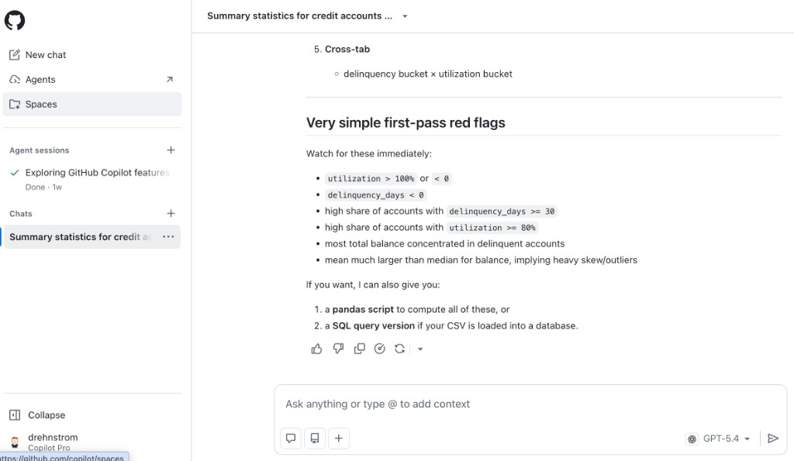
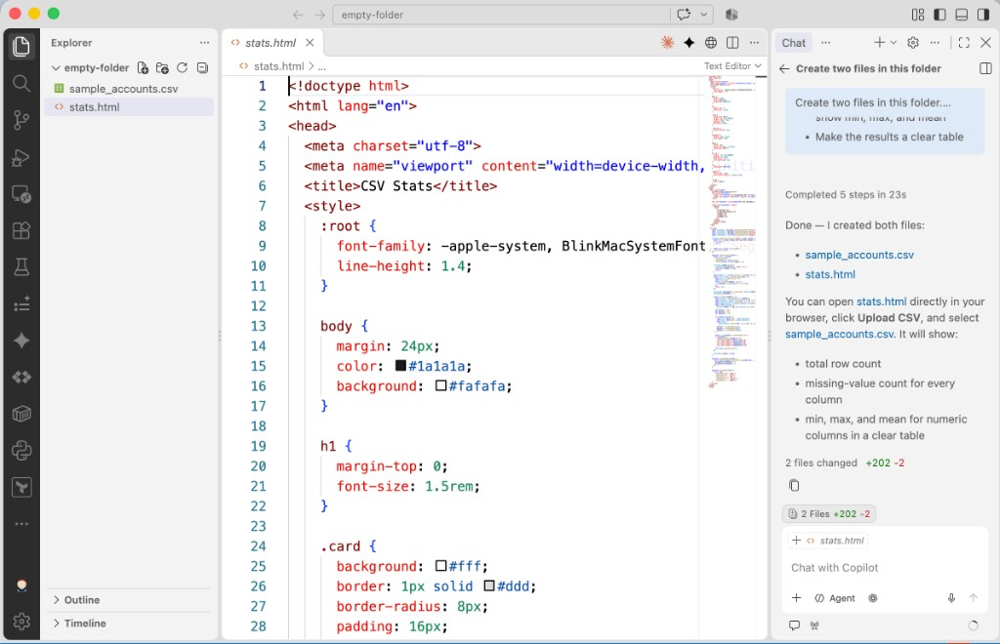
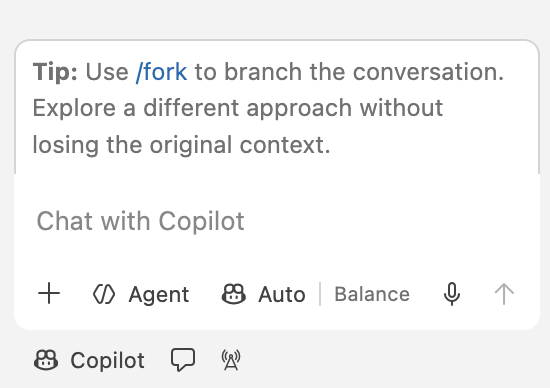
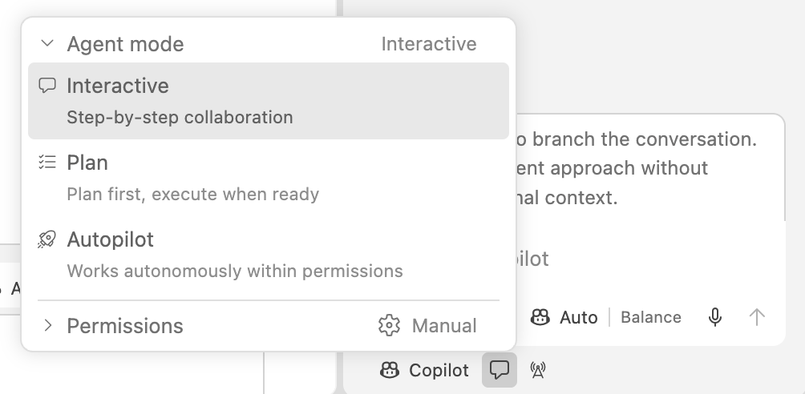
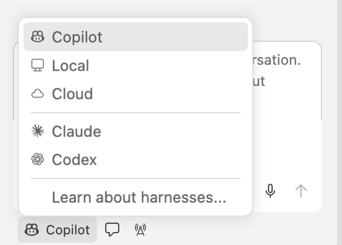
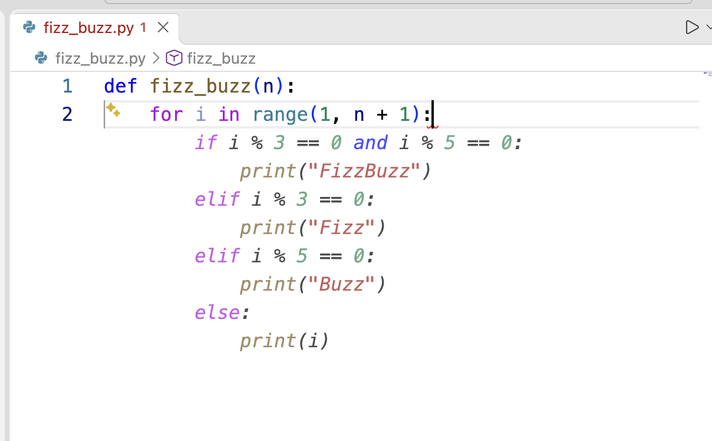
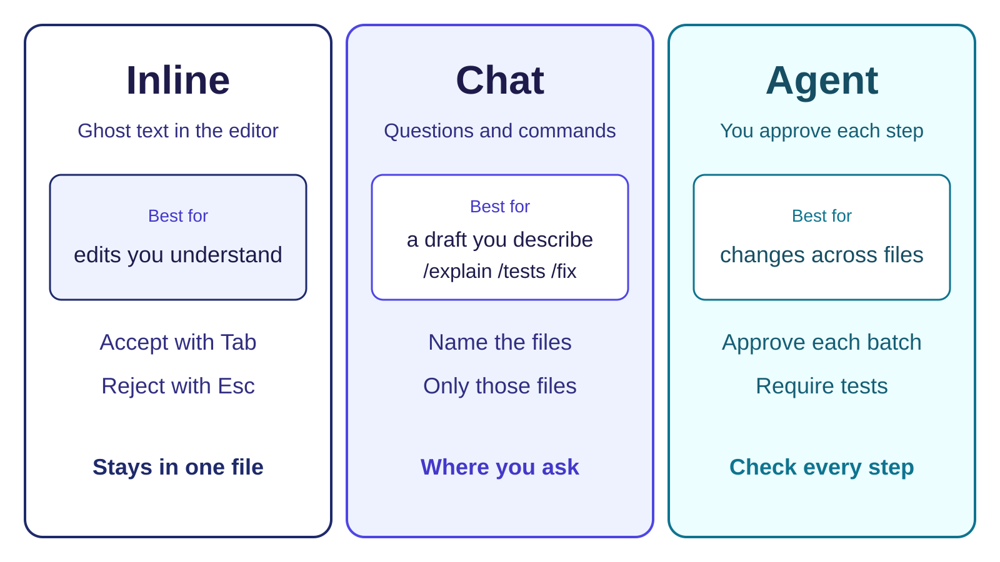
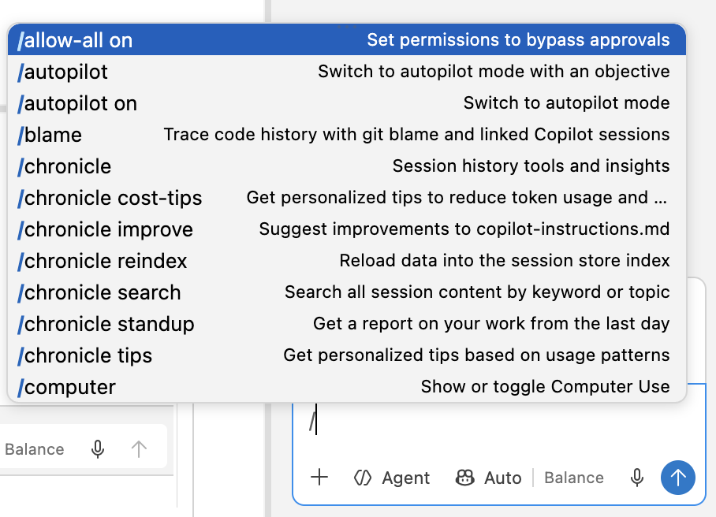
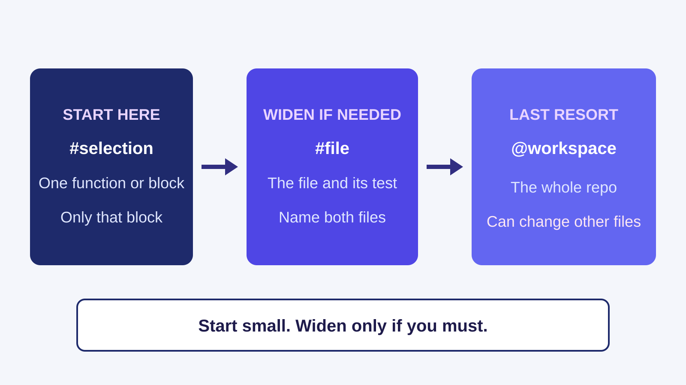

<!-- course-title: GitHub Copilot for Credit Analytics and Risk Modeling -->
<!-- course-theme: roi-alt-theme -->

<!-- layout: title -->


GitHub Copilot for Credit Analytics and Risk Modeling

# Chapter 1: Copilot Fundamentals and Secure Context-Setting
---
# Chapter 1: Objectives

- Use Copilot from VS Code, the website, and the Copilot app
- Write safe prompts and control prompt context
- Select inline, Chat, or Agent modes when generating code
- Store team defaults in `.github/copilot-instructions.md` and shared prompt files
---
<!-- layout: navigation -->
# Chapter 1

- **Where Copilot Runs**
- Prompting in VS Code
- Context, Instructions, and Reuse
---
<!-- layout: 3-column -->
# Where the Work Belongs

### VS Code
- Inline completions, Chat, and Agent mode
- Diffs, tests, and file-scoped edits
- Where production changes land

### Web
- [github.com/copilot](https://github.com/copilot) for quick questions
- Useful before you open the repo
- Not a place to merge code

### Apps
- Desktop and mobile for a draft thought
- No test run, no diff, no approval
- Paste the idea into VS Code before you trust it

<!-- below-columns -->

> [!NOTE]
> GitHub docs call these places "Surfaces"
---
# Demo: Using the Copilot Website

1. Open [github.com/copilot](https://github.com/copilot).
2. Paste the following prompt, and read the results. 

```text
What is the difference between Copilot Chat and inline suggestions in VS Code?
```

3. At the bottom of the chat, open the model menu and choose a different model.

4. Paste this prompt:

```text
I have a CSV of credit accounts with balance, utilization, and delinquency_days. Which summary statistics should I compute first, and what would a bad value look like?
```

> [!NOTE]
> Compare the two answers. The second one should include count, missing values, min, max, and mean, and flag blank utilization or delinquency_days values that are obviously wrong or unusually long.
---
<!-- layout: title-image -->
# GitHub Copilot Website


---
# Demo: Using Copilot in Visual Studio Code

1. Open Visual Studio Code. Choose File> Open Folder, then open an empty folder. _Just create an empty folder anywhere on your computer_. 
2. Open Copilot Chat from the Copilot icon in the title bar. Notice that `</> Agent` is selected at the bottom of the chat input box by default.
3. Paste the prompt below and press Enter. If asked, allow Copilot to create the files requested in the prompt. 

```text
Create two files in this folder.

sample_accounts.csv
- Columns: account_id, balance, utilization, delinquency_days
- 12 realistic credit-card rows
- Leave utilization blank on 2 rows
- Set one delinquency_days value to 9999

stats.html
- One page I can open in a browser. No server and no install.
- An Upload CSV button
- After upload, show the row count
- For every column, show how many values are missing
- For every numeric column, show min, max, and mean
- Make the results a clear table
```

4. In the Explorer pane on the left, right-click `stats.html`, choose Reveal in Finder or Reveal in File Explorer, and open the file in a browser.

5. Click Upload CSV and choose `sample_accounts.csv` from the same folder.
---
<!-- layout: title-image -->
# Visual Studio Code with Copilot


---
# Inside the Copilot Chat Box in VS Code

- **`+` (Add Context)**: Attach `#file` references, folders, or symbols to your prompt
- **`</> Agent` (`Shift+Cmd+I` / `Ctrl+Shift+I`)**: Unified workspace agent that can answer questions, edit files, and run terminal commands
- **`Auto | Balance`**: Selects the underlying model (or lets Copilot pick automatically)
- **Bottom toolbar icons**: Switch between the **Harness** (`Copilot`), **Agent Mode** (speech bubble), and live session tools


---
# Choosing an Agent Mode: Interactive, Plan, or Autopilot

- Click the **speech bubble icon** below the chat input box to control how Agent mode collaborates with you:
  - **Interactive (Default)**: Step-by-step collaboration where you review diffs and approve actions as Copilot works
  - **Plan**: Builds a step-by-step plan first and waits to execute until you are ready
  - **Autopilot**: Works autonomously across steps within the permissions you set
- **Permissions (`Manual`)**: Keep set to **Manual** for credit analytics so Copilot always asks before running terminal commands or touching sensitive files


---
# Selecting a Harness in VS Code

- Click **Copilot** in the bottom-left corner of the chat panel to choose where and how the agent runs:
  - **Copilot / Local / Cloud**: Run with GitHub Copilot in your local VS Code session or in a cloud workspace
  - **Claude / Codex**: Switch to alternative agent harnesses if enabled for your organization
- For all exercises in this course, keep the harness set to **Copilot** and Agent mode set to **Interactive** or **Plan**


---
# Prevent Data Leakage in Prompts

- A prompt leaves your computer. Copilot sends it to the model and stores it with the chat.
- Do not paste names, account IDs, Social Security numbers, or real customer rows.
- Do paste column names, a few rows you invented, and the cutoff as a parameter.
- If you would not email it outside the company, do not paste it into Copilot.


---
<!-- layout: 2-column -->
# Risky Ask vs Safe Ask

### Risky
- “Here are our customers’ names, account numbers, and Social Security numbers. Find who is behind on payments.”
- “This spreadsheet is a real export from our system. Tell me which accounts to close.”
- “Use last month’s customer list and decide who we should turn down.”

### Safe
- “Here are the column names and 10 rows I made up. Draft code that scores accounts.”
- “Keep the cutoff as a number I can change.”
- “List what you assumed. Do not invent columns.”
---
# Demo: Inline Completion

1. In VS Code, create a file named `fizz_buzz.py`.
2. Type this line, press Enter, and pause.

```python
def fizz_buzz(n):
```

3. Wait for the gray ghost text.
4. Press Tab to accept it.
5. Read the inserted code. Undo it if it is not the loop you wanted.

> [!NOTE]
> Ghost text requires Copilot completions. If nothing appears, check the Copilot icon in the status bar.
---
# Accepting an Inline Suggestion

- Read the gray text before you press a key
   - Press Tab only when you understand it and it is what you meant to write
   - Press Esc when it is wrong, or when you do not understand it
- If only the start is right, accept that part. On a Mac, press `Cmd+Right`; on Windows, press `Ctrl+Right`
- To ask for an edit right inside the file, select the lines and press `Cmd+I` (Mac) or `Ctrl+I` (Windows) to open Inline Chat


---
<!-- layout: navigation -->
# Chapter 1

- Where Copilot Runs
- **Prompting in VS Code**
- Context, Instructions, and Reuse
---
<!-- layout: title-image -->
# Inline, Chat, or Agent


---
<!-- layout: card-layout -->
# Three Slash Commands Worth Memorizing

### /explain
- Select a function and ask what it assumes, including how it treats blank values.

### /tests
- Name the cases, including an empty input, a missing column, and which accounts count.

### /fix
- Paste the error and ask for a change only to the lines that failed.
---
# Common Slash Commands in VS Code

| Command | What it does | When to use it |
| :--- | :--- | :--- |
| `/explain` | Explains how selected code works and what it assumes | Before editing unfamiliar Python, SQL, or legacy SAS |
| `/tests` | Generates unit tests for the selected function or file | Adding `pytest` coverage for normal and edge cases |
| `/fix` | Proposes a targeted fix for an error or failing block | Pasting a traceback or fixing a broken calculation |
| `/doc` | Generates docstrings and inline comments | Documenting inputs, outputs, and rules on a function |
| `/clear` | Clears the current chat history and starts fresh | Switching tasks so old context does not pollute the next prompt |
| `/new` | Scaffolds a new workspace, file, or notebook | Starting a new project structure or Jupyter notebook |
| `/help` | Lists all available slash commands and chat participants | Checking exact command names and syntax in VS Code |
---
# Type `/` to Browse Available Commands

- You do not have to memorize every slash command
- Type `/` in the Copilot Chat input box to open the autocomplete menu with each command and its description
- Keep typing to filter the list, or use the Up and Down arrow keys and press `Tab` or `Enter` to select one
- Custom team prompt files (in `.github/prompts/`) also appear right in this `/` menu


---
<!-- layout: 2-column -->
# Weak Prompt vs Strong Prompt

### Weak
- “Analyze this data.”
- “Make a chart.”
- “Fix the bug.”

### Strong
- “Read `sample_accounts.csv`. Each row is one credit account. Print the average of `balance`, and skip blank `utilization` rows.”
- “Bar chart of delinquent accounts by `risk_band`. Put `risk_band` on the x-axis and account count on the y-axis.”
- “`average()` crashes on an empty list. Return `None` for an empty list, and do not change any other function.”
---
# File-Scoped Prompt You Will Reuse

```text
Task: Add a delinquency trend helper.
Use:
- #file src/analytics/delinquency.py
- #file tests/test_delinquency.py
Output:
- Edit only those two files.
- Add tests for an empty frame and a missing risk_band.
Stop:
- If you are not sure what one row represents, list assumptions and do not edit.
```
---
<!-- layout: 3-column -->
# When Another Prompt Will Not Help

### You left out a rule
- Copilot chose which accounts count, because you did not say.
- Write that rule, then prompt again.

### It edited the wrong file
- It changed a file you did not name.
- Send the prompt again with the file names.

### It made a business decision
- It recommended a cutoff or who to decline.
- That choice stays with you.

<!-- below-columns -->

> [!WARNING]
> The human always has to understand and be in charge of all code changes. 
---
# Demo: Explain, Tests, and Fix

1. In VS Code, create a file named `average.py`. Then, paste this code and save the file.

```python
def average(numbers):
    total = 0
    for n in numbers:
        total = total + n
    return total / len(numbers)

print(average([]))
```

2. Select the `average` function. Then, open Copilot Chat and paste the following prompt.

```text
/explain What does this function assume, and what happens when the list is empty?
```

3. Read the reply before you continue, and then paste this prompt.

```text
/tests Include a normal list and an empty list.
```

4. Read the tests. Confirm the empty list is one of the cases.
5. Open the terminal in the folder that contains the file, and run this command.

```bash
python average.py
```

6. Copy the error. Paste this prompt, and replace the second line with the error you copied.

```text
/fix
PASTE THE ERROR HERE
Change only the lines that failed. An empty list should return None.
```

7. Read the edit. Keep it only if an empty list returns None.

> [!NOTE]
> If `python` is not found, run `python3 average.py`. If a reply ignores the function, select `average` and send the prompt again.
---
<!-- layout: navigation -->
# Chapter 1

- Where Copilot Runs
- Prompting in VS Code
- **Context, Instructions, and Reuse**
---
<!-- layout: title-image -->
# Start with the Smallest Context


---
# How You Point Copilot at Code

- Select the function. Chat uses that selection.
- Type `#file` and choose the file. Add the test file when you want tests.
- Type `@workspace` only when the question or change spans multiple files across the repo.
- Broad workspace context can lead Copilot to touch files you did not name. Name the exact files with `#file` when you can.
---
<!-- layout: 2-column -->
# What copilot-instructions.md Is For

### The file
- It lives at `.github/copilot-instructions.md`
- Copilot adds it to every chat in that repo
- You do not paste it into the prompt
- It holds rules for the whole team, not today’s task

### Rules that belong there
- Write tests with the change
- Do not use real customer data in examples
- State assumptions before editing
- Leave out one-off questions, secrets, and live data
---
# Example: `.github/copilot-instructions.md`

- Create `.github/copilot-instructions.md` at the root of your repository so Copilot applies these rules automatically:

```markdown
# Credit Analytics Team Copilot Instructions

## Coding Standards
- Use Python 3.11, pandas, and pytest for all analytics scripts.
- Add type hints and a short docstring to every new function.

## Data and Domain Rules
- Never include real customer PII, names, or production account IDs.
- Exclude rows where status == 'charged_off' from delinquency rate denominators.
- Treat delinquency_days > 365 as a data error flag, not a valid observation.

## Verification Rules
- Write pytest unit tests for every new or modified function, including empty inputs and nulls.
- State assumptions and wait for approval before editing multiple files.
```
---
<!-- layout: 2-column -->
# Instructions vs a Prompt File

### `.github/copilot-instructions.md`
- Loaded on every chat in the repo
- Standing rules for the team
- You do not choose it each time

### `.github/prompts/name.prompt.md`
- One job you repeat, such as “add tests for this function”
- You run it by typing `/` and the file name
- It does not run until you ask for it
---
# Example: `.github/prompts/add-tests.prompt.md`

- Save repeatable tasks under `.github/prompts/` and run them in Chat by typing `/add-tests`:

```markdown
# Prompt File: .github/prompts/add-tests.prompt.md

Write pytest unit tests for the selected function or attached #file:
1. Use synthetic credit account rows only (no real customer data).
2. Test normal inputs across Prime, Near-Prime, and Subprime risk_band values.
3. Test edge cases: empty DataFrame, missing utilization values, and delinquency_days = 9999.
4. Do not modify the production function unless I explicitly ask.
```
---
# Chapter 1 Hands-On Lab

- Lab: [Effective Prompting and Context Engineering](https://labv.roitraining.com/?lab=https://github.com/roitraining/github-copilot-for-credit-analysts/tree/master/labs/lab-01-effective-prompting-and-context-engineering)
- Time: 30 minutes
---
# What You Learned

- Used Copilot from VS Code, the website, and the Copilot app
- Wrote safe prompts and controlled prompt context
- Selected inline, Chat, or Agent modes when generating code
- Stored team defaults in `.github/copilot-instructions.md` and shared prompt files
---
# Quiz 1 of 3

**You need Copilot to change one function in VS Code. What context should you give it?**

- A. `@workspace`, so it can see the whole repo
- B. The selected function, or `#file` on that file and its test
- C. Every file in the repo, pasted into the chat
- D. The website, with the repo described from memory
---
# Quiz 1: Answer

**You need Copilot to change one function in VS Code. What context should you give it?**

**Correct: B.** Start with the selection or the named files.

- Select the function when the change stays in that block
- Add the test file with `#file` when you want tests
- Use `@workspace` only when the change needs other files
- Broad `@workspace` context can lead Copilot to touch files you did not name
---
# Quiz 2 of 3

**The team wants the same rules on every chat, without pasting them each time. Where do the rules go?**

- A. In a prompt file that someone runs with `/`
- B. In `.github/copilot-instructions.md`
- C. In the ghost text, so Tab inserts the rules
- D. In one chat. Later chats will remember it
---
# Quiz 2: Answer

**The team wants the same rules on every chat, without pasting them each time. Where do the rules go?**

**Correct: B.** Copilot adds `copilot-instructions.md` to every chat in that repo.

- A prompt file is one job you repeat. It does not run until you ask
- Ghost text is an inline suggestion, not a store for team rules
- One chat does not set the default for the next chat
- Keep the file to standing rules, such as tests and no live customer data
---
<!-- layout: 2-column -->
# Quiz 3 of 3: Discussion

### Prompt
A teammate runs `/fix` on a function that crashes. They keep the edit without reading it. Copilot also rewrote a function that already worked.

### Discuss
- What should they have included with `/fix`?
- What should they check before keeping the edit?
- Which command comes first if they do not yet understand the function?
---
<!-- layout: 2-column -->
# Quiz 3: Discussion Points

**A teammate runs `/fix` on a function that crashes. They keep the edit without reading it. Copilot also rewrote a function that already worked.**

### Strong Answers Mention
- The error, and a limit to the lines that failed
- Keep the edit only if the crash is fixed and the other function is unchanged
- `/explain` first, when they cannot say what the function does
- `/tests` for the failing case, such as an empty list

### Watch For
- Keeping the edit because it looks finished
- Using `/fix` to rewrite the whole file
- Skipping `/explain` when the function is unclear
---
<!-- layout: stacked -->
# Questions and Answers


