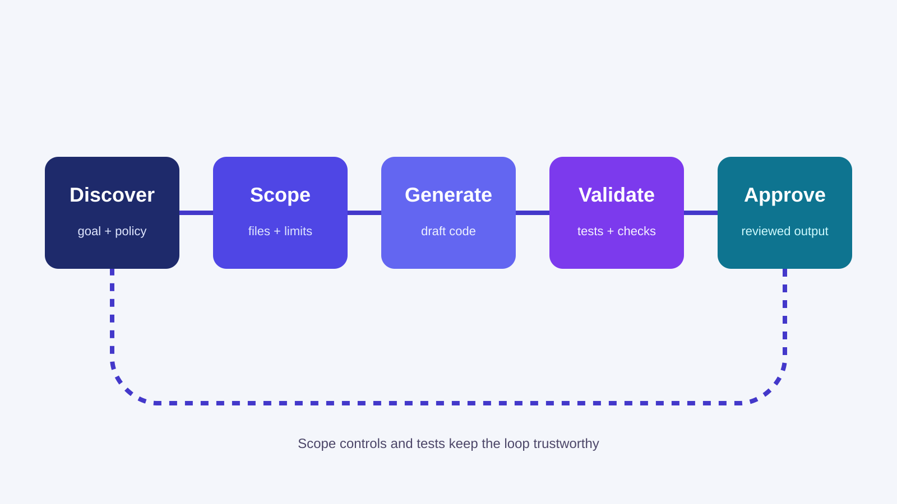
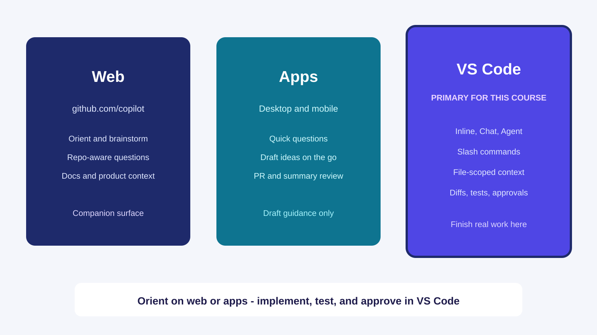
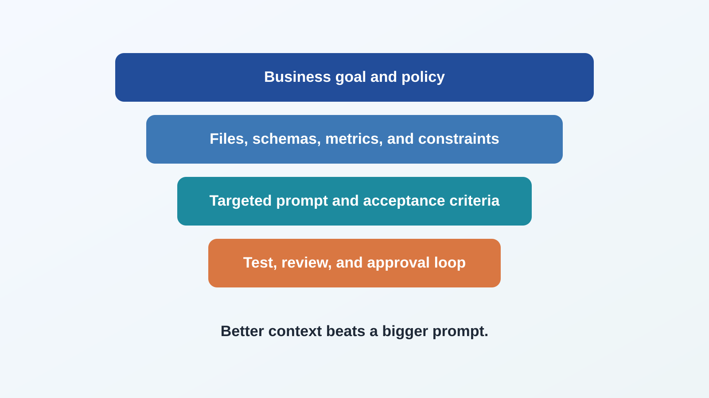

<!-- course-title: GitHub Copilot for Credit Analytics and Risk Modeling -->
<!-- course-theme: roi-theme -->

<!-- layout: title -->


GitHub Copilot for Credit Analytics and Risk Modeling

# Chapter 1: Copilot Fundamentals and Secure Context-Setting

---

# Chapter 1: Objectives

- Explain how Copilot capabilities map to real credit analytics engineering workflows
- Apply enterprise-safe prompting and data-handling habits in regulated model-risk environments
- Use VS Code interaction surfaces intentionally for speed, control, and reviewability
- Engineer context across files and repositories to improve generation quality and reduce rework
- Build a team operating model for instructions, reusable prompts, and measurable quality outcomes

---

<!-- layout: navigation -->
# Chapter 1

- Copilot Platform and Enterprise Guardrails
- Prompting Surfaces in VS Code
- Context Engineering Patterns
- Team Instructions, Skills, and Prompt Reuse

---

# Why This Chapter Matters

- Most Copilot failures are workflow failures, not model failures
- Teams lose trust when they skip scope control, testing prompts, and review protocols
- This chapter defines the operating system for how your team uses Copilot all day

> [!IMPORTANT]
> In credit analytics, acceleration without control creates governance debt.

---

<!-- layout: stacked -->
# Safe Copilot Workflow

- Start with the business goal and policy constraints
- Scope the task to the right files and limits
- Generate a draft with explicit acceptance criteria
- Validate with tests and data checks before approval
- Review evidence and lock the workflow into a repeatable pattern



---

<!-- layout: 3-column -->
# Copilot Capability Map

### Assistive
- Inline completions
- Code explanations
- Local refactors

### Agentic
- Multi-step task execution
- File edits with validation loops
- Change summaries for review

### Customizable
- Repository instructions
- Reusable prompt templates
- Skill and tool integrations

---

# GitHub Copilot Website: What It Is For

- Use [github.com/copilot](https://github.com/copilot) as the product entry point, not as your daily coding surface
- It is where teams evaluate Copilot offerings, access paths, and organizational rollout context
- Day-to-day implementation for this course still happens primarily in VS Code

---

<!-- layout: 2-column -->
# Website vs VS Code: Division of Labor

### GitHub Copilot Website
- Product overview and onboarding entry
- Plan and access information
- Links to documentation and rollout guidance

### VS Code Copilot Experience
- Inline completions and chat-driven coding
- File-scoped prompting and multi-file edits
- Planning, implementation, tests, and approvals

---

<!-- layout: 2-column -->
# Copilot Apps on Desktop and Mobile

### Useful Scenarios
- Review pull request summaries away from coding workstation
- Ask quick repository questions while traveling
- Capture ideas and prompts for later execution in VS Code

### Practical Limits for This Course
- Apps are complementary surfaces, not primary coding environments
- Production code edits, tests, and approvals stay in VS Code workflows
- Treat mobile and desktop app outputs as draft guidance until validated

---

<!-- layout: 3-column -->
# Copilot Surfaces in the Real Workflow

### Discover
- Visit [github.com/copilot](https://github.com/copilot)
- Confirm product fit
- Review feature families

### Configure
- Align org access and policy
- Confirm team standards
- Share rollout expectations

### Execute
- Build in VS Code
- Validate with tests and reviews
- Capture evidence in pull requests

---

<!-- layout: 2-column -->
# Instructor Demo: Website to Editor Flow

### Demo Script
- Open [github.com/copilot](https://github.com/copilot)
- Identify where learners find official docs and onboarding links
- Transition into VS Code for actual coding workflows

### Teaching Point
- Website explains “what Copilot is”
- VS Code shows “how to do real work safely”
- Keep learners focused on execution habits

---

<!-- layout: card-layout -->
# Enterprise Guardrails You Must Internalize

### Data Sensitivity
- Prompting practices must align with data classification and sharing policy.

### Access Controls
- Organization settings determine available models, features, and integrations.

### Human Accountability
- Analysts and reviewers own business correctness, regardless of generated code quality.

### Audit Trail
- Prompt intent, review notes, and validation evidence should be retained.

---

<!-- layout: 2-column -->
# Data Classification and Prompt Boundaries

### Safe to Share in Prompts
- Sanitized schemas
- Synthetic examples
- Publicly documented transformations
- Non-sensitive code scaffolds

### Restricted or Prohibited
- Raw customer identifiers
- Full account-level extracts
- Proprietary strategy thresholds
- Sensitive narrative from active governance reviews

---

# Secure Prompt Rewrite Pattern

- Convert risky prompts into policy-safe prompts before sending to Copilot
- Replace live records with schema plus representative synthetic rows
- Split sensitive business logic into abstract constraints

```text
Risky:
"Analyze this account-level default dataset and recommend cutoff scores."

Safe rewrite:
"Given this synthetic schema and sample rows, draft Python code for
feature preparation and threshold-evaluation utilities.
Do not infer policy cutoffs. Leave threshold values as parameters."
```

---

<!-- layout: 2-column -->
# Human Control Points in the Workflow

### Before Generation
- Define objective and acceptance criteria
- Scope context and constraints
- Confirm policy-safe inputs

### After Generation
- Review assumptions and edge cases
- Run tests and data checks
- Approve or reject with documented rationale

---

# When Copilot Should Not Be the First Move

- Do not start with generation when domain logic is still unclear
- Clarify metric definitions and denominator rules with stakeholders first
- Resolve conflicting business requirements before asking for code

> [!WARNING]
> Copilot can produce coherent code for an incoherent requirement. That is still a defect.

---

<!-- layout: navigation -->
# Chapter 1

- Copilot Platform and Enterprise Guardrails
- Prompting Surfaces in VS Code
- Context Engineering Patterns
- Team Instructions, Skills, and Prompt Reuse

---

# Choosing the Right Interaction Surface

- Surface choice determines output quality, review cost, and turnaround speed
- Use inline completions for local precision
- Use chat for structured generation and explanation
- Use agentic task flows for bounded, multi-step implementation

---

<!-- layout: stacked -->
# VS Code Surface Map

- Website gives product orientation and access context
- VS Code handles real implementation and review
- Agents add controlled execution when the work is multi-step



---

<!-- layout: 2-column -->
# Inline Completions: High-Confidence Use Cases

### Use Inline for
- Completing boilerplate
- Expanding local function logic
- Small refactors in known patterns
- Test assertion additions

### Avoid Inline for
- Cross-file architectural changes
- Unknown domain rules
- Large migrations
- Governance-critical logic without review plan

---

<!-- layout: 2-column -->
# Chat: Best for Structured Problem Solving

### Strong Chat Requests
- “Generate and explain”
- “Compare two approaches”
- “Refactor with constraints”
- “Draft tests for these edge cases”

### Weak Chat Requests
- “Fix everything”
- “Make this production-ready”
- “Optimize this somehow”
- “Do whatever is best”

---

# Prompt Anatomy for Analysts

- A complete prompt includes intent, context, constraints, output, and checks
- Missing any one element increases revision loops and hidden defects

```text
Intent: What business problem to solve.
Context: Which files, schema definitions, and assumptions apply.
Constraints: Policy, performance, and style requirements.
Output: Expected artifact shape and location.
Checks: Tests, validation metrics, and review criteria.
```

---

<!-- layout: 2-column -->
# Prompt Upgrade: Before and After

### Before
- “Create SQL for delinquency trends.”
- No grain definition
- No denominator rule
- No validation requirement

### After
- “Create SQL for monthly 30-day delinquency rate by risk_band at portfolio grain.”
- “Exclude charged-off accounts from denominator.”
- “Return row count per segment for stability checks.”
- “Add companion query to verify duplicates at output grain.”

---

# File-Scoped Prompting: Exact Pattern

- Tell Copilot exactly which files to read before asking for changes
- Pair the task with target files, support files, and acceptance tests
- Prevent broad repo drift by naming output file location explicitly

```text
Task: Add a delinquency trend helper.
Use:
- #file src/analytics/delinquency.py
- #file docs/metrics.md
- #file tests/test_delinquency.py
Output:
- Edit src/analytics/delinquency.py only.
- Update tests/test_delinquency.py with two edge-case tests.
```

---

<!-- layout: 2-column -->
# Context Selectors in Practice

### Narrow Scope First
- `#selection` for targeted edits
- `#file` for function-level or module-level changes
- `@workspace` only when dependencies span multiple files

### Decision Rule
- Start with smallest scope that can succeed
- Escalate only when imports or contracts require wider context
- Ask for a file impact list before approving multi-file edits

---

<!-- layout: 2-column -->
# Prompting for Controlled Multi-File Changes

### Safe Pattern
- Ask for plan before code edits
- Require impacted-file list
- Approve one batch of files at a time
- Run tests between batches

### Unsafe Pattern
- “Refactor the whole repository”
- No acceptance criteria
- No test gates
- No rollback plan

---

# Prompt Iteration Loop

- Treat prompting as iterative engineering, not one-shot generation
- Start with scoped prototype output
- Review assumptions and refine constraints
- Add test and edge-case requirements
- Lock final prompt into reusable team library if successful

---

<!-- layout: 3-column -->
# Fast Prompt Triage When Output Is Off

### Ambiguity
- Clarify objective
- Define input and output schema
- Restate business rule language

### Missing Context
- Attach relevant files
- Provide glossary and metric definitions
- Identify target modules explicitly

### Missing Checks
- Require assertions
- Require unit tests
- Request assumption summary

---

# Prompting for Explanations, Not Just Code

- High-performing teams ask Copilot to explain generated logic before merge
- Request plain-language rationale for joins, filters, and transformations
- Ask for known failure modes and suggested test cases

```text
Explain this generated function in reviewer language:
- what assumptions it makes
- where null behavior can change outcomes
- which edge cases should be tested first
```

---

<!-- layout: navigation -->
# Chapter 1

- Copilot Platform and Enterprise Guardrails
- Prompting Surfaces in VS Code
- Context Engineering Patterns
- Team Instructions, Skills, and Prompt Reuse

---

# Context Engineering: Core Principle

- Better context beats bigger prompts
- Precision context reduces hallucinated assumptions and unnecessary edits
- Scope as narrowly as possible, then expand intentionally

---

<!-- layout: stacked -->
# Context Stack for Better Output

- Business goal and policy are the foundation
- Schemas, metrics, and files narrow the problem
- Prompt and review rules decide the quality bar



---

<!-- layout: 3-column -->
# Context Sources You Control

### Code Context
- Current file
- Selected block
- Neighboring modules

### Domain Context
- Metric dictionary
- Business-rule document
- Data contract notes

### Process Context
- Coding standards
- Test requirements
- Review checklist

---

<!-- layout: 2-column -->
# Scoping Ladder

### Step 1: Local
- Current selection
- One function or class
- Minimal-diff edits

### Step 2: Module
- Related imports
- Shared utilities
- Immediate tests

### Step 3: Repository
- Cross-file dependency graph
- Shared standards
- Broader regression checks

---

# Example: Context Pack for SQL Migration

- For SAS-to-SQL translation, context quality drives both correctness and trust
- Include source logic, target data model, and acceptance checks in one request

```text
Context pack:
- #file legacy_rules.sas
- #file schema_dictionary.md
- #file sql_style_guide.md

Task:
Translate monthly risk-segment rollup logic into ANSI SQL.
Preserve denominator rules and null handling.
Return SQL and a validation query that compares record counts by segment.
```

---

<!-- layout: 2-column -->
# Multi-File Refactor Context Pattern

### What to Provide
- Entry-point file
- Shared utility modules
- Existing tests that must pass
- Known constraints to preserve behavior

### What to Request
- Impact summary before edits
- Ordered change plan
- File-by-file diffs
- Post-change test report

---

# Context Compression for Better Responses

- Summarize large domain documents into compact decision rules before prompting
- Include only definitions that affect current task outcomes
- Remove historical narrative that does not affect implementation choices

> [!TIP]
> A one-page “metric definition sheet” outperforms a 40-page policy document in most generation tasks.

---

<!-- layout: card-layout -->
# Common Context Engineering Failures

### Over-Scoping
- Sending entire repositories for simple tasks introduces irrelevant patterns.

### Under-Scoping
- Missing schema or business definitions leads to plausible but incorrect outputs.

### Contradictory Context
- Conflicting files and instructions create unstable generation behavior.

### Unverified Assumptions
- Teams accept generated assumptions without demanding explicit validation.

---

# Ask Copilot to Declare Its Assumptions

- Explicit assumptions expose hidden risks before code reaches production
- Require Copilot to list open questions and uncertain logic areas
- Block merge when unresolved assumptions affect critical metrics

```text
Before writing code, list:
1) Assumptions you are making.
2) Missing inputs required for certainty.
3) Which assumptions could materially alter delinquency metrics.
```

---

<!-- layout: navigation -->
# Chapter 1

- Copilot Platform and Enterprise Guardrails
- Prompting Surfaces in VS Code
- Context Engineering Patterns
- Team Instructions, Skills, and Prompt Reuse
---

# Team Operating Model for Copilot

- Consistency at team level is the difference between occasional wins and durable productivity
- Standardize instructions, prompts, and review checklists
- Assign ownership for maintaining Copilot operating assets

---

<!-- layout: 2-column -->
# Planning and Approval Workflow

### Planning Prompt
- “Propose a step-by-step plan only.”
- “List files to edit and tests to run.”
- “Do not modify files yet.”

### Approval Prompt
- “Proceed with step 1 only.”
- “Show diff summary before next step.”
- “Stop after tests and wait for approval.”

---

# Planning Example You Can Reuse

```text
You are helping with credit analytics code maintenance.
First, produce a plan only:
1) What will you change?
2) Which files and why?
3) Which tests will you run?
4) What could go wrong?
Do not edit files until I approve.
```

---

# Approval Gate Example

```text
Approved: execute Step 1 only.
Constraints:
- Edit only files you listed in Step 1.
- Preserve current business logic.
- Run targeted tests.
- Return a concise diff summary and test results.
Stop and wait for my next approval.
```

---

# Repository Instructions: What to Include

- Repository instructions should encode non-negotiable engineering behaviors
- Define style, testing, error handling, and documentation expectations
- Capture prohibited patterns and unsafe shortcuts

```text
Suggested sections:
- Coding conventions
- Data-handling restrictions
- Test minimums
- Review expectations
- Documentation and traceability rules
```

---

<!-- layout: 2-column -->
# Customizing Copilot in VS Code

### Instruction Files
- `.github/copilot-instructions.md` sets default team rules
- `AGENTS.md` guides multi-agent workflow boundaries
- Custom instruction files can encode domain safety checks

### Why It Matters
- Better than ad hoc prompts for recurring standards
- Keeps policy and review expectations consistent across teams
- Makes the model follow the operating model rather than improvising

---

<!-- layout: 2-column -->
# Specialized Agents and MCP in Practice

### Specialized Agents
- Separate tasks by role: review, refactor, docs, or validation
- Keep review logic distinct from implementation logic
- Reduce noisy, cross-purpose prompts in large repos

### MCP and Tool Integration
- Connect the agent to external systems, docs, or APIs
- Expose structured tools for repo access, data checks, or issue workflows
- Use the tool layer to keep prompts shorter and evidence stronger

> [!TIP]
> In regulated analytics work, well-scoped agents and tool access often outperform a single all-purpose prompt.

---

<!-- layout: 2-column -->
# When to Use Which Customization

### Custom Instructions
- Set default team standards and operating rules
- Best for repository-wide expectations and code quality constraints
- Good for policy, testing, and review expectations

### Specialized Agents
- Split work by role or task type
- Best for review, refactor, documentation, or validation flows
- Good when a single general prompt is too noisy or too broad

### MCP Tools
- Connect the agent to external systems, data, or repo tooling
- Best for structured access to evidence, issue workflows, or data checks
- Good when the model needs verifiable operational context

---

<!-- layout: card-layout -->
# Customization Stack: Pick the Right Layer

### Repository Instructions
- Default rules for every prompt
- Best for policy, testing, and review guardrails
- Use when the rule should apply everywhere

### Skills
- Reusable playbooks for recurring tasks
- Best for SQL checks, refactors, and review prompts
- Use when the workflow is repeatable and teachable

### Specialized Agents
- Role-specific execution and review
- Best for documentation, validation, and narrow refactors
- Use when work needs separate operating logic

### MCP Tools
- Real context from repos, issues, and data systems
- Best when the model needs evidence, not guesses
- Use when the workflow depends on live tool access

---

<!-- layout: 2-column -->
# Example Instruction Snippet

### Instruction Goal
- Enforce analytics reliability standards
- Reduce review churn
- Improve generated test quality

### Sample Content
```markdown
For credit-risk analytics code:
- Require explicit null handling for all model inputs.
- Reject broad exception swallowing.
- Add unit tests for denominator and segmentation logic.
- Summarize assumptions in pull request notes.
```

---

<!-- layout: 2-column -->
# Where to Configure Copilot Behavior

### Repository-Level
- `.github/copilot-instructions.md` for coding standards and constraints
- `AGENTS.md` to guide cross-agent behavior in this repository
- Shared prompt files in a versioned folder

### Team Process-Level
- Pull request templates for review expectations
- Required test commands in CI
- Governance checklist for model-risk evidence

---

# Create a Skill: Minimum Viable Structure

- Skills turn successful prompt patterns into reusable team assets
- Start with one narrow skill per recurring workflow
- Keep scope specific and measurable

```text
.agents/skills/sql-quality-check/
  SKILL.md
  examples/
    prompt-template.md
```

---

<!-- layout: 2-column -->
# Skill File Template

### Frontmatter
```yaml
name: sql-quality-check
description: >
  Generates SQL plus validation queries for credit metrics.
```

### Body Guidance
- When to use the skill
- Inputs required from the user
- Output format and quality gates
- Common failure modes and fixes

---

<!-- layout: card-layout -->
# Skill Design Rules That Work

### Narrow Scope
- One skill should solve one recurring workflow well.

### Explicit Inputs
- Define required files, schema notes, and acceptance criteria.

### Concrete Outputs
- Require output shape, validations, and test artifacts.

### Iterative Improvement
- Version skill guidance based on observed review outcomes.

---

# Example Skill Invocation Prompt

```text
Use the sql-quality-check skill.
Task:
- Build SQL for monthly 30-day delinquency by risk_band.
Context:
- #file docs/metric-definitions.md
- #file data/schema.md
Output:
- Query plus validation query for duplicate-grain and null checks.
```

---

<!-- layout: 3-column -->
# Approvals Checklist for Generated Changes

### Logic
- Metric definition preserved
- Denominator rules preserved
- Null and edge handling explicit

### Engineering
- Tests added or updated
- No silent exception handling
- Diff scope matches approved plan

### Governance
- Assumptions documented
- Reviewer sign-off captured
- Evidence linked in pull request

---

<!-- layout: card-layout -->
# Prompt Library Design

### Foundation Prompts
- Reusable prompts for profiling, SQL drafting, and model baseline generation.

### Validation Prompts
- Templates for assumption checks, test generation, and metric review.

### Review Prompts
- Structured prompts for pull request risk analysis and governance artifacts.

### Recovery Prompts
- Prompts for debugging failed generations and narrowing context quickly.

---

<!-- layout: 3-column -->
# Skill and Prompt Governance

### Ownership
- One owner per prompt family
- Defined review cadence
- Version history in git

### Quality
- Score prompt outcomes
- Track rework cycles
- Retire low-value templates

### Adoption
- Publish quick-start guide
- Run team demos
- Capture feedback monthly

---

# Measuring Copilot Performance Like a Product

- If you do not measure output quality, you cannot improve adoption quality
- Track speed and quality together to avoid false productivity gains

```text
Practical team metrics:
- Prompt-to-accepted-code cycle time
- Rework rate after first generation
- Test pass rate on generated changes
- Review findings per pull request
```

---

<!-- layout: 2-column -->
# 30-60-90 Day Enablement Plan

### First 30 Days
- Stand up instruction baseline
- Build initial prompt library
- Pilot with one analytics squad

### Days 31 to 90
- Expand to additional teams
- Calibrate quality metrics
- Formalize governance evidence workflow

---

# Chapter 1 Hands-On Lab

- Lab: Effective Prompting and Context Engineering
- Time: 30 minutes

---

# What You Learned

- Explained how Copilot capabilities map to real credit analytics engineering workflows
- Applied enterprise-safe prompting and data-handling habits in regulated model-risk environments
- Used VS Code interaction surfaces intentionally for speed, control, and reviewability
- Engineered context across files and repositories to improve generation quality and reduce rework
- Built a team operating model for instructions, reusable prompts, and measurable quality outcomes

---

<!-- layout: navigation -->
# Chapter 1 Knowledge Check

- Quiz 1
- Quiz 2
- Quiz 3 Discussion

---

# Quiz 1 of 3

Your team asks Copilot to generate a delinquency metric pipeline and gets inconsistent outputs week to week. What is the best first remediation?

- A. Switch to a different model immediately
- B. Ban inline completions for all contributors
- C. Standardize repository instructions and prompt templates with explicit acceptance checks
- D. Increase prompt length with more background narrative

---

# Quiz 1: Answer

Your team asks Copilot to generate a delinquency metric pipeline and gets inconsistent outputs week to week. What is the best first remediation?

**Correct: C.** Consistency comes from shared operating standards and measurable checks.

- Team instructions reduce behavioral variance
- Prompt templates encode proven request structure
- Acceptance checks force objective validation

---

# Quiz 2 of 3

Which action best reduces the risk of plausible but incorrect generated SQL?

- A. Asking for “optimized SQL” first
- B. Supplying the full repository for context on every request
- C. Defining output grain, denominator rules, and a validation query in the prompt
- D. Requesting shorter responses only

---

<!-- layout: 2-column -->
# Quiz 2: Answer

### Correct Choice
- **C.** Define output grain, denominator rules, and a validation query in the prompt.
- These constraints force structural clarity before generation.

### Why It Works
- Grain definition controls aggregation correctness
- Denominator rules protect business meaning
- Validation queries expose hidden join issues

---

<!-- layout: 2-column -->
# Quiz 3 of 3: Discussion

### Prompt
- Your analytics team wants to “roll out Copilot everywhere” next month.
- What rollout plan protects quality while still moving fast?

### Discuss
- Which guardrails are mandatory before broad rollout?
- Which metrics prove value beyond speed?
- What governance evidence should be required per project?

---

<!-- layout: 2-column -->
# Quiz 3: Discussion Points

### Strong Answers Mention
- Scoped pilot before broad adoption
- Shared instructions and prompt libraries
- Quality metrics paired with speed metrics
- Required review and validation artifacts

### Watch For
- “Speed-only” success criteria
- No ownership model for prompts and instructions
- No process for unresolved assumptions

---

<!-- layout: stacked -->
# Questions and Answers

Questions?


