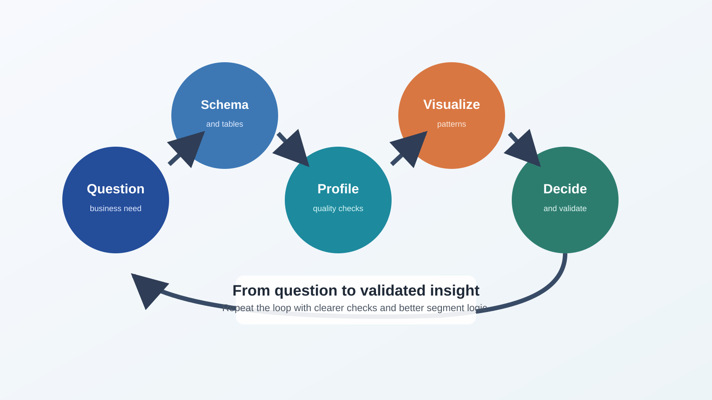
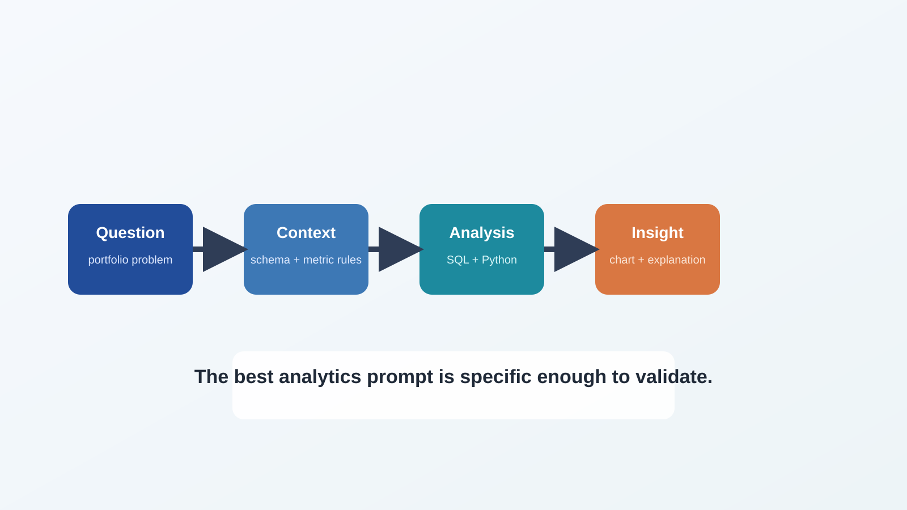

<!-- course-title: GitHub Copilot for Credit Analytics and Risk Modeling -->
<!-- course-theme: roi-theme -->

<!-- layout: title -->


GitHub Copilot for Credit Analytics and Risk Modeling

# Chapter 2: AI-Assisted Data Exploration and Analytics

---

# Chapter 2: Objectives

- Use Copilot to generate profiling, SQL, and visualization workflows from explicit business requirements
- Apply file-scoped prompting patterns that produce reliable analytics outputs with less rework
- Translate natural language credit questions into validated SQL and Python analysis artifacts
- Build a repeatable verification and approval workflow for AI-generated analytics code

---

<!-- layout: navigation -->
# Chapter 2

- Data Profiling Prompts and Workflows
- Visual Analytics and Hypothesis Development
- SQL and Legacy Script Translation
- Quality Checks for Generated Analytics Code

---

# What “In Depth” Means in This Chapter

- You will run concrete Copilot workflows, not generic prompting theory
- Each workflow includes file scope, prompt template, validation steps, and approval gates
- Every generated artifact is treated as draft code until checks pass

---

<!-- layout: stacked -->
# Data Profiling Workflow: Standard Operating Procedure

- Use this 6-step sequence every time you profile a new portfolio dataset
- Step 1: Clarify business questions and required segmentation
- Step 2: Prepare schema context files and metric definitions
- Step 3: Prompt Copilot for profiling module and tests
- Step 4: Execute and inspect profiling outputs
- Step 5: Prompt targeted refinements
- Step 6: Approve and package reusable functions



---

<!-- layout: 2-column -->
# File-Scoped Profiling Prompt Pattern

### Context Files to Include
- `#file docs/schema-dictionary.md`
- `#file docs/metric-definitions.md`
- `#file src/eda/portfolio_profile.py`
- `#file tests/test_portfolio_profile.py`

### Required Output Controls
- Edit only named files
- Return summary of assumptions
- Add tests for null-heavy segments
- Stop and wait for approval

---

# Production-Grade Profiling Prompt

```text
Task: Build a profiling module for monthly credit portfolio monitoring.
Use:
- #file docs/schema-dictionary.md
- #file docs/metric-definitions.md
- #file src/eda/portfolio_profile.py
- #file tests/test_portfolio_profile.py

Requirements:
- Null-rate by column and by segment.
- Percentile summary for utilization and balance.
- Outlier detection for delinquency_days and exposure_amount.
- Data quality flags table with severity levels.
- Add pytest tests for empty DataFrame and missing required columns.

Constraints:
- Use vectorized pandas operations.
- Keep function signatures stable.
- Edit only the two target files.
```

---

<!-- layout: 3-column -->
# Prompt Inputs That Improve Quality

### Business Context
- Portfolio definition
- Time window rules
- Segment hierarchy

### Technical Context
- Data types
- Null semantics
- Expected output grain

### Validation Context
- Required tests
- Baseline benchmarks
- Acceptance thresholds

---

<!-- layout: 2-column -->
# First-Pass Output Review Checklist

### Code Review
- Function boundaries are clear
- No hidden type coercion
- Null logic is explicit
- Output columns match contract

### Business Review
- Definitions match metric guide
- Segment logic is complete
- Outlier rules are explainable
- Severity labels are actionable

---

# Iteration Prompt: Fix Only What Failed

- When output is partially correct, request surgical revisions
- Preserve correct logic and target only failing behaviors

```text
Revise only these issues:
1) Null handling in utilization percentiles for segment="new_to_credit".
2) Outlier threshold for delinquency_days should cap at 365.
3) Add one test for mixed missing and non-missing rows.
Do not rewrite unaffected functions.
```

---

<!-- layout: navigation -->
# Chapter 2

- Data Profiling Prompts and Workflows
- Visual Analytics and Hypothesis Development
- SQL and Legacy Script Translation
- Quality Checks for Generated Analytics Code

---

# Visual Analytics Workflow with Copilot

- Prompt for decision-support charts, not decorative plots
- Define the business claim each chart should test
- Require axis, denominator, and segment ordering clarity

---

<!-- layout: stacked -->
# From Question to Insight

- Start with a clear decision question
- Bind the analysis to schema and metric rules
- Turn the output into a defensible business insight



---

<!-- layout: 2-column -->
# Chart Request Template

### Ask for
- Chart question and expected signal
- Exact measures and dimensions
- Formatting standards
- “How to interpret” notes

### Prevent
- Implicit denominator changes
- Mixed units on one axis
- Inconsistent segment ordering
- Unlabeled filters

---

# Example: Trend Analysis Prompt

```text
Create two matplotlib charts for delinquency monitoring.
Chart 1:
- Monthly 30-day delinquency rate by risk_band.
- Percent y-axis, common scale, ordered legend.
Chart 2:
- Month-over-month basis-point change by risk_band.

Add chart annotations for major inflection points.
Include a 4-bullet interpretation summary.
```

---

<!-- layout: 2-column -->
# Visual QA Prompt for Copilot

### Validation Prompt
```text
Review this plotting code for analytical risks:
- denominator mismatch
- missing segment filters
- misleading axis scaling
- unstable color mapping
Propose minimal fixes only.
```

### Expected Value
- Finds interpretation risks early
- Creates reviewer-friendly critique
- Improves chart consistency standards

---

<!-- layout: 3-column -->
# Hypothesis Generation Prompt Pattern

### Observation
- “Delinquency rose in two bands.”
- “Utilization variance widened.”

### Ask Copilot For
- 3 plausible explanations
- Data checks per explanation
- Priority order for testing

### Output Shape
- Hypothesis table
- Required data fields
- Suggested SQL checks

---

# Example: Hypothesis Table Prompt

```text
From these chart summaries, generate a hypothesis table with columns:
- hypothesis
- expected supporting signal
- expected contradicting signal
- validation query outline
- priority (high, medium, low)
Limit to 5 hypotheses.
```

---

<!-- layout: navigation -->
# Chapter 2

- Data Profiling Prompts and Workflows
- Visual Analytics and Hypothesis Development
- SQL and Legacy Script Translation
- Quality Checks for Generated Analytics Code

---

# Natural Language to SQL: Reliable Pattern

- Copilot SQL quality depends on grain, joins, and denominator clarity
- Start with business question, then define output contract
- Ask for query plus validation query pair every time

---

<!-- layout: 2-column -->
# SQL Prompt Contract

### Must Include
- Source tables and aliases
- Join keys and join type
- Output grain
- Denominator rules
- Date logic

### Must Return
- Main query
- Validation query
- Assumption list
- Known edge cases

---

# SQL Generation Prompt Example

```text
Business question:
Which segments drove the quarter-over-quarter increase in 30-day delinquency?

Generate SQL with:
- Quarterly delinquency rate by segment and product.
- Explicit denominator excluding charged-off accounts.
- Volume columns for reliability checks.
- Validation query for duplicate output grain and null rates.

Explain assumptions in 5 bullets.
```

---

<!-- layout: 2-column -->
# SQL Validation Query Example

### Main-Query Checks
- Row counts by quarter and segment
- Duplicate keys at output grain
- Null rates for derived metrics

### Reconciliation Checks
- Compare totals to benchmark report
- Segment sum equals portfolio total
- Time-window filter matches specification

---

# Legacy SAS to Python or SQL Translation Workflow

- Do not request direct full-file conversion as a single step
- First ask Copilot to explain legacy logic blocks
- Translate one logical block at a time
- Validate each translated block with reconciliation tests

---

<!-- layout: 2-column -->
# SAS Migration Prompt Pattern

### Step 1: Interpret
```text
Read #file legacy/roll_rate.sas.
Summarize:
- input assumptions
- transformation steps
- output grain
- potential ambiguity
Do not generate code yet.
```

### Step 2: Translate
```text
Translate block 1 only into SQL.
Keep output column names unchanged.
Return validation query for record-count parity.
```

---

# Translation Approval Gates

- Approve each migration stage only after parity checks pass
- Gate 1: Structural parity at output grain
- Gate 2: Metric parity within tolerance bands
- Gate 3: Reviewer sign-off on business semantics

---

<!-- layout: navigation -->
# Chapter 2

- Data Profiling Prompts and Workflows
- Visual Analytics and Hypothesis Development
- SQL and Legacy Script Translation
- Quality Checks for Generated Analytics Code
---

# Verification Pipeline for Generated Analytics Code

- Use a fixed validation pipeline so quality does not depend on individual reviewer habits
- Static checks
- Unit tests
- Data-level assertions
- Benchmark reconciliation
- Approval summary

---

<!-- layout: 3-column -->
# Quality Gates by Stage

### Stage 1: Static
- Lint and style checks
- Type and import checks
- Obvious anti-pattern detection

### Stage 2: Logic
- Unit tests for core functions
- Edge-case tests
- Deterministic output checks

### Stage 3: Business
- Benchmark reconciliation
- Segment-level reasonableness
- Reviewer sign-off notes

---

<!-- layout: 2-column -->
# Approval Prompt for Analytics Changes

### Reviewer Prompt
```text
Summarize this change for approval:
- what changed
- what did not change
- test outcomes
- unresolved risks
- rollback plan
```

### Accept Criteria
- Scope matches approved plan
- Test suite passes
- Benchmark reconciliation clean
- Risk notes complete

---

# Analytics Pull Request Evidence Template

```text
PR evidence checklist:
- Prompt used (version and date)
- Context files referenced
- Main outputs generated
- Tests executed and result summary
- Benchmark comparison snapshot
- Reviewer approval decision
```

---

<!-- layout: card-layout -->
# Failure Modes and Fast Recovery

### Wrong Grain
- Re-specify output keys and require duplicate checks.

### Join Inflation
- Ask for join-cardinality diagnostics before rewriting logic.

### Silent Null Drift
- Add explicit null-rate reports at each major step.

### Overbroad Refactor
- Re-run with strict file scope and “minimal diff” constraint.

---

# Chapter 2 Hands-On Lab

- Lab: Copilot-Assisted Data Profiling and Hypothesis Generation
- Time: 30 minutes

---

# What You Learned

- Used Copilot to generate profiling, SQL, and visualization workflows from explicit business requirements
- Applied file-scoped prompting patterns that produce reliable analytics outputs with less rework
- Translated natural language credit questions into validated SQL and Python analysis artifacts
- Built a repeatable verification and approval workflow for AI-generated analytics code

---

<!-- layout: navigation -->
# Chapter 2 Knowledge Check

- Quiz 1
- Quiz 2
- Quiz 3 Discussion

---

# Quiz 1 of 3

Which prompt structure most reliably improves SQL output quality from Copilot?

- A. Ask for the fastest query with no additional constraints
- B. Provide source tables, output grain, denominator rules, and require a validation query
- C. Ask for a generic SQL template and fill details later
- D. Provide only the business question and trust defaults

---

# Quiz 1: Answer

Which prompt structure most reliably improves SQL output quality from Copilot?

**Correct: B.** It defines structural and business constraints before generation.

- Query structure is anchored to output contract
- Validation query catches hidden defects
- Reviewer confidence improves with explicit assumptions

---

# Quiz 2 of 3

What is the best first response when Copilot-generated profiling output is mostly correct but has two logic errors?

- A. Regenerate the entire module from scratch
- B. Accept and patch errors manually later
- C. Submit a surgical revision prompt targeting only failed logic and tests
- D. Switch to charting before fixing logic

---

<!-- layout: 2-column -->
# Quiz 2: Answer

### Correct Choice
- **C.** Submit a surgical revision prompt targeting only failed logic and tests.
- This preserves validated code while fixing defects.

### Why It Works
- Limits unnecessary churn
- Keeps review scope manageable
- Improves iteration speed with control

---

<!-- layout: 2-column -->
# Quiz 3 of 3: Discussion

### Prompt
- Your team migrated a SAS metric to SQL with Copilot.
- Performance improved, but totals differ from legacy reports.

### Discuss
- Which reconciliation checks happen first?
- What parity thresholds are acceptable?
- How should approval be documented?

---

<!-- layout: 2-column -->
# Quiz 3: Discussion Points

### Strong Answers Mention
- Output-grain and duplicate-key checks
- Segment-level and portfolio-level reconciliation
- Explicit tolerance band agreement
- Clear sign-off evidence in pull request

### Watch For
- Approving based on runtime speed alone
- No denominator comparison
- No audit trail for approval decision

---

<!-- layout: stacked -->
# Questions and Answers

Questions?


