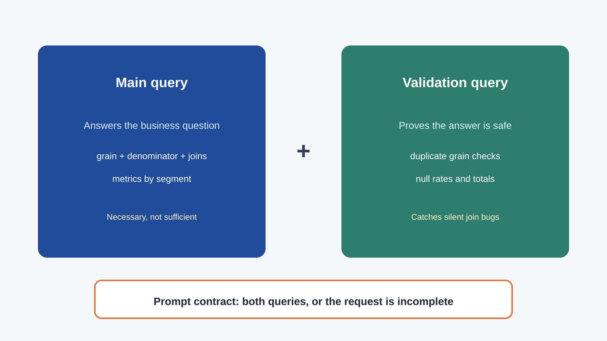
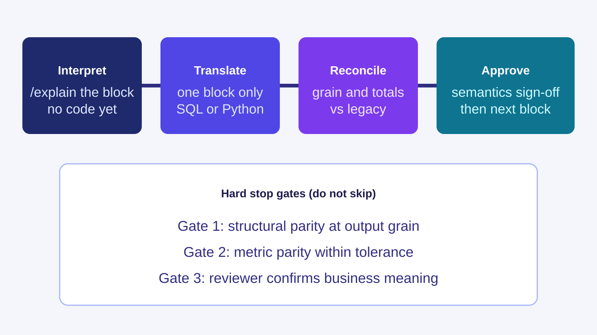
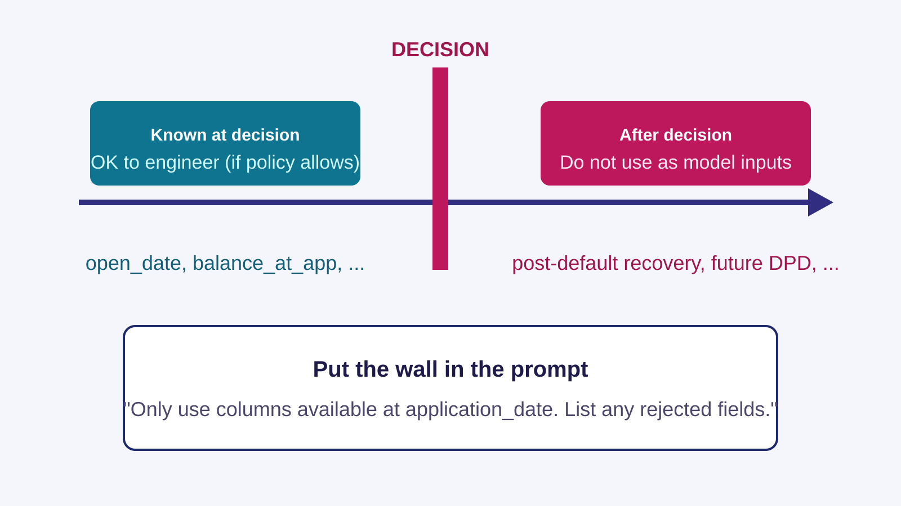
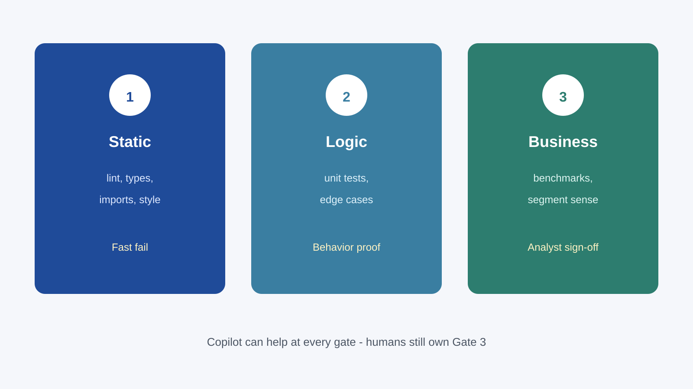

<!-- course-title: GitHub Copilot for Credit Analytics and Risk Modeling -->
<!-- course-theme: roi-theme -->

<!-- layout: title -->


GitHub Copilot for Credit Analytics and Risk Modeling

# Chapter 2: AI-Assisted Data Exploration and Analytics

---

# Chapter 2: Objectives

- Prompt Copilot for portfolio profiling and revise only the logic that failed
- Ask for charts and hypothesis rows that name a signal and a check
- Require a SQL validation query beside every metric query
- Translate SAS one block at a time, and block features that are not known at decision time

---

<!-- layout: navigation -->
# Chapter 2

- **Profiling and Charts**
- SQL and SAS Translation
- Features and Quality Checks

---

# One Question for This Chapter

- Which risk bands drove the quarter’s rise in 30-day delinquency?
- Grain is account-month, rolled to month by `risk_band`
- Denominator excludes charged-off accounts
- Copilot may draft the code. You still own the grain and the denominator

> [!NOTE]
> Use the Chapter 1 prompt shape: named files, constraints, tests, and a stop. This chapter changes the analytics task, not the habit.

---

<!-- layout: 3-column -->
# Profile These Before You Chart

### Nulls
- Null rate by column and by `risk_band`
- A band that is suddenly half-null is not a risk story

### Shape
- Percentiles for utilization and balance
- `delinquency_days` above 365 is a data defect until proven otherwise

### Grain
- Duplicate account-month keys
- Row counts by month before any rate

---

# Profiling Prompt

```text
Task: Build profiling helpers for a monthly portfolio DataFrame.
Use:
- #file src/eda/portfolio_profile.py
- #file tests/test_portfolio_profile.py
Require:
- Null rate by column and by risk_band
- Percentiles for utilization and balance
- A flag when delinquency_days is above 365
- pytest for an empty frame and a missing risk_band
Edit only those two files.
If a column meaning is unclear, list assumptions and do not invent columns.
```

---

<!-- layout: 2-column -->
# First Draft vs the Revision You Send Back

### What the draft often gets wrong
- `utilization` nulls in `new_to_credit` become zeros
- `delinquency_days` of 9999 stays in the percentile table
- Tests cover only a clean frame

### Revision prompt
- “Keep the functions that already match the tests.”
- “Treat `new_to_credit` utilization nulls as missing, not zero.”
- “Cap the outlier flag at 365 days and add one mixed-null test.”
- “Do not rewrite unaffected functions.”

---

<!-- layout: 3-column -->
# A Chart Answers One Question

### Rate chart
- Level of 30-day delinquency by band this month
- Does not show what moved

### Change chart
- Month-over-month basis-point change by band
- Does not show whether the level is high

### Still not a cause
- Neither chart explains why a band moved
- Volume has to sit beside the rate or mix shift will fool you

---

# Hypothesis Row You Can Defend

| Hypothesis | Signal you have | Check before you believe it | Priority |
| :--- | :--- | :--- | :--- |
| Near-prime drove the rise | Rate up about 40 bp, volume stable | Duplicate keys and null `risk_band` | High |
| Mix shift, not worse risk | More accounts in worse bands | Recompute the rate holding mix fixed | Medium |

- Reject a row whose “signal” is a story (“the economy”) and whose check is “review later”
- Cap the table at five rows. Copilot will pad a longer list with guesses

---

<!-- layout: navigation -->
# Chapter 2

- Profiling and Charts
- **SQL and SAS Translation**
- Features and Quality Checks

---

<!-- layout: title-image -->
# Every Metric Query Needs a Twin



---

# The Bug the Twin Is There to Catch

```sql
-- Looks finished. Charged-off accounts are still in the denominator.
select risk_band,
       avg(case when dpd >= 30 then 1.0 else 0.0 end) as dlq_30_rate
from perf
group by risk_band;
```

```sql
-- Companion: one row per account-month, or the rate is not a rate.
select acct_id, perf_month, count(*) as n
from perf
group by acct_id, perf_month
having count(*) > 1;
```

> [!WARNING]
> Copilot will return the first query alone unless you require the second.

---

# SQL Prompt for the Chapter Question

```text
Business question:
Which segments drove the quarter-over-quarter rise in 30-day delinquency?

Return both:
- Quarterly delinquency rate by segment and product
- Denominator excludes charged-off accounts
- Account volume beside the rate
- A validation query for duplicate grain and null segment

Explain assumptions in five bullets. Do not invent columns.
```

---

<!-- layout: title-image -->
# SAS: Interpret, Then One Block



---

# Make Copilot Name the Ambiguity First

```sas
data roll;
  set perf;
  if dpd > 30 then bucket = "30plus";
  where dpd > 0;
run;
```

- `WHERE` filters rows as they are read. `IF` assigns after the read
- A translation that swaps them changes who is in the metric
- Ask for inputs, grain, and this kind of ambiguity before any SQL or Python

> [!IMPORTANT]
> “Do not generate code yet” is the control. Skip it and you review a fluent wrong port.

---

<!-- layout: 2-column -->
# Then Translate One Block

### Step 1: Interpret
```text
Read #file legacy/roll_rate.sas.
Summarize inputs, transforms, grain, and ambiguity.
Do not generate code yet.
```

### Step 2: Translate
```text
Translate the first DATA step only into SQL.
Keep output column names.
Return a record-count parity query against the SAS row count.
```

---

<!-- layout: navigation -->
# Chapter 2

- Profiling and Charts
- SQL and SAS Translation
- **Features and Quality Checks**

---

<!-- layout: title-image -->
# Features Stop at Decision Time



---

<!-- layout: 2-column -->
# Name the Columns Out Loud

### Allowed in this exercise
- `open_date` and `application_date` for tenure
- Balance and limit known on `application_date` for utilization
- A flag when raw utilization exceeds 1.0, stored before any cap

### Not allowed
- `delinquency_days` measured after the decision
- Recovery amounts, cure flags, or “ever 60 DPD” built from the outcome window
- Any column Copilot proposes that you did not name

---

# Feature Helper Prompt

```text
Task: Draft helpers for utilization_ratio and tenure_months.
Use:
- #file src/features/credit_features.py
- #file tests/test_credit_features.py
Rules:
- Only columns available on application_date.
- Cap utilization_ratio at 1.0 and keep a flag for values above 1.0 before the cap.
- pytest for nulls, inverted dates, and utilization above 1.
- Do not add features I did not name.
```

---

<!-- layout: title-image -->
# Three Gates Before You Trust the Draft



---

# Tests Can Pass While the Story Is Wrong

- Pytest confirms the function returns a rate between 0 and 1
- The chart still shows a 40 bp rise that is a volume collapse in one band
- Gate 3 asks whether the population changed or the risk changed
- Copilot can add the volume column. You decide whether the movement is real

---

<!-- layout: card-layout -->
# When the Output Is Wrong, Change the Prompt, Not the Whole File

### Wrong grain
- Restate the output keys and require a duplicate-key check before any rewrite.

### Join inflation
- Ask for a join-cardinality count, then a minimal fix.

### Silent null drift
- Require a null-rate report after each major step.

### Overbroad rewrite
- Resend with the file list and the words “minimal diff.”

---

# Chapter 2 Hands-On Lab

- Lab: Copilot-Assisted Data Profiling and Hypothesis Generation
- Time: 30 minutes

---

# What You Learned

- Prompted Copilot for portfolio profiling and revised only the logic that failed
- Asked for charts and hypothesis rows that name a signal and a check
- Required a SQL validation query beside every metric query
- Translated SAS one block at a time, and blocked features that are not known at decision time

---

# Quiz 1 of 3

**Which SQL prompt is the one you should send?**

- A. “Write the fastest delinquency query you can.”
- B. “Quarterly 30-day rate by segment, charged-off accounts out of the denominator, plus a duplicate-grain check.”
- C. “Give me a SQL template. I will fill in the business rules later.”
- D. “Why did delinquency rise last quarter?”

---

# Quiz 1: Answer

**Which SQL prompt is the one you should send?**

**Correct: B.** Grain, denominator, and a validation query are the contract.

- Speed and a vague business question leave the denominator up to the model
- A template you “fill in later” is how the wrong denominator ships
- The companion query is what catches a join that duplicated account-months

---

# Quiz 2 of 3

**Copilot’s profiling module passes most tests and still zeros out `new_to_credit` utilization nulls. What do you send next?**

- A. “Regenerate the module from scratch.”
- B. “Looks close enough. We will patch it in the pull request.”
- C. “Keep passing functions. Treat those nulls as missing, and add one mixed-null test.”
- D. “Stop profiling and build the chart.”

---

# Quiz 2: Answer

**Copilot’s profiling module passes most tests and still zeros out `new_to_credit` utilization nulls. What do you send next?**

**Correct: C.** A surgical revision keeps the code you already checked.

- A full regenerate throws away passing tests and hides a new diff
- Patching later means the chat record and the code diverge
- Charting on zero-filled nulls will invent a utilization story

---

<!-- layout: 2-column -->
# Quiz 3 of 3: Discussion

### Prompt
A SAS roll-rate was translated with Copilot. It runs faster, and the portfolio total does not match the legacy job.

### Discuss
- Which checks do you run before you touch the SQL again?
- What parity gap would you accept, and who signs that?
- What has to be in the pull request besides “tests passed”?

---

<!-- layout: 2-column -->
# Quiz 3: Discussion Points

**A SAS roll-rate was translated with Copilot. It runs faster, and the portfolio total does not match the legacy job.**

### Strong Answers Mention
- Grain, duplicate keys, and `WHERE` versus `IF` behavior
- Segment totals, not only the portfolio total
- An explicit tolerance and a named sign-off
- The parity query in the pull request

### Watch For
- Approving because the new job is faster
- Comparing totals that use different denominators

---

<!-- layout: stacked -->
# Questions and Answers

Questions?


