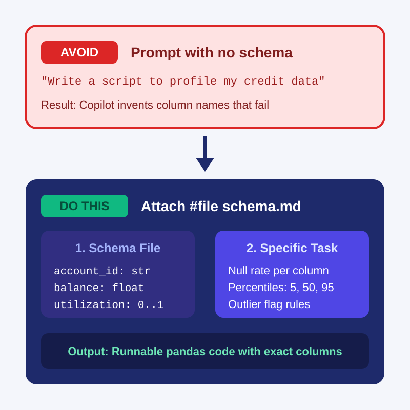
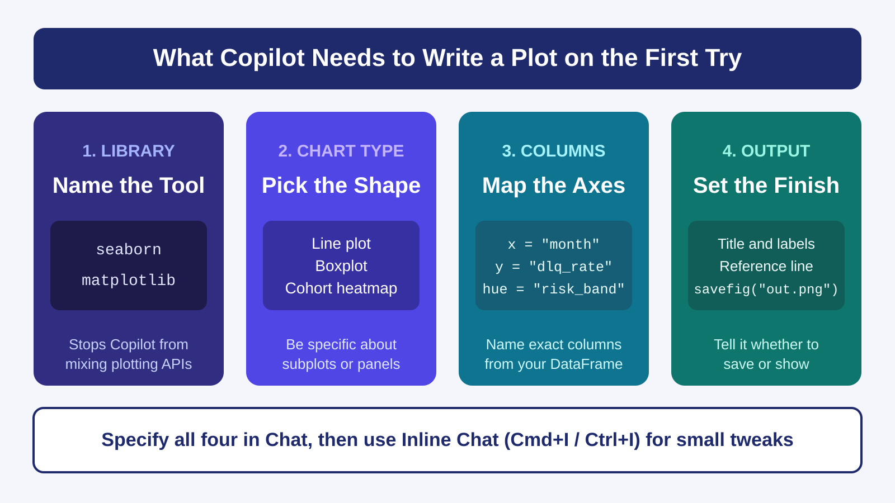
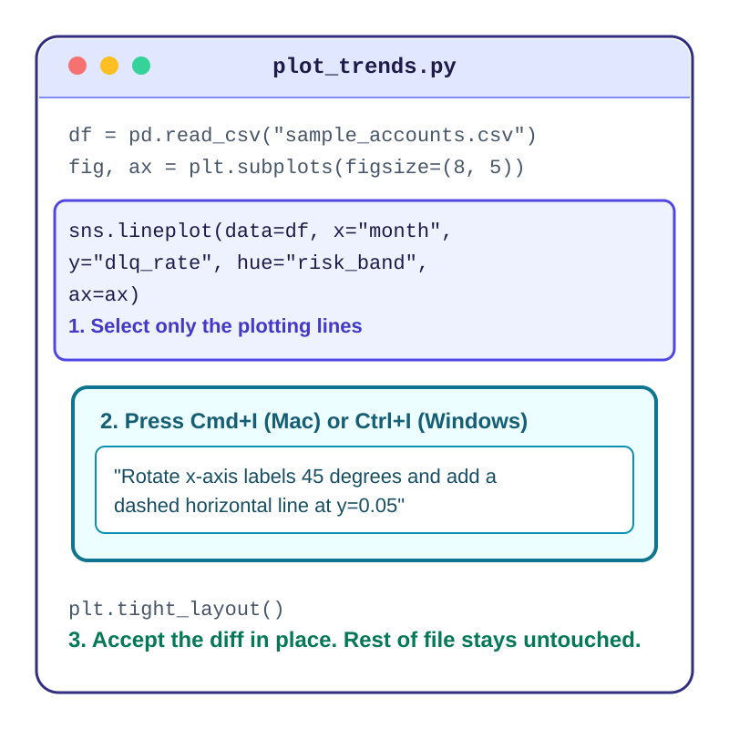
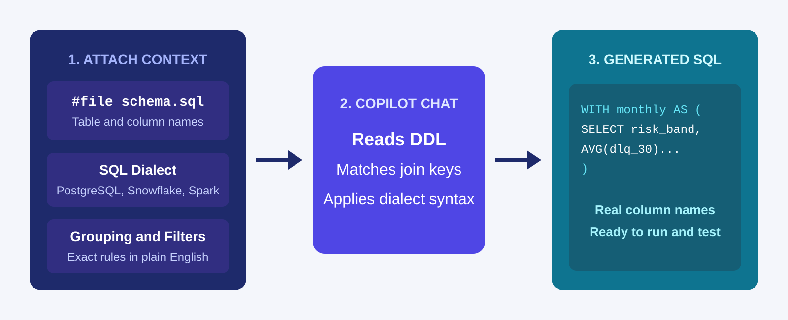
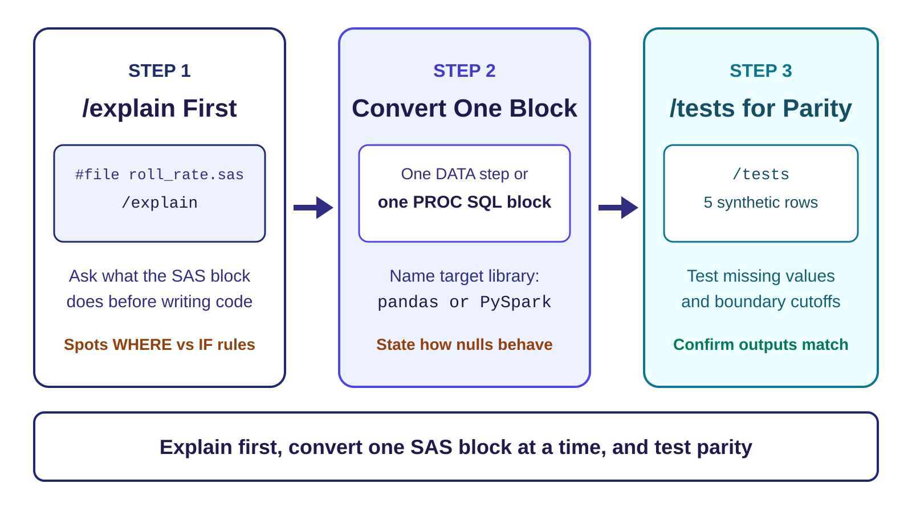

<!-- course-title: GitHub Copilot for Credit Analytics and Risk Modeling -->
<!-- course-theme: roi-alt-theme -->

<!-- layout: title -->


GitHub Copilot for Credit Analytics and Risk Modeling

# Chapter 2: AI-Assisted Data Exploration and Analytics

---

# Chapter 2: Objectives

- Attach schema context with `#file` so Copilot writes Python profiling and segmentation code without guessing column names
- Prompt Copilot Chat and Inline Chat (`Cmd+I` or `Ctrl+I`) to generate and refine `matplotlib` and `seaborn` charts
- Feed table definitions to Copilot to generate SQL queries with CTEs and window functions
- Translate legacy SAS blocks to Python using `/explain`, scoped prompts, and `/tests`
- Use comment-driven inline completions to build feature engineering pipelines in VS Code

---

<!-- layout: navigation -->
# Chapter 2

- **Prompting for Data Profiling**
- Generating Charts with Copilot
- SQL, SAS Migration, and Feature Pipelines

---

# Give Copilot the Schema, Not the Data

- Copilot cannot see your DataFrame columns unless you put their names in context
- If you prompt “profile my credit data,” Copilot invents column names that fail at runtime
- Create a short `schema.md` file or header sample and attach it with `#file` in Chat
- You get runnable `pandas` code while keeping real customer records out of the prompt



---

<!-- layout: 3-column -->
# Three Ways to Generate Profiling Code

### Ghost Text (Tab)
- Write a descriptive comment above a line in your `.py` file
- Best for one check, such as a single `groupby` or null count
- Fastest when the DataFrame is already in the file

### Inline Chat (`Cmd+I` / `Ctrl+I`)
- Select existing DataFrame lines and press `Cmd+I` (Mac) or `Ctrl+I` (Windows)
- Ask Copilot to add a column check or summary right in the editor
- Shows an inline diff you can Accept or Discard

### Copilot Chat (`#file`)
- Open the Chat sidebar and attach `#file schema.md`
- Ask for a reusable profiling module with multiple functions
- Best when starting a brand-new script

---

<!-- layout: 2-column -->
# Weak vs Strong Profiling Prompts

### Weak Prompt
- “Write a Python script to explore my credit card dataset and check for bad values.”
- Leaves column names, library choice, and output format up to guesswork
- Often produces generic `df.describe()` boilerplate with made-up column names

### Strong Prompt
- “Using `#file schema.md`, write `profile_accounts(df)` in `pandas`.”
- “Return a summary DataFrame with row count, null percent per column, and 5th, 50th, and 95th percentiles for numeric columns.”
- “Add a separate function `flag_outliers(df)` that returns rows where `utilization > 1.0` or `delinquency_days < 0`.”

---

# Iterating on `groupby` Logic with Inline Chat

- Start with a working function, then use Inline Chat to add segmentation without rewriting the file
- Highlight the function in VS Code, press `Cmd+I` (Mac) or `Ctrl+I` (Windows), and state the exact grouping columns and metrics

```text
Modify this function to group by risk_band and vintage_quarter.
Calculate account count, mean balance, and the share of rows where delinquency_days >= 30.
Keep the existing null check unchanged.
```

> [!TIP]
> Naming the function part to keep (“Keep the existing null check unchanged”) stops Copilot from deleting working code during an edit.

---

# Demo: Profiling a Dataset with `#file` Schema Context

1. In VS Code, open your workspace folder and create a file named `schema.md` with these contents:

```markdown
# Credit Accounts Schema (sample_accounts.csv)
- `account_id` (string): unique account identifier
- `risk_band` (string): Prime, Near-Prime, or Subprime
- `balance` (float): current balance in USD
- `credit_limit` (float): credit limit in USD
- `utilization` (float): ratio from 0.0 to 1.0 (may contain blanks)
- `delinquency_days` (int): days past due (9999 indicates a data error)
```

2. Open Copilot Chat, attach `#file schema.md`, and run this prompt:

```text
Using #file schema.md, create two files:
1. make_sample_data.py: generates sample_accounts.csv with 50 synthetic rows across all three risk_band values, including 4 blank utilization rows and 2 rows with delinquency_days = 9999.
2. profile_accounts.py: loads sample_accounts.csv with pandas and prints:
   - Null count and null percentage for every column
   - 5th, 50th, and 95th percentiles for balance and utilization
   - Count of error rows where delinquency_days > 365
   - A groupby summary by risk_band showing account count and mean balance
```

3. Run `python make_sample_data.py` and `python profile_accounts.py` in the VS Code terminal to verify the output.

---

<!-- layout: navigation -->
# Chapter 2

- Prompting for Data Profiling
- **Generating Charts with Copilot**
- SQL, SAS Migration, and Feature Pipelines

---

<!-- layout: title-image -->
# Four Parts of a Chart Prompt



---

<!-- layout: card-layout -->
# Prompt Patterns for Common Analytics Plots

### Multi-Line Trend Chart
- Name the library (`seaborn`), the time column on `x`, the rate column on `y`, and `hue="risk_band"`.
- Ask Copilot to sort the date axis and format `y` as percentages.

### Distribution and Outlier Boxplot
- Ask for a `seaborn.boxplot` with `x="risk_band"` and `y="utilization"`.
- Tell Copilot to add a red dashed reference line at `y=1.0` using `ax.axhline`.

### Cohort Heatmap
- Ask Copilot to build a `pandas.pivot_table` first, then pass it to `sns.heatmap`.
- Specify `annot=True` and `fmt=".1%"` so every cell displays its value clearly.

---

# Use Inline Chat to Tweak a Chart in Place

- Pasting a whole script back into the Chat sidebar just to rotate labels wastes time and can alter your data prep
- Highlight only the plotting lines in the editor and press `Cmd+I` (Mac) or `Ctrl+I` (Windows)
- Ask for the exact visual adjustment and review the highlighted diff before pressing Accept



---

<!-- layout: 2-column -->
# Sidebar Chat vs Inline Chat for Plots

### Use Copilot Chat Sidebar When
- Creating a brand-new plotting script from `#file schema.md`
- Combining multiple charts into a new multi-panel `plt.subplots(1, 2)` layout
- Asking `/explain` what a complex `matplotlib` formatting block does

### Use Inline Chat (`Cmd+I` / `Ctrl+I`) When
- Rotating overlapping x-axis date labels by 45 degrees
- Adding a horizontal threshold line or data callout to an existing axis
- Switching a color palette or moving a legend outside the plot box

---

# Fixing Broken Plot Code with `/fix`

- `matplotlib` and `seaborn` often fail when column types are strings instead of dates or numbers, or when nulls break an axis
- Select the failing plot block, open Chat, and pair `/fix` with the traceback or visual symptom

| Problem You See | Prompt to Send Copilot |
| :--- | :--- |
| `TypeError` or `ValueError` traceback | `/fix` + paste the error line + “Cast `perf_month` to datetime before plotting.” |
| Overlapping x-axis labels | Select the plot block in Inline Chat: “Rotate x-axis labels 45 degrees and call `plt.tight_layout()`.” |
| Blank window or script hangs in terminal | Inline Chat: “Save the figure to `charts/delinquency_by_band.png` with `dpi=150` instead of `plt.show()`.” |

---

# Demo: Generating and Refining a Two-Panel Chart

1. In VS Code, open Copilot Chat and attach `#file schema.md` and `#file profile_accounts.py` from the previous demo.
2. Send this prompt to create a visualization script:

```text
Using #file schema.md, create plot_portfolio.py using matplotlib and seaborn.
Load sample_accounts.csv, filter out rows where delinquency_days > 365, and create a 1x2 subplot figure (figsize 12x5):
- Left panel: bar chart of account count by risk_band
- Right panel: boxplot of utilization by risk_band
Save the figure to portfolio_summary.png and close the plot.
```

3. Run `python plot_portfolio.py` and open `portfolio_summary.png` in VS Code to inspect the chart.
4. Open `plot_portfolio.py`, select the right-panel `boxplot` code, press `Cmd+I` (Mac) or `Ctrl+I` (Windows), and type:

```text
Add a horizontal red dashed line at y=0.80 labeled "High Utilization Threshold" and add data labels on top of the left panel bars.
```

5. Accept the diff, rerun `python plot_portfolio.py`, and watch `portfolio_summary.png` update in VS Code.

---

<!-- layout: navigation -->
# Chapter 2

- Prompting for Data Profiling
- Generating Charts with Copilot
- **SQL, SAS Migration, and Feature Pipelines**

---

<!-- layout: stacked -->
# Attach Table Definitions Before You Ask for SQL

- Copilot writes broken SQL when it has to guess table names, join keys, or SQL dialects
- Keep a `schema.sql` file with your `CREATE TABLE` definitions in the project and attach it with `#file schema.sql`
- Name the target SQL dialect (`PostgreSQL`, `Snowflake`, `T-SQL`, or `Spark SQL`) in the prompt so date functions work on the first run



---

# Prompting Copilot for Multi-Step SQL Queries

- Break complex analytical SQL prompts into named Common Table Expressions (CTEs) so the generated query is easy to read and verify

```text
Using #file schema.sql, write a Snowflake SQL query with two CTEs:
1. active_accounts: filter monthly_performance to status != 'charged_off'
2. band_summary: group active_accounts by perf_month and risk_band, calculating account count and average 30-day delinquency rate (dpd >= 30)
In the final SELECT, use LAG() over risk_band ordered by perf_month to show month-over-month delinquency change.
Do not invent columns not in schema.sql.
```

> [!TIP]
> Store your target SQL dialect in `.github/copilot-instructions.md` (for example, “Default SQL dialect is Snowflake SQL; prefer CTEs over nested subqueries”) so you do not have to repeat it in every prompt.

---

<!-- layout: title-image -->
# Translate Legacy SAS in Three Copilot Steps



---

<!-- layout: 2-column -->
# SAS to Python: Explain First, Then Translate

### Legacy SAS (`#file roll_rate.sas`)
```sas
data acct_flags;
  set credit.monthly_perf;
  where status ne 'CHARGED_OFF';
  util_ratio = balance / credit_limit;
  if dpd >= 30 then dlq_flag = 1;
  else dlq_flag = 0;
run;
```

### Two-Step Copilot Chat Sequence
```text
Step 1:
/explain #file roll_rate.sas
List how SAS handles missing values in balance / credit_limit and in dpd >= 30.

Step 2:
Translate #file roll_rate.sas into a pandas function build_acct_flags(df).
Ensure null dpd values produce dlq_flag = 0 (matching SAS where missing is less than 0), and add a docstring noting the SAS parity rules.
```

<!-- below-columns -->

> [!IMPORTANT]
> In SAS, a missing numeric value (`.`) evaluates as less than any number, while in `pandas` `NaN` comparisons return `False`. Asking `/explain` about missing values before translating catches this difference every time.

---

<!-- layout: 2-column -->
# Building Feature Pipelines with Comment-Driven Ghost Text

### How to Drive Ghost Text
- Inline ghost text is faster than the Chat sidebar when adding engineered columns one by one
- Write a numbered comment with the target column name, formula, and edge-case rule
- Press `Enter`, read the gray completion, and press `Tab` to accept

### What You Type vs What Copilot Completes
```python
def add_credit_features(df: pd.DataFrame) -> pd.DataFrame:
    out = df.copy()

    # 1. utilization_ratio: balance / credit_limit; np.nan if credit_limit <= 0
    out["utilization_ratio"] = np.where(
        out["credit_limit"] > 0,
        out["balance"] / out["credit_limit"],
        np.nan,
    )

    # 2. over_limit_flag: 1 if balance > credit_limit else 0
    out["over_limit_flag"] = (out["balance"] > out["credit_limit"]).astype(int)

    return out
```

---

# Demo: Comment-Driven Feature Engineering

1. In VS Code, create a new file named `features.py` and type only the imports, function header, and comments below:

```python
import numpy as np
import pandas as pd

def engineer_features(df: pd.DataFrame) -> pd.DataFrame:
    out = df.copy()

    # Calculate available_credit as credit_limit minus balance, floored at 0

    # Create is_delinquent_30 as 1 when delinquency_days >= 30 and delinquency_days <= 365, else 0

    # Bucket utilization into 'Low' (<0.3), 'Medium' (0.3 to 0.7), and 'High' (>0.7) using np.select

    return out
```

2. Place your cursor on the blank line below the first comment, wait for Copilot’s gray ghost text, read it, and press `Tab` to accept.
3. Repeat for the second and third comments.
4. Select the entire `engineer_features` function, open Copilot Chat, and run `/tests` to generate a quick check for `available_credit` when `balance` exceeds `credit_limit`.

---

# Chapter 2 Hands-On Lab

- Lab: Copilot-Assisted Data Profiling and Hypothesis Generation
- Time: 30 minutes

---

# What You Learned

- Attached schema context with `#file` so Copilot wrote Python profiling and segmentation code without guessing column names
- Prompted Copilot Chat and Inline Chat (`Cmd+I` or `Ctrl+I`) to generate and refine `matplotlib` and `seaborn` charts
- Fed table definitions to Copilot to generate SQL queries with CTEs and window functions
- Translated legacy SAS blocks to Python using `/explain`, scoped prompts, and `/tests`
- Used comment-driven inline completions to build feature engineering pipelines in VS Code

---

# Quiz 1 of 3

**When you ask Copilot Chat to write a Python profiling script or SQL query, it keeps inventing column names that do not exist in your dataset. What is the best fix?**

- A. Paste 10,000 rows of real customer production data into the Chat window
- B. Attach a schema file (`#file schema.md` or `#file schema.sql`) with the exact column names and types
- C. Repeatedly click Regenerate until Copilot guesses the right column names
- D. Turn off Copilot Chat and only use inline ghost text

---

# Quiz 1: Answer

**When you ask Copilot Chat to write a Python profiling script or SQL query, it keeps inventing column names that do not exist in your dataset. What is the best fix?**

**Correct: B.** Attach a schema file (`#file schema.md` or `#file schema.sql`) with the exact column names and types.

- Copilot cannot guess column names that are not in its active context
- A lightweight schema file gives Copilot exact names, types, and value ranges without exposing customer PII
- Regenerating without schema context just produces a different set of guessed names

---

# Quiz 2 of 3

**You already have a working 60-line Python script that loads data and builds a `seaborn` chart. You only want to rotate the x-axis labels 45 degrees and add a horizontal reference line. Which Copilot workflow is best?**

- A. Ask the Chat sidebar to rewrite the entire 60-line file from scratch
- B. Select just the plotting lines in the editor, press `Cmd+I` or `Ctrl+I` for Inline Chat, and ask for those two changes
- C. Delete the plotting code and wait for ghost text to guess the new layout
- D. Copy the script into the Copilot mobile app

---

# Quiz 2: Answer

**You already have a working 60-line Python script that loads data and builds a `seaborn` chart. You only want to rotate the x-axis labels 45 degrees and add a horizontal reference line. Which Copilot workflow is best?**

**Correct: B.** Select just the plotting lines in the editor, press `Cmd+I` or `Ctrl+I` for Inline Chat, and ask for those two changes.

- Inline Chat scopes the edit to your highlighted lines and shows a clean in-place diff
- Data loading and filtering above the selection stay untouched
- Regenerating the whole file in the sidebar risks breaking working code above or below the plot

---

<!-- layout: 2-column -->
# Quiz 3 of 3: Discussion

### Prompt
A teammate needs to migrate a 400-line legacy SAS script with six `DATA` steps and two `PROC SQL` blocks into Python `pandas`. They paste the entire file into Copilot Chat with the prompt: “Convert this to Python.”

### Discuss
- What typically goes wrong when you ask Copilot to translate a 400-line SAS file in a single prompt?
- How should they use `#file`, `/explain`, and `/tests` to migrate the script safely?
- Which SAS-to-pandas behavior differences should they explicitly mention in their prompt?

---

<!-- layout: 2-column -->
# Quiz 3: Discussion Points

**A teammate needs to migrate a 400-line legacy SAS script with six `DATA` steps and two `PROC SQL` blocks into Python `pandas`. They paste the entire file into Copilot Chat with the prompt: “Convert this to Python.”**

### Strong Answers Mention
- Run `/explain` on `#file` first to map inputs, outputs, and macro variables before generating Python
- Translate one `DATA` step or `PROC SQL` block at a time into its own function
- State how SAS missing values (`.` evaluating as less than any number) and `WHERE` vs `IF` filtering should behave in `pandas`
- Use `/tests` with synthetic rows after each step to verify parity before moving to the next block

### Watch For
- Accepting a 400-line one-shot translation because the Python syntax looks clean
- Ignoring how `NaN` comparisons in `pandas` differ from `.` comparisons in SAS
- Skipping unit tests until all six steps are merged together

---

<!-- layout: stacked -->
# Questions and Answers


