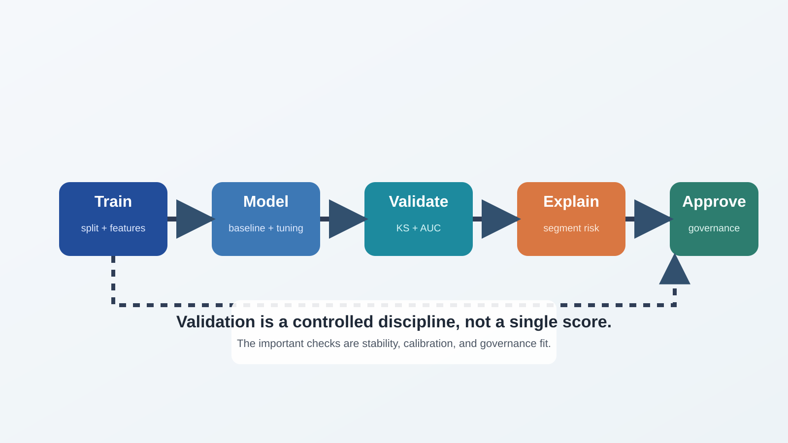

<!-- course-title: GitHub Copilot for Credit Analytics and Risk Modeling -->
<!-- course-theme: roi-theme -->

<!-- layout: title -->


GitHub Copilot for Credit Analytics and Risk Modeling

# Chapter 3: Modeling and Strategy Validation

---

# Chapter 3: Objectives

- Generate baseline model pipelines with Copilot using explicit leakage, split, and metric constraints
- Build validation harnesses with repeatable tests for statistical, operational, and governance checks
- Refactor notebook-style modeling code into reusable modules with controlled diffs and approvals
- Audit AI-generated model logic with reviewer prompts that surface assumptions and risks

---

<!-- layout: navigation -->
# Chapter 3

- Prompting for Model Development
- Validation Metrics and Test Harnesses
- Refactoring Analysis into Reusable Modules
- Auditing Model Logic and Decisions

---

# Model Development with Copilot: Operating Rule

- Copilot can generate implementation fast, but model intent must come from analysts
- Define target, timeline, feature policy, and leakage boundaries before code generation
- Require output contracts and tests in every model prompt

---

<!-- layout: 2-column -->
# Model Prompt Context Files

### Required Inputs
- `#file docs/model-objective.md`
- `#file docs/feature-policy.md`
- `#file docs/metric-definitions.md`
- `#file src/modeling/baseline_pipeline.py`

### Optional Enhancers
- Historical benchmark results
- Existing evaluation notebook
- Team coding standards
- Reviewer checklist file

---

# Baseline Pipeline Prompt Template

```text
Task: Create a baseline binary classification pipeline for 60-day delinquency risk.
Use:
- #file docs/model-objective.md
- #file docs/feature-policy.md
- #file docs/metric-definitions.md
- #file src/modeling/baseline_pipeline.py
- #file tests/test_baseline_pipeline.py

Requirements:
- Time-based train, validation, and holdout split.
- Missing value strategy defined per feature type.
- Categorical encoding inside scikit-learn pipeline.
- Metrics: AUC, KS, precision-recall, calibration table.
- Add tests for split integrity and prediction output schema.

Constraints:
- Do not edit unrelated files.
- Return assumptions and unresolved questions.
```

---

<!-- layout: 3-column -->
# Common Prompt Gaps and Their Risks

### Missing Split Rules
- Leakage risk
- Inflated performance
- Invalid validation

### Missing Feature Policy
- Unapproved attributes
- Inconsistent preprocessing
- Governance breach

### Missing Metric Definitions
- Wrong denominators
- Incomparable reporting
- Misleading model choice

---

<!-- layout: 2-column -->
# Prompt for Alternative Baselines

### Why Ask for Alternatives
- Compare complexity versus lift
- Avoid overfitting to one model family
- Build reviewer confidence in selection

### Prompt Pattern
```text
Generate two baseline variants:
1) Logistic regression pipeline.
2) Tree-based pipeline.
Use identical split and metrics.
Return comparison table with strengths and risks.
```

---

# Controlled Iteration Pattern

- Iterate with explicit change requests, not full-regeneration prompts
- Preserve validated components
- Modify one dimension at a time: features, split, metric, or thresholding

```text
Revise only calibration reporting.
Keep all preprocessing and split logic unchanged.
Add reliability curve data and Brier score output.
```

---

<!-- layout: navigation -->
# Chapter 3

- Prompting for Model Development
- Validation Metrics and Test Harnesses
- Refactoring Analysis into Reusable Modules
- Auditing Model Logic and Decisions

---

<!-- layout: stacked -->
# Validation Harness Architecture

- Separate model training, evaluation, and reporting into testable components
- Training module: fit pipeline and persist artifacts
- Evaluation module: compute metrics and diagnostics
- Reporting module: generate tables and narrative summaries



---

<!-- layout: 3-column -->
# Validation Layers

### Statistical
- AUC and KS
- Precision-recall
- Calibration by band

### Stability
- Segment drift indicators
- Population shift checks
- Time-window sensitivity

### Operational
- Runtime constraints
- Schema contract checks
- Failure-path behavior

---

# Validation Utility Prompt

```text
Create validation utilities in src/modeling/validation.py.
Include:
- AUC, KS, PR AUC, top-decile precision.
- Calibration by score band.
- Segment-level performance by product and risk tier.
- Stability table versus prior quarter.
Add tests in tests/test_validation.py for edge cases.
```

---

<!-- layout: 2-column -->
# Threshold Analysis Prompt Pattern

### Prompt
```text
Generate threshold analysis for decision cutoffs:
- approve rate
- expected bad rate
- capture of high-risk accounts
Return threshold table from 0.1 to 0.9.
```

### Review Checks
- Monotonicity sanity checks
- Denominator consistency
- Missing-segment behavior

---

# Segment Diagnostics Prompt

- Ask Copilot to expose where model performance hides segment risk
- Require both aggregate and segment-level views
- Flag sparse segments with reliability warnings

```text
Produce segment diagnostics by:
- product
- risk_band
- customer_tenure_bucket
Mark segments with support under 500 accounts as low confidence.
```

---

<!-- layout: 2-column -->
# Test Harness Checklist

### Unit Tests
- Data-prep function behavior
- Split logic correctness
- Metric function outputs
- Prediction schema shape

### Regression Tests
- Known defect scenarios
- Threshold-table integrity
- Segment warning behavior
- Reproducibility with fixed seed

---

<!-- layout: navigation -->
# Chapter 3

- Prompting for Model Development
- Validation Metrics and Test Harnesses
- Refactoring Analysis into Reusable Modules
- Auditing Model Logic and Decisions

---

# Notebook-to-Module Refactor Workflow

- Refactor in stages with approval gates between each stage
- Stage 1: Extract pure data-prep functions
- Stage 2: Extract training pipeline builder
- Stage 3: Extract evaluation and reporting
- Stage 4: Wire CLI or orchestration entry point

---

<!-- layout: 2-column -->
# Refactor Planning Prompt

### Planning Request
```text
Read #file notebooks/model_dev.ipynb and propose refactor plan only.
Return:
- target module structure
- functions to extract
- risks per extraction step
- tests to add before edits
Do not edit files yet.
```

### Why This Helps
- Prevents broad, risky rewrites
- Aligns reviewer expectations
- Makes approvals incremental

---

# Refactor Execution Prompt

```text
Execute refactor step 1 only:
- Create src/modeling/features.py
- Move feature engineering logic
- Preserve behavior
- Add tests for extracted functions
Return diff summary and test results.
Stop for approval.
```

---

<!-- layout: 3-column -->
# Refactor Quality Controls

### Scope Control
- Named files only
- Minimal diffs
- No opportunistic rewrites

### Behavior Control
- Parity tests
- Metric comparison
- Output schema checks

### Process Control
- Stepwise approval
- Change summary
- Rollback plan

---

<!-- layout: navigation -->
# Chapter 3

- Prompting for Model Development
- Validation Metrics and Test Harnesses
- Refactoring Analysis into Reusable Modules
- Auditing Model Logic and Decisions
---

# Audit Prompt Pattern for Model Logic

- Ask Copilot to critique generated code as a reviewer, not as an author
- Request explicit risk findings with severity and evidence
- Require suggested tests for each risk

```text
Audit this pipeline code for:
- leakage risk
- label construction issues
- denominator errors in metrics
- unstable segment behavior
Return findings with severity and suggested tests.
```

---

<!-- layout: card-layout -->
# High-Value Audit Questions

### Data Lineage
- Are all features available at decision time?

### Label Integrity
- Is the target label aligned with decision horizon?

### Metric Fidelity
- Are metric formulas consistent with governance definitions?

### Segment Fairness
- Do weak segments have explicit warnings and mitigations?

---

<!-- layout: 2-column -->
# Reviewer Approval Checklist

### Technical Approval
- Tests pass
- Leakage checks pass
- Metric definitions match standards
- Refactor preserves behavior

### Governance Approval
- Assumptions documented
- Open risks listed
- Evidence attached to pull request
- Human reviewer sign-off present

---

# Model-Risk Evidence Prompt

```text
Draft a reviewer summary with:
- model purpose
- assumptions
- validation outcomes
- known limitations
- recommended follow-up checks
Use plain language for governance stakeholders.
```

---

# Chapter 3 Hands-On Lab

- Lab: AI-Assisted Model and Strategy Validation
- Time: 30 minutes

---

# What You Learned

- Generated baseline model pipelines with Copilot using explicit leakage, split, and metric constraints
- Built validation harnesses with repeatable tests for statistical, operational, and governance checks
- Refactored notebook-style modeling code into reusable modules with controlled diffs and approvals
- Audited AI-generated model logic with reviewer prompts that surface assumptions and risks

---

<!-- layout: navigation -->
# Chapter 3 Knowledge Check

- Quiz 1
- Quiz 2
- Quiz 3 Discussion

---

# Quiz 1 of 3

Which prompt most reduces model leakage risk during Copilot code generation?

- A. “Build the highest AUC model possible.”
- B. “Use random split and optimize quickly.”
- C. “Use time-based split, define feature availability policy, and add split-integrity tests.”
- D. “Try several models and pick the best.”

---

# Quiz 1: Answer

Which prompt most reduces model leakage risk during Copilot code generation?

**Correct: C.** It encodes leakage controls directly into implementation requirements.

- Time-based split limits future information leakage
- Feature policy constrains invalid attributes
- Tests make leakage checks repeatable

---

# Quiz 2 of 3

What is the best way to refactor notebook modeling code with Copilot?

- A. Ask for full project rewrite in one prompt
- B. Extract staged modules with step-by-step approvals and parity tests
- C. Move code manually and test later
- D. Focus on style cleanup before functional extraction

---

<!-- layout: 2-column -->
# Quiz 2: Answer

### Correct Choice
- **B.** Extract staged modules with step-by-step approvals and parity tests.
- Controlled staging reduces regression risk.

### Why It Works
- Scope remains reviewable
- Regressions are caught early
- Approvals remain evidence-based

---

<!-- layout: 2-column -->
# Quiz 3 of 3: Discussion

### Prompt
- Copilot generated a model with strong aggregate metrics but weak calibration for one segment.
- How should the team respond before deployment?

### Discuss
- Which diagnostics come first?
- What remediation options are acceptable?
- What must be documented for approval?

---

<!-- layout: 2-column -->
# Quiz 3: Discussion Points

### Strong Answers Mention
- Segment-level recalibration or threshold strategy
- Minimum support and reliability considerations
- Updated tests for segment behavior
- Governance note on residual risk

### Watch For
- Approving based on aggregate metrics only
- No plan for sparse segments
- Missing documentation of trade-offs

---

<!-- layout: stacked -->
# Questions and Answers

Questions?


