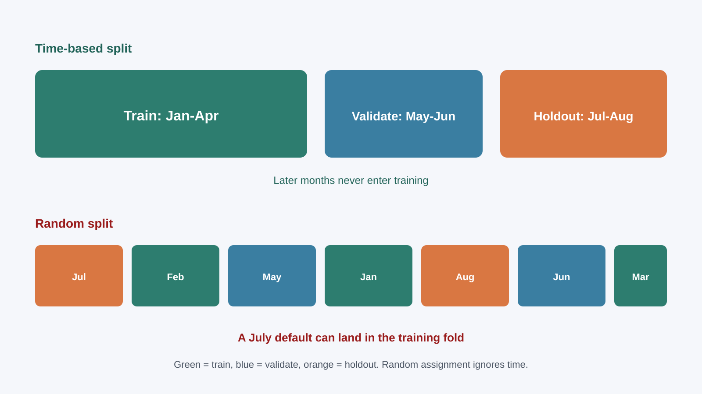

<!-- course-title: GitHub Copilot for Credit Analytics and Risk Modeling -->
<!-- course-theme: roi-alt-theme -->

<!-- layout: title -->


GitHub Copilot for Credit Analytics and Risk Modeling

# Chapter 3: Modeling and Strategy Validation

---

# Chapter 3: Objectives

- Put a time-based split and a feature-availability rule in every model-code prompt
- Read AUC next to calibration and segment support before trusting a draft
- Extract a notebook into modules one approved step at a time
- Audit generated model logic for leakage, labels, and denominators before sign-off

---

<!-- layout: navigation -->
# Chapter 3

- **Prompting for Model Code**
- Validation and Diagnostics
- Refactor and Audit

---

# Chapter 2’s Wall, Plus the Split

- Features still have to be known at decision time. That rule does not change here
- A second leak is the split: future months in the training fold
- Copilot will optimize whatever metric you name. If you name only AUC, you get AUC
- You set the target, the split, and the forbidden fields before it writes a pipeline

---

<!-- layout: title-image -->
# Random Split vs Time Split



---

# The Metric Lie, Illustrated

| Split in the prompt | What the draft can report | What you should believe |
| :--- | :--- | :--- |
| “Maximize AUC” with a random split | A flattering AUC | Little, until you rerun on a time split |
| Time-based train, validate, holdout | A lower, more honest AUC | The number, after split-integrity tests pass |
| No split stated | Whatever default the library uses | Nothing. Send the prompt back |

> [!NOTE]
> Treat any specific AUC in a demo as illustrative. The teaching point is the gap between a random split and a time split, not a benchmark to memorize.

---

# Baseline Pipeline Prompt

```text
Task: Draft a baseline classifier for 60-day delinquency within 12 months.
Use:
- #file src/modeling/baseline_pipeline.py
- #file tests/test_baseline_pipeline.py
Require:
- Train on months before the cutoff, then validation, then a later holdout.
- Features available on application_date only. List any column that looks post-decision.
- Report AUC, KS, and a calibration table. Do not pick a cutoff.
- Tests that fail if a later month appears in train.
Edit only those two files. If the label window is unclear, stop and ask.
```

---

<!-- layout: 3-column -->
# Three Omissions That Inflate the Model

### No split rule
- Future defaults leak into train
- The holdout is no longer a holdout

### No feature policy
- Copilot adds a useful-looking post-decision field
- Prep then differs from the policy you meant

### No metric definition
- KS and AUC get computed on dropped null labels
- A quiet denominator change looks like lift

---

# Revise One Piece

```text
The split tests pass. Revise only calibration reporting.
Keep preprocessing and the time split unchanged.
Add a reliability table by score band and a Brier score.
Do not retune the model in this step.
```

- If the reply also changes the feature list, reject the diff and resend
- Retuning and “fixing calibration” in one prompt makes the review impossible

---

<!-- layout: navigation -->
# Chapter 3

- Prompting for Model Code
- **Validation and Diagnostics**
- Refactor and Audit

---

<!-- layout: 3-column -->
# Which Number Is Allowed to Reassure You

### AUC or KS
- Rank-ordering across the book
- Can look strong while a band is mis-scaled

### Calibration
- Predicted rate versus observed rate by score band
- This is the number that catches a confident, wrong score

### Segment support
- Performance by product, `risk_band`, and tenure bucket
- Under 500 accounts: show the cell, label it low confidence, do not hide it

---

# A Calibration Miss Beats a Pretty AUC

| Score band | Predicted bad rate | Observed bad rate | Accounts |
| :--- | :--- | :--- | :--- |
| 0.02 to 0.04 | 3% | 3.1% | 12,000 |
| 0.20 to 0.30 | 4% | 9% | 9,000 |

- Book-level AUC can stay flattering while the second band is unusable
- 9,000 accounts is not a small cell you can drop
- Ask Copilot for this table. Do not ask it whether to approve the model

---

# Validation Prompt

```text
Create src/modeling/validation.py and tests/test_validation.py.
Include:
- AUC, KS, and top-decile precision on the time-based holdout
- Calibration by score band
- The same metrics by product and risk_band
- A flag when a segment has fewer than 500 accounts
Tests must fail on empty predictions and must not drop null labels silently.
Do not recommend a production cutoff.
```

---

<!-- layout: 2-column -->
# After the Metrics Compile

### You check
- The formula matches your metric note, including the denominator
- One segment total against a figure you already trust
- Sparse segments are flagged, not averaged away

### You do not accept
- Holdout AUC by itself
- A helper that drops null labels with no count of how many
- A rate whose denominator changed inside the function

---

# Stability Is a Comparison, Not a Vibe

- Compare this quarter’s score distribution or bad rate to the prior quarter on the same segments
- A large shift with no policy change is a data or feature bug until someone explains it
- Ask Copilot for the comparison table. You decide whether the shift is acceptable

```text
Add a stability table versus the prior quarter for score mean and bad rate
by product. Do not interpret the shift as approve or reject.
```

---

<!-- layout: navigation -->
# Chapter 3

- Prompting for Model Code
- Validation and Diagnostics
- **Refactor and Audit**

---

<!-- layout: title-image -->
# One Module per Approval


---

# Plan, Then Step 1 Only

```text
Plan only from #file notebooks/model_dev.ipynb.
Return target modules, extraction order, and tests to add before each move.
Do not edit yet.
```

```text
Approved: step 1 only.
Create src/modeling/features.py, move feature logic, add tests, stop.
Do not extract the pipeline in this step.
```

> [!IMPORTANT]
> Parity first: row counts and a sample of feature values must match the notebook before you delete those cells.

---

<!-- layout: 2-column -->
# When the Refactor Prompt Is Too Big

### Send it
- One module, named
- Tests listed before the move
- “Stop after this step”

### Refuse it
- “Turn this notebook into a production package”
- Several modules in one approval
- Style cleanup mixed with logic moves

---

# What an Audit Reply Must Contain

| Severity | Finding | Evidence Copilot should cite | Test you add |
| :--- | :--- | :--- | :--- |
| High | Possible leakage | Column uses post-decision DPD | Split-integrity or feature-list test |
| Medium | Label window unclear | Outcome built with no stated horizon | Test that documents the 12-month label |
| Low | Sparse segment hidden | Cell under 500 accounts omitted | Test that the flag column exists |

```text
Audit #file src/modeling/baseline_pipeline.py for leakage, label construction,
and denominator errors. Return severity, evidence, and a test. Do not invent metrics.
```

---

<!-- layout: 2-column -->
# A Reviewer Summary May Only Cite

### Allowed
- Purpose and population taken from the code and your prompt
- Metrics that appear in a test output or a table you provide
- Limitations and follow-ups marked as open

### Not allowed
- An AUC, KS, or cutoff the run did not produce
- “Validated” or “approved” as a conclusion
- A segment story with no support count

---

# Chapter 3 Hands-On Lab

- Lab: AI-Assisted Model and Strategy Validation
- Time: 30 minutes

---

# What You Learned

- Put a time-based split and a feature-availability rule in every model-code prompt
- Read AUC next to calibration and segment support before trusting a draft
- Extracted a notebook into modules one approved step at a time
- Audited generated model logic for leakage, labels, and denominators before sign-off

---

# Quiz 1 of 3

**Which prompt most reduces leakage when Copilot drafts model code?**

- A. “Build the highest AUC model you can.”
- B. “Use a random split so the sample stays balanced.”
- C. “Time-based train, validation, and holdout. Features known at application only. Fail the test if a later month is in train.”
- D. “Try three algorithms and keep the best score.”

---

# Quiz 1: Answer

**Which prompt most reduces leakage when Copilot drafts model code?**

**Correct: C.** The split and the feature rule have to be requirements, not hopes.

- Maximizing AUC rewards a leaky split
- A random split is how later defaults enter training
- Algorithm shopping does not fix a bad label window

---

# Quiz 2 of 3

**What is the right way to turn a modeling notebook into modules with Copilot?**

- A. One prompt: “Rewrite this project as a package.”
- B. A plan with no edits, then one module per approval, with parity tests before notebook cells are removed
- C. Move the code by hand and add tests after the pull request
- D. Clean up names and markdown first, then extract everything

---

# Quiz 2: Answer

**What is the right way to turn a modeling notebook into modules with Copilot?**

**Correct: B.** Staged extraction keeps each diff reviewable.

- A single rewrite hides logic changes inside a style change
- Tests after the pull request means the move and the proof are separated
- Renaming first feels productive and does not reduce extraction risk

---

<!-- layout: 2-column -->
# Quiz 3 of 3: Discussion

### Prompt
Holdout AUC looks strong. One product segment is badly calibrated, and it has 9,000 accounts.

### Discuss
- Which diagnostics do you open first?
- What changes are acceptable before anyone talks about a cutoff?
- What has to be written down if the model is still proposed for use?

---

<!-- layout: 2-column -->
# Quiz 3: Discussion Points

**Holdout AUC looks strong. One product segment is badly calibrated, and it has 9,000 accounts.**

### Strong Answers Mention
- Calibration by band and by that product, with support counts
- Recalibration or a segment limitation, not a silent threshold tweak
- Residual risk written down before any approval
- 9,000 accounts is not a “small cell” you can drop

### Watch For
- Approving on AUC alone
- Hiding the segment because the book-level number looks fine

---

<!-- layout: stacked -->
# Questions and Answers

Questions?


