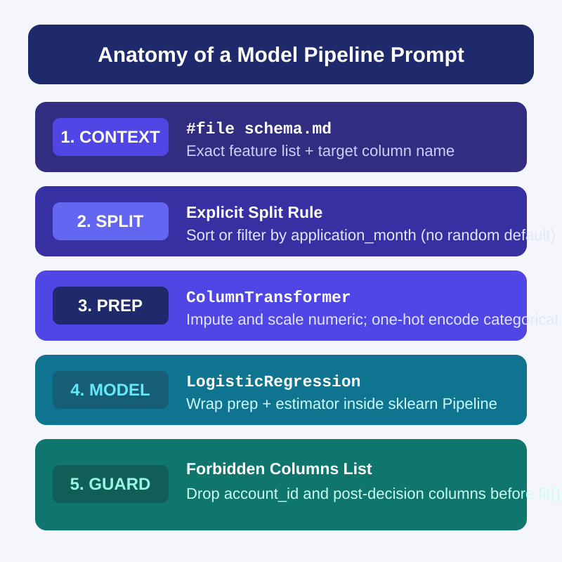
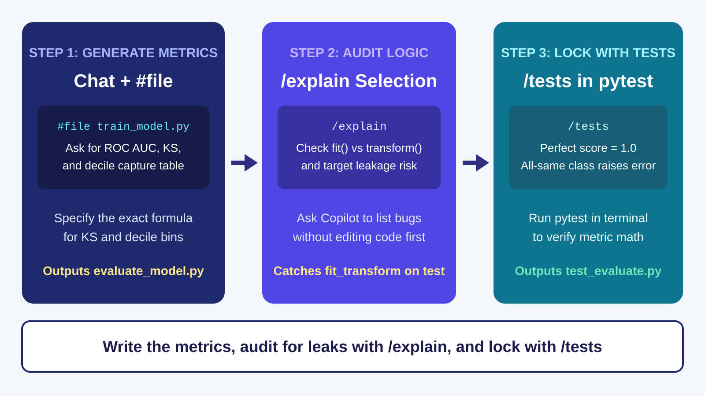
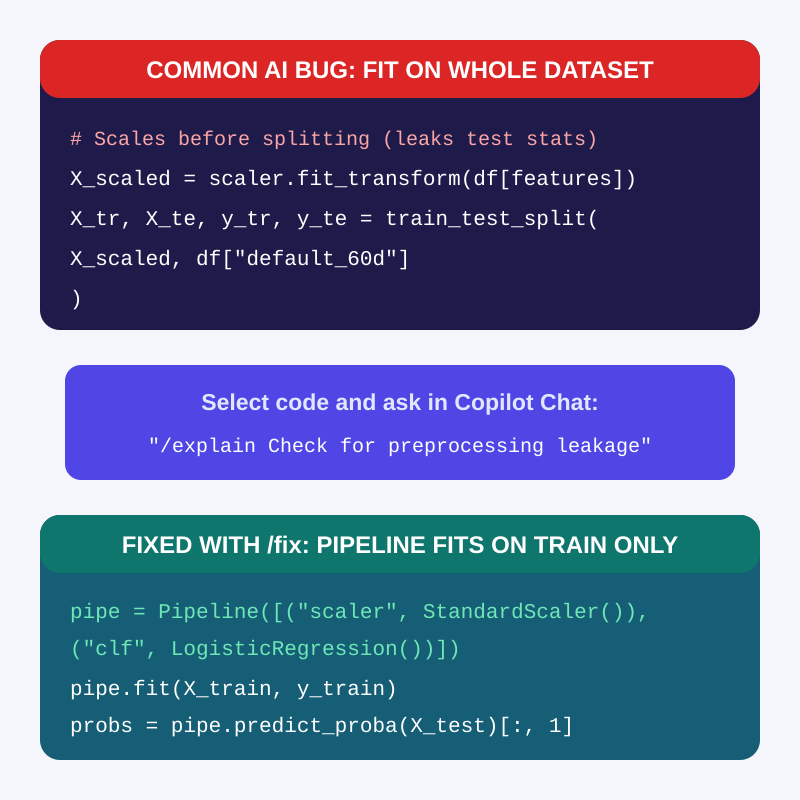
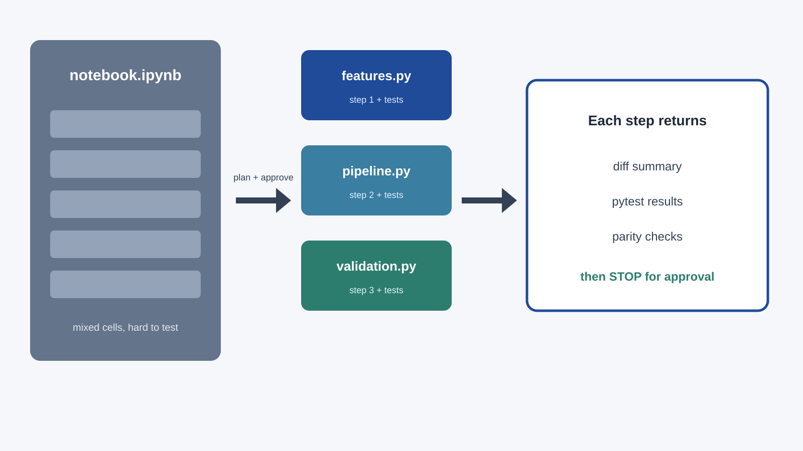
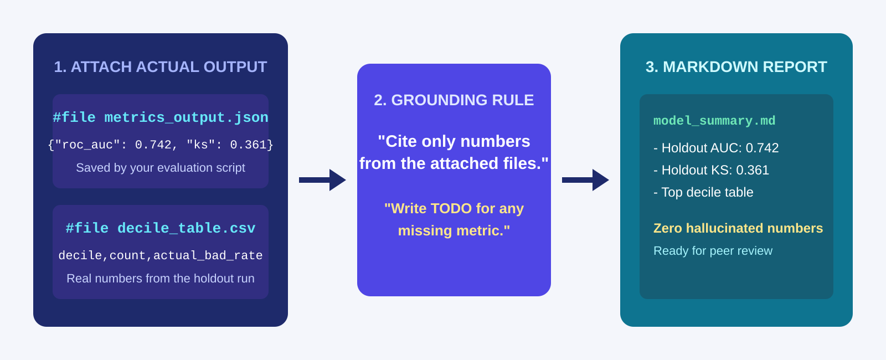

<!-- course-title: GitHub Copilot for Credit Analytics and Risk Modeling -->
<!-- course-theme: roi-alt-theme -->

<!-- layout: title -->


GitHub Copilot for Credit Analytics and Risk Modeling

# Chapter 3: Modeling and Strategy Validation

---

# Chapter 3: Objectives

- Prompt Copilot Chat with `#file` schema context to scaffold `scikit-learn` feature and model pipelines
- Use Inline Chat (`Cmd+I` or `Ctrl+I`) and ghost text to add custom transformers and swap estimators
- Direct Copilot to generate validation scripts for ROC AUC, KS, and decile capture tables, then verify them with `/tests`
- Audit AI-generated modeling code for data leakage and preprocessing bugs using `/explain` and `/fix`
- Extract ad-hoc Jupyter notebook cells into reusable Python modules and generate grounded Markdown summaries from output files

---

<!-- layout: navigation -->
# Chapter 3

- **Generating Model Pipelines with Copilot**
- Prompting for Validation, Tests, and Code Audits
- From Notebooks to Modules and Summaries

---

# Why Generic Model Prompts Fail in Copilot

- Asking Copilot “build a credit risk model” produces a flat script that calls `train_test_split` randomly and runs `fit_transform` on the whole table
- Copilot defaults to generic Kaggle-style tutorials unless you name the `scikit-learn` objects and split rules you want
- Attach `#file schema.md` and specify the exact target column, allowed feature list, and date-based split rule
- Require a `scikit-learn` `Pipeline` and `ColumnTransformer` so preprocessing only fits on the training fold



---

<!-- layout: 2-column -->
# Weak vs Strong Model Pipeline Prompts

### Weak Prompt
- “Train a logistic regression model on my credit dataset to predict default.”
- Copilot guesses column names and includes ID or post-decision columns as features
- Uses a random split instead of an out-of-time split

### Strong Prompt
- “Using `#file schema.md`, create `train_pipeline.py` with `scikit-learn`.”
- “Split `df` on `application_month < '2025-10'` for train and `>= '2025-10'` for test. Drop `account_id` and `delinquency_days`.”
- “Build a `ColumnTransformer` (median impute + `StandardScaler` on numeric; `OneHotEncoder(handle_unknown='ignore')` on `risk_band`) inside a `Pipeline` with `LogisticRegression`.”

---

<!-- layout: 3-column -->
# Three Copilot Tools for Feature and Model Code

### Copilot Chat (`#file`)
- Best for scaffolding a new `Pipeline` and `ColumnTransformer` from `#file schema.md`
- Generates the full training script and file structure in one pass

### Inline Chat (`Cmd+I` / `Ctrl+I`)
- Highlight the `Pipeline` block and press `Cmd+I` (Mac) or `Ctrl+I` (Windows)
- Ask to add a `FunctionTransformer` step or swap `LogisticRegression` for `HistGradientBoostingClassifier`

### Ghost Text (`Tab`)
- Write a comment above a dictionary of hyperparameters or a custom feature formula
- Press `Tab` to accept the boilerplate lines without leaving the editor

---

# Adding a Custom Feature Step with Inline Chat

- Once your baseline `Pipeline` runs, use Inline Chat (`Cmd+I` or `Ctrl+I`) to insert custom feature transformers without rewriting the script
- Select the `ColumnTransformer` block in the editor and describe the exact transformation to add

```text
Add a FunctionTransformer step before scaling that caps utilization at 1.0
and creates a binary column util_missing_flag before median imputation.
Keep the existing OneHotEncoder step unchanged.
```

> [!TIP]
> Tell Copilot which pipeline steps must stay unchanged so your diff stays limited to the new feature logic.

---

# Demo: Building a Baseline Pipeline via Copilot Chat

1. In VS Code, create or update `schema.md` so it includes a binary target column and an application month:

```markdown
# Credit Modeling Schema (modeling_accounts.csv)
- `account_id` (string): unique identifier (exclude from features)
- `application_month` (string): YYYY-MM format from 2025-01 to 2025-12
- `risk_band` (string): Prime, Near-Prime, or Subprime
- `balance` (float): balance at application in USD
- `credit_limit` (float): credit limit at application in USD
- `utilization` (float): ratio 0.0 to 1.0 (may contain nulls)
- `default_60d` (int): 1 if 60+ days past due within 12 months, else 0 (target)
```

2. Open Copilot Chat (`</> Agent` in **Interactive** mode), attach `#file schema.md`, and run this prompt:

```text
Using #file schema.md, create train_baseline.py.
1. Include a helper make_synthetic_modeling_data() that generates modeling_accounts.csv with 300 rows across 2025-01 to 2025-12, including 15 null utilization values.
2. Split rows where application_month < '2025-10' into train and >= '2025-10' into test.
3. Exclude account_id, application_month, and default_60d from the feature list.
4. Build a scikit-learn Pipeline with ColumnTransformer (SimpleImputer(strategy='median') and StandardScaler for numeric columns; OneHotEncoder(handle_unknown='ignore') for risk_band) and LogisticRegression().
5. Fit on train, predict probabilities on test, and print train/test row counts and test ROC AUC.
```

3. Run `python train_baseline.py` in the VS Code terminal and inspect the generated pipeline and output.

---

<!-- layout: navigation -->
# Chapter 3

- Generating Model Pipelines with Copilot
- **Prompting for Validation, Tests, and Code Audits**
- From Notebooks to Modules and Summaries

---

<!-- layout: title-image -->
# Three-Step Copilot Workflow for Validation



---

# Prompting Copilot for Credit Validation Metrics

- If you ask Copilot to “evaluate the model,” it defaults to `accuracy_score` and a confusion matrix at a `0.50` threshold
- Credit risk validation uses rank-ordering and probability calibration (`ROC AUC`, `KS statistic`, Brier score, and decile capture tables)
- Spell out the exact formula for custom metrics like `KS` so Copilot does not guess or import a library you do not have installed

```text
Using #file train_baseline.py, create evaluate_model.py with two functions:
1. compute_ks(y_true, y_prob): sort by y_prob descending and return the maximum absolute difference between cumulative bad rate and cumulative good rate.
2. build_decile_table(y_true, y_prob): bin predictions into 10 equal-sized deciles (1 = highest predicted risk) and return a DataFrame with account_count, bad_count, actual_bad_rate, mean_predicted_prob, and cumulative_bad_capture.
```

---

<!-- layout: card-layout -->
# Using `/tests` to Verify Validation Math

### Perfect Separation Check
- Select `compute_ks` and run `/tests` in Chat.
- Ask for a synthetic test where all bad accounts have `y_prob = 0.9` and all good accounts have `y_prob = 0.1`, asserting `KS == 1.0`.

### Decile Row and Order Check
- Select `build_decile_table` and run `/tests`.
- Assert that the output has exactly 10 rows, decile 1 has the highest `mean_predicted_prob`, and `account_count.sum() == len(y_true)`.

### Edge-Case Input Check
- Ask Copilot to add `pytest` cases for an empty array, `NaN` probabilities, and a holdout set with zero defaults (`y_true` all zeros).
- Verify that the function raises a clear `ValueError` instead of returning silent `NaN` values.

---

# Auditing Copilot Code with `/explain` and `/fix`

- Even when AI-generated model code runs without errors, it can hide target leakage or silent row drops
- Select the pipeline and split code, then use `/explain` with a targeted audit checklist before running `/fix`



---

# Four Audit Questions to Paste into Copilot Chat

| Bug to Catch | Prompt to Run on `#selection` or `#file` |
| :--- | :--- |
| Preprocessing leakage | `/explain Does any imputer, scaler, or encoder call fit or fit_transform before the train/test split?` |
| Feature leakage | `/explain List every column passed into X_train and flag any ID, date, or post-decision outcome column.` |
| Random split on time data | `/explain How are train and test split? Could rows from a later application_month appear in X_train?` |
| Silent row drops | `/explain Does the script drop rows with nulls in y_test or X_test without reporting how many were dropped?` |

> [!IMPORTANT]
> Ask Copilot to **report only** first (“List any issues; do not edit code yet”). Once you confirm the bug, highlight the offending lines and use `/fix` or Inline Chat for a surgical fix.

---

# Demo: Auditing a Leaky Model Script with Copilot

1. In VS Code, create `leaky_model.py` and paste this intentionally flawed script:

```python
import pandas as pd
from sklearn.linear_model import LogisticRegression
from sklearn.metrics import roc_auc_score
from sklearn.model_selection import train_test_split
from sklearn.preprocessing import StandardScaler

df = pd.read_csv("modeling_accounts.csv").dropna()
features = ["balance", "credit_limit", "utilization", "default_60d"]

scaler = StandardScaler()
X_scaled = scaler.fit_transform(df[features])
X_train, X_test, y_train, y_test = train_test_split(X_scaled, df["default_60d"], test_size=0.2)

clf = LogisticRegression().fit(X_train, y_train)
print("AUC:", roc_auc_score(y_test, clf.predict_proba(X_test)[:, 1]))
```

2. Select all lines in `leaky_model.py`, open Copilot Chat, and run:

```text
/explain Audit this script for target leakage, preprocessing leakage, split errors, and silent row drops. List each bug without rewriting the code yet.
```

3. Review Copilot’s findings (`default_60d` inside `features`, `fit_transform` before splitting, random split instead of `application_month`, and silent `.dropna()`).
4. Run `/fix` with instructions to fix all four issues using `#file schema.md`.

---

<!-- layout: navigation -->
# Chapter 3

- Generating Model Pipelines with Copilot
- Prompting for Validation, Tests, and Code Audits
- **From Notebooks to Modules and Summaries**

---

<!-- layout: title-image -->
# Extracting Notebooks into Modules One Block at a Time



---

<!-- layout: 2-column -->
# How to Refactor a Notebook with Copilot

### What Happens When You Prompt All at Once
- “Convert `#file notebook.ipynb` into a Python package”
- Copilot merges cells, renames variables mid-flight, and drops filter steps
- Gives you a 300-line diff that is impossible to verify against the notebook

### The Staged Copilot Workflow
- **Step 1**: Attach `#file notebook.ipynb` in Chat (or press `Cmd+I` / `Ctrl+I` inside an individual notebook cell) and ask for a module extraction plan (no code yet)
- **Step 2**: Select one logical cell group (such as feature prep) and prompt Chat to extract it into `src/features.py` with type hints
- **Step 3**: Run `/tests` on `src/features.py` and verify output parity before extracting the next cell group

---

<!-- layout: stacked -->
# Grounding Copilot When Summarizing Model Output

- If you ask Copilot to “write a validation summary report” with no data attached, it invents plausible-sounding AUC and KS numbers
- Always save your script’s actual metrics to a file (`metrics_output.json` or `decile_table.csv`) and attach that file with `#file`
- Add an explicit grounding constraint: “Use only numbers present in `#file metrics_output.json`; mark any missing item as `TODO`”



---

# Prompting for a Grounded Validation Summary

```text
Using #file metrics_output.json, #file decile_table.csv, and #file train_baseline.py,
create validation_summary.md with these sections:
1. Model Overview (target column, train/test split dates, and feature list read from train_baseline.py)
2. Holdout Metrics (exact ROC AUC and KS from metrics_output.json)
3. Decile Capture Table (formatted as a Markdown table from decile_table.csv)
4. Open Questions / TODOs (leave threshold selection and business sign-off as TODO)

Rule: Do not invent any metric values. If a metric is not in metrics_output.json, write TODO.
```

> [!WARNING]
> Always compare every number in the generated Markdown table against `metrics_output.json` and `decile_table.csv` before sharing the file.

---

# Demo: Generate and Summarize Validation Output

1. In VS Code, open Copilot Chat (`</> Agent` in **Interactive** mode) and attach `#file train_baseline.py` from earlier.
2. Prompt Copilot to add evaluation output saving at the bottom of `train_baseline.py`:

```text
Update #file train_baseline.py so that after scoring the test set, it:
1. Computes test ROC AUC, KS statistic, and a 10-bin decile table.
2. Writes train_rows, test_rows, roc_auc, and ks to metrics_output.json.
3. Writes the decile table to decile_table.csv.
```

3. Run `python train_baseline.py` so `metrics_output.json` and `decile_table.csv` are created on disk.
4. In Copilot Chat, attach `#file metrics_output.json` and `#file decile_table.csv`, and prompt Copilot to generate `validation_summary.md` using only the numbers in those two files.

---

# Chapter 3 Hands-On Lab

- Lab: AI-Assisted Model and Strategy Validation
- Time: 30 minutes

---

# What You Learned

- Prompted Copilot Chat with `#file` schema context to scaffold `scikit-learn` feature and model pipelines
- Used Inline Chat (`Cmd+I` or `Ctrl+I`) and ghost text to add custom transformers and swap estimators
- Directed Copilot to generate validation scripts for ROC AUC, KS, and decile capture tables, then verified them with `/tests`
- Audited AI-generated modeling code for data leakage and preprocessing bugs using `/explain` and `/fix`
- Extracted ad-hoc Jupyter notebook cells into reusable Python modules and generated grounded Markdown summaries from output files

---

# Quiz 1 of 3

**When you ask Copilot Chat to generate a model training script with a vague prompt like “Train a model on my dataset,” what does Copilot typically generate?**

- A. An out-of-time split with a `ColumnTransformer` tailored to your exact credit policy
- B. A generic script with a random `train_test_split`, guessed column names, and risk of fitting preprocessors on the full dataset
- C. A syntax error, because Copilot cannot write `scikit-learn` code
- D. A pre-populated `metrics_output.json` file from your production database

---

# Quiz 1: Answer

**When you ask Copilot Chat to generate a model training script with a vague prompt like “Train a model on my dataset,” what does Copilot typically generate?**

**Correct: B.** A generic script with a random `train_test_split`, guessed column names, and risk of fitting preprocessors on the full dataset.

- Without `#file schema.md` and explicit split instructions, Copilot falls back to generic tutorial patterns
- Naming the date-split column, forbidden columns, and `scikit-learn` `Pipeline` structure in your prompt prevents preprocessing leakage
- You can then use `/explain` to audit the generated script before trusting its output

---

# Quiz 2 of 3

**You want Copilot Chat to draft a Markdown summary of your model’s holdout performance (`ROC AUC`, `KS`, and decile table) without hallucinating any numbers. How should you prompt it?**

- A. Ask Copilot to estimate typical credit card AUC and KS values for a baseline logistic regression model
- B. Attach `#file train_baseline.py` only and ask Copilot to predict what the metrics will be when the code runs
- C. Save the actual run metrics to `metrics_output.json` and `decile_table.csv`, attach both files with `#file`, and instruct Copilot to cite only numbers from those files (marking missing items as `TODO`)
- D. Use inline ghost text inside an empty Markdown file with no context files open

---

# Quiz 2: Answer

**You want Copilot Chat to draft a Markdown summary of your model’s holdout performance (`ROC AUC`, `KS`, and decile table) without hallucinating any numbers. How should you prompt it?**

**Correct: C.** Save the actual run metrics to `metrics_output.json` and `decile_table.csv`, attach both files with `#file`, and instruct Copilot to cite only numbers from those files (marking missing items as `TODO`).

- Copilot cannot execute your model in its head; if no output file is in context, it will invent placeholder numbers
- Attaching the saved JSON and CSV files gives Copilot the exact figures from your test run
- Instructing Copilot to write `TODO` for missing items stops it from guessing uncomputed metrics

---

<!-- layout: 2-column -->
# Quiz 3 of 3: Discussion

### Prompt
A teammate has a 25-cell Jupyter notebook (`experiment.ipynb`) that loads data, engineers features, fits a gradient boosting model, and prints validation metrics. They want to use Copilot to turn it into clean, tested Python modules under `src/`.

### Discuss
- Why is pasting the whole notebook with “Convert this to a Python package” risky?
- How should they sequence Copilot Chat, `#file`, and `/tests` to extract the code safely?
- How can they verify that the extracted functions produce the exact same outputs as the notebook cells?

---

<!-- layout: 2-column -->
# Quiz 3: Discussion Points

**A teammate has a 25-cell Jupyter notebook (`experiment.ipynb`) that loads data, engineers features, fits a gradient boosting model, and prints validation metrics. They want to use Copilot to turn it into clean, tested Python modules under `src/`.**

### Strong Answers Mention
- Ask Copilot Chat to read `#file experiment.ipynb` and propose an extraction plan before writing any code
- Extract one cell group at a time (for example, `features.py` first, then `pipeline.py`, then `evaluate.py`)
- Run `/tests` after each extracted module to lock behavior with unit tests before moving to the next cell group
- Compare row counts, feature values, and metric outputs between the notebook and the new module to confirm parity

### Watch For
- Extracting all 25 cells in a single prompt and trying to debug a giant multi-file diff at the end
- Allowing Copilot to change feature formulas or imputation rules while refactoring notebook code into functions
- Deleting notebook cells before verifying that the new module produces identical results

---

<!-- layout: stacked -->
# Questions and Answers


