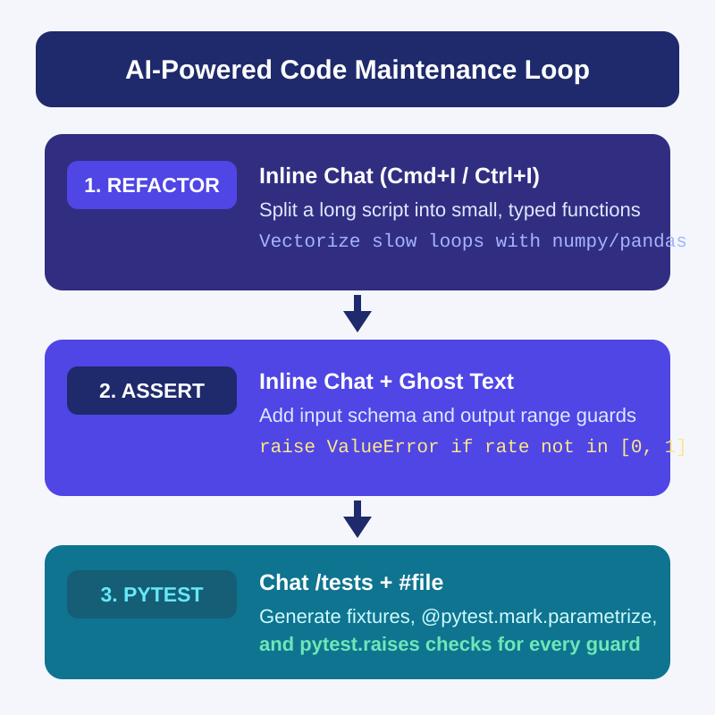
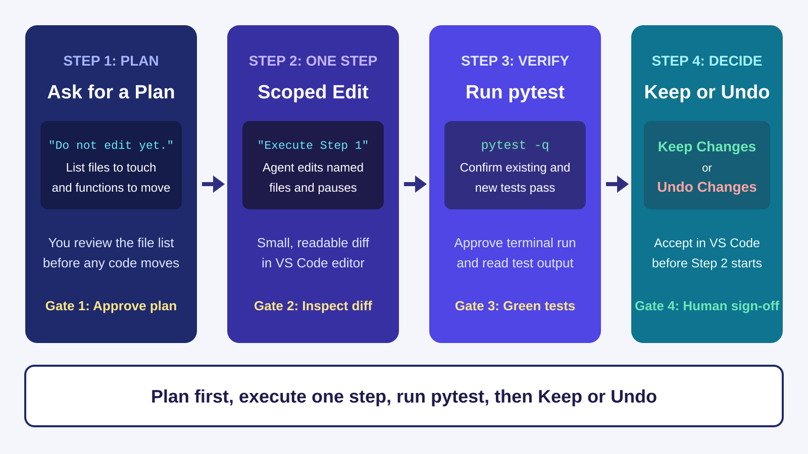
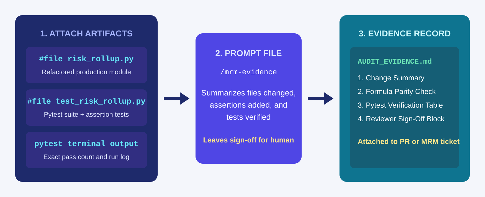
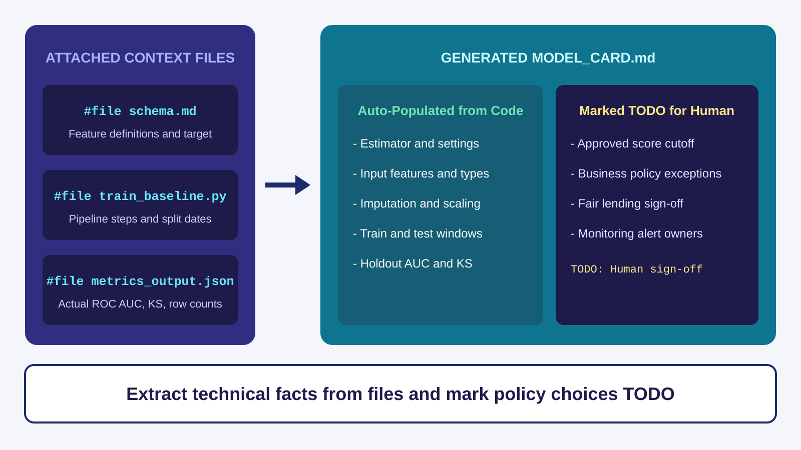
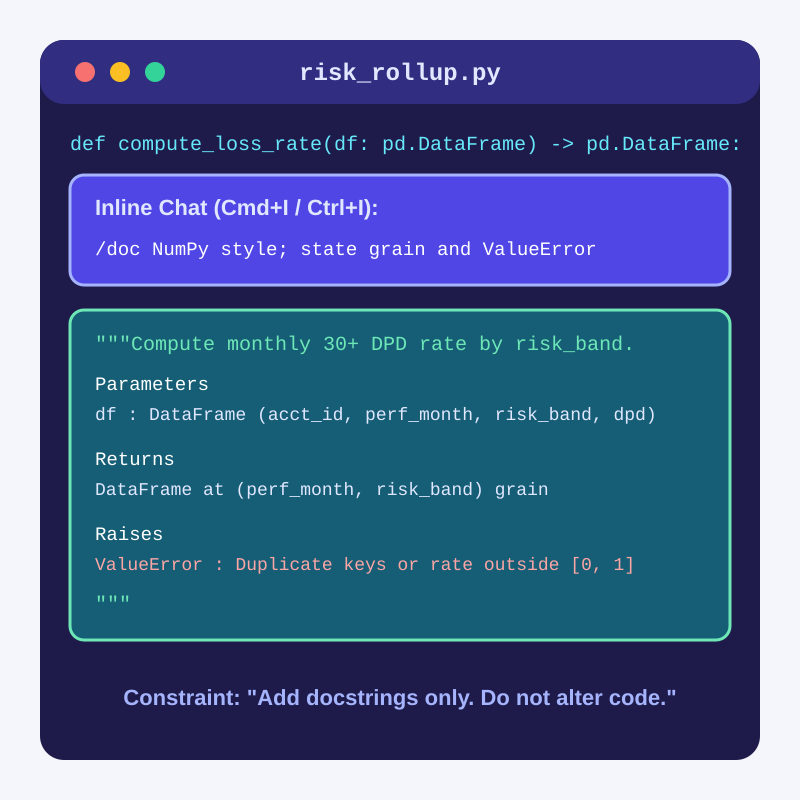

<!-- course-title: GitHub Copilot for Credit Analytics and Risk Modeling -->
<!-- course-theme: roi-alt-theme -->

<!-- layout: title -->


GitHub Copilot for Credit Analytics and Risk Modeling

# Chapter 4: Agentic Governance and Code Lifecycle
---
# Chapter 4: Objectives

- Refactor, modularize, and vectorize slow Python analytics scripts
- Prompt Copilot to add defensive assertions and `pytest` suites
- Use plan-first prompts, single-step approvals, and VS Code diff reviews
- Build reusable `.github/prompts/*.prompt.md` templates 
- Generate grounded Model Cards, technical specifications, and docstrings
---
<!-- layout: navigation -->
# Chapter 4

- **AI-Powered Code Maintenance**
- Human-in-the-Loop 
- Automated Documentation
---
# Three Copilot Workflows for Code Maintenance

- Analytical scripts often start as long, single-file prototypes with slow row loops, no runtime checks, and zero tests
- Use Inline Chat to split monolithic functions and replace loops with vectorized `pandas` or `numpy`
- Use Inline Chat or ghost text to insert defensive `ValueError` guards right above and below numerical calculations
- Use Copilot Chat to generate a complete `pytest` suite that tests both normal math and every new assertion


---
<!-- layout: 2-column -->
# Refactoring and Optimizing with Inline Chat

### Splitting a Long Function
- Highlight the 80-line function in VS Code and press `Cmd+I` (Mac) or `Ctrl+I` (Windows)
- Prompt: “Split this into `filter_active_accounts(df)` and `compute_band_rates(df)` with type hints. Do not change the math or column names.”
- Review the side-by-side diff in the editor before clicking Accept

### Vectorizing a Slow Loop
- Highlight a slow `for idx, row in df.iterrows():` block and open Inline Chat
- Prompt: “Replace this `iterrows()` loop with vectorized `np.select` or `pandas` operations that produce identical values, including for `NaN` rows.”
- Ask `/tests` for a parity test comparing the old function and new function on 20 synthetic rows
---
<!-- layout: card-layout -->
# Prompting Copilot for Defensive Assertions

### Input Schema Guard
- Select the top of your function in Inline Chat and ask Copilot to check required columns.
- Raise a `ValueError` listing any missing column names before running calculations.

### Grain and Denominator Guard
- Ask Copilot to assert that `(account_id, perf_month)` has no duplicate rows.
- Raise a `ValueError` if filtering out `charged_off` rows leaves an empty denominator (`len(active) == 0`).

### Statistical Output Guard
- Place your cursor after the rate calculation and write a comment for ghost text.
- Raise a `ValueError` if any computed delinquency or loss rate is `NaN`, below `0.0`, or above `1.0`.
---
# Generating Comprehensive `pytest` Suites with `/tests`

- Typing `/tests` alone often produces only one happy-path test; always pair `/tests` with explicit edge cases and `pytest` features

```text
/tests #file src/monitoring/risk_rollup.py
Create tests/test_risk_rollup.py using pytest:
1. Add a @pytest.fixture with 8 synthetic account rows covering Prime, Near-Prime, and Subprime, including 1 charged_off row and 1 null balance.
2. Use @pytest.mark.parametrize to test normal rate calculations across risk bands.
3. Use pytest.raises(ValueError) to test missing required columns, duplicate (account_id, perf_month) keys, an all-charged-off denominator, and a rate outside [0, 1].
```

> [!TIP]
> Add “Use `@pytest.fixture` with synthetic rows and `pytest.raises` for all `ValueError` guards” to `.github/copilot-instructions.md` so `/tests` follows this standard automatically.
---
# Demo: Refactoring, Asserting, and Testing with Copilot

1. In VS Code, create `risk_rollup.py` and paste this unguarded, loop-heavy function:

```python
import pandas as pd

def calc_delinquency(df):
    rates = {}
    for band in df["risk_band"].unique():
        sub = df[df["risk_band"] == band]
        active = 0
        bad = 0
        for _, row in sub.iterrows():
            if row["status"] != "charged_off":
                active += 1
                if row["dpd"] >= 30:
                    bad += 1
        rates[band] = bad / active
    return pd.Series(rates, name="dlq_30_rate")
```

2. Select `calc_delinquency`, press `Cmd+I` (Mac) or `Ctrl+I` (Windows), and run this prompt:

```text
1. Replace the iterrows() loop with vectorized pandas groupby operations.
2. Add ValueError checks at the top for required columns (account_id, risk_band, status, dpd) and duplicate account_id values.
3. Raise ValueError if any band has zero active accounts or if any output rate is outside [0.0, 1.0].
```

3. Accept the diff, open Copilot Chat, and run `/tests #file risk_rollup.py` asking for `pytest` tests that verify both the exact rates and all `pytest.raises(ValueError)` guards.
4. Run `pytest` in the VS Code terminal to confirm all tests pass.
---
<!-- layout: navigation -->
# Chapter 4

- AI-Powered Code Maintenance
- **Human-in-the-Loop**
- Automated Documentation
---
<!-- layout: title-image -->
# Driving Copilot Agent Mode with Human Gates


---
<!-- layout: 2-column -->
# Autopilot Prompt vs Plan Mode + Interactive Prompt

### Unconstrained Autopilot Prompt (Risky)
- “Clean up our monitoring scripts, reorganize the files, and fix any issues you see.”
- Edits 6 files at once, renames public functions, and alters metric filters without pausing
- Leaves you with a sprawling diff where a formula bug can hide inside formatting changes

### Plan Mode + Interactive Prompt (Controlled)
- Switch the Agent mode menu (speech bubble icon) to **Plan** (or keep **Interactive** with **Manual** permissions)
- Prompt: “Read `#file risk_rollup.py` and `#file test_risk_rollup.py`. Propose a 3-step plan to extract validation guards into `validators.py`. List the files each step touches and wait for my approval.”
- Review the plan, then execute one step at a time and run `pytest`
---
# Using VS Code’s Review Controls in Agent Mode

- When Copilot Agent edits files in your workspace, VS Code displays inline diffs and an action bar (`Keep` or `Undo`) for every modified file
- Never click **Keep All** before expanding each modified file and running `pytest`

| VS Code Agent Control | How to Use It During Review |
| :--- | :--- |
| Agent mode menu (`Interactive` / `Plan`) | Use **Plan** to review the step list before any edits, and **Interactive** for step-by-step collaboration. |
| Permissions (`Manual`) | Keep set to **Manual** so Copilot must ask before running terminal commands or modifying outside files. |
| File change list and inline diffs (`Keep` / `Undo`) | Click each modified file to inspect the side-by-side diff; click `Undo` on any file you did not authorize Copilot to touch. |

> [!IMPORTANT]
> If Agent mode modifies a test just to make a broken formula pass, click **Undo** on the test file immediately and narrow your prompt.
---
<!-- layout: stacked -->
# Generating MRM Audit Evidence with a Prompt File

- Model Risk Management (MRM) reviewers need a clear record of what changed, whether business formulas moved, and which tests verified the change
- Instead of writing audit notes from scratch, store a reusable prompt template at `.github/prompts/mrm-evidence.prompt.md`
- Attach the code file, test file, and `pytest` output, then run `/mrm-evidence` in Copilot Chat


---
# Creating `.github/prompts/mrm-evidence.prompt.md`

- Save this reusable prompt file in `.github/prompts/mrm-evidence.prompt.md` and run it by typing `/mrm-evidence` in Chat:

```markdown
# Prompt File: .github/prompts/mrm-evidence.prompt.md

Using the attached code file, test file, and pytest terminal output, generate `AUDIT_EVIDENCE.md` with:
1. **Scope of Change**: List every function modified or added.
2. **Formula and Denominator Parity**: State whether any filter, grain, or rate formula changed.
3. **Runtime Assertions Added**: List each `ValueError` check and the condition that triggers it.
4. **Test Verification**: Table of `pytest` test names, what each verifies, and pass/fail status from the attached run.
5. **Human Sign-Off Checklist**: Leave reviewer name, date, and approval decision as `TODO`.

Rule: Do not invent test results or claim a model is "Approved."
```
---
<!-- layout: navigation -->
# Chapter 4

- AI-Powered Code Maintenance
- Human-in-the-Loop 
- **Automated Documentation**
---
<!-- layout: title-image -->
# Generating Grounded Model Cards from Code and Output


---
# Prompting Copilot for a Model Card

- If you ask Copilot to “write a model card for our delinquency model” with no files attached, it invents feature lists, training dates, and validation numbers
- Attach `#file schema.md`, `#file train_baseline.py`, and `#file metrics_output.json` so every technical section comes straight from your repo

```text
Using #file schema.md, #file train_baseline.py, and #file metrics_output.json,
create MODEL_CARD.md with these sections:
1. Model Architecture and Hyperparameters (read from train_baseline.py)
2. Feature List and Preprocessing Pipeline (from schema.md and ColumnTransformer)
3. Training and Holdout Split Window (from train_baseline.py)
4. Holdout Performance Metrics (exact numbers from metrics_output.json)
5. Governance, Cutoffs, and Policy Limitations (mark every item in this section as TODO for human completion)

Do not invent any metric, date, or policy rule not present in the attached files.
```
---
# Using `/doc` and `/explain` to Document Complex Scripts

- Highlight any function and press `Cmd+I` (Mac) or `Ctrl+I` (Windows), then type `/doc` to generate a structured docstring in place
- Specify your team’s docstring format (`NumPy` or `Google` style) and require grain, exclusions, and raised exceptions
- Add the guardrail “Add docstrings and comments only; do not modify any executable code” so Copilot never alters a formula while documenting it


---
# Demo: Document and Package Code for Review

1. In VS Code, open `risk_rollup.py` from the earlier demo, select `calc_delinquency`, press `Cmd+I` (Mac) or `Ctrl+I` (Windows), and run:

```text
/doc Add a NumPy-style docstring stating required columns, the charged_off exclusion rule, output Series format, and all ValueError conditions. Do not change any executable lines.
```

2. Accept the docstring diff and run `pytest` in the terminal to confirm all tests still pass.
3. In Copilot Chat, attach `#file risk_rollup.py` and `#file test_risk_rollup.py`, paste your `pytest` terminal output, and run:

```text
Generate AUDIT_EVIDENCE.md with:
1. Functions changed and vectorized
2. Runtime ValueError assertions added
3. Table of pytest tests in test_risk_rollup.py and pass count
4. Human sign-off section marked TODO
```
---
# Chapter 4 Hands-On Lab

- Lab: [Agentic Governance and Automated Code Cleanup](https://labv.roitraining.com/?lab=https://github.com/roitraining/github-copilot-for-credit-analysts/tree/master/labs/lab-04-agentic-governance-and-code-cleanup)
- Time: 30 minutes
---
# What You Learned

- Refactored, modularized, and vectorized slow Python analytics scripts
- Prompted Copilot to add defensive assertions and `pytest` suites
- Used plan-first prompts, single-step approvals, and VS Code diff reviews
- Built reusable `.github/prompts/*.prompt.md` templates 
- Generated grounded Model Cards, technical specifications, and docstrings
---
# Quiz 1 of 3

**You want to use Copilot Agent mode in VS Code to refactor a 300-line monitoring script into separate modules (`validators.py`, `metrics.py`, and `test_metrics.py`). How should you start the session?**

- A. Prompt Agent mode to “Clean up and reorganize the whole repo however you think is best” and click Keep All
- B. Ask Agent mode for a step-by-step plan listing which files each step will touch (“Do not edit files yet”), then approve and test one step at a time
- C. Delete all existing unit tests first so Agent mode is not slowed down by test failures
- D. Paste the 300-line script into the Copilot mobile app
---
# Quiz 1: Answer

**You want to use Copilot Agent mode in VS Code to refactor a 300-line monitoring script into separate modules (`validators.py`, `metrics.py`, and `test_metrics.py`). How should you start the session?**

**Correct: B.** Ask Agent mode for a step-by-step plan listing which files each step will touch (“Do not edit files yet”), then approve and test one step at a time.

- A plan-first prompt lets you verify the file list and module boundaries before Agent mode edits code
- Executing one step at a time keeps each VS Code diff small enough to inspect line by line
- Running `pytest` between steps catches any accidental formula or denominator change immediately
---
# Quiz 2 of 3

**When you use Copilot Inline Chat (`/doc`) to add docstrings and comments to an existing credit calculation function, what instruction should you include in your prompt?**

- A. “Also rewrite the formula if you think of a different way to calculate the rate.”
- B. “Add NumPy-style docstrings covering inputs, exclusions, and `ValueError` conditions; do not modify any executable code.”
- C. “Invent a realistic holdout ROC AUC score and put it in the docstring.”
- D. “Remove all `ValueError` checks so the function is shorter.”
---
# Quiz 2: Answer

**When you use Copilot Inline Chat (`/doc`) to add docstrings and comments to an existing credit calculation function, what instruction should you include in your prompt?**

**Correct: B.** “Add NumPy-style docstrings covering inputs, exclusions, and `ValueError` conditions; do not modify any executable code.”

- Explicitly telling Copilot not to touch executable lines prevents silent formula changes during a documentation pass
- Always inspect the inline diff in VS Code to verify that only docstring or comment lines were added
- Re-run `pytest` after accepting the docstring to be 100% certain runtime behavior is unchanged
---
<!-- layout: 2-column -->
# Quiz 3 of 3: Discussion

### Prompt
A teammate needs to prepare a Model Card (`MODEL_CARD.md`) and an MRM audit summary (`AUDIT_EVIDENCE.md`) for a model pipeline they built with Copilot. They open an empty chat window with no files attached and type: “Write a complete Model Card and MRM audit report for our new credit card delinquency model.”

### Discuss
- What will Copilot put into `MODEL_CARD.md` when no code, schema, or metrics files are attached?
- Which exact files should they attach with `#file` before prompting?
- Which sections of a Model Card can Copilot populate from code, and which sections must be marked `TODO` for a human?
---
<!-- layout: 2-column -->
# Quiz 3: Discussion Points

**A teammate needs to prepare a Model Card (`MODEL_CARD.md`) and an MRM audit summary (`AUDIT_EVIDENCE.md`) for a model pipeline they built with Copilot. They open an empty chat window with no files attached and type: “Write a complete Model Card and MRM audit report for our new credit card delinquency model.”**

### Strong Answers Mention
- Without attached files, Copilot will hallucinate feature names, split dates, hyperparameter values, and validation metrics
- Attach `#file schema.md`, `#file train_baseline.py`, `#file test_risk_rollup.py`, and `#file metrics_output.json` (plus the `pytest` terminal output)
- Copilot can extract the exact feature list, preprocessing steps, estimator settings, and JSON metrics from those files
- Business cutoffs, policy exceptions, fair-lending sign-offs, and final approval decisions must be left as `TODO` for humans

### Watch For
- Treating fluent, AI-invented AUC or KS numbers in a Model Card as real validation results
- Letting Copilot write “Status: Approved for Production” in the generated document
- Forgetting to create a reusable `.github/prompts/mrm-evidence.prompt.md` file for the team
---
<!-- layout: stacked -->
# Questions and Answers


