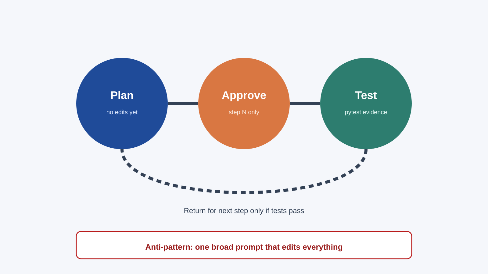
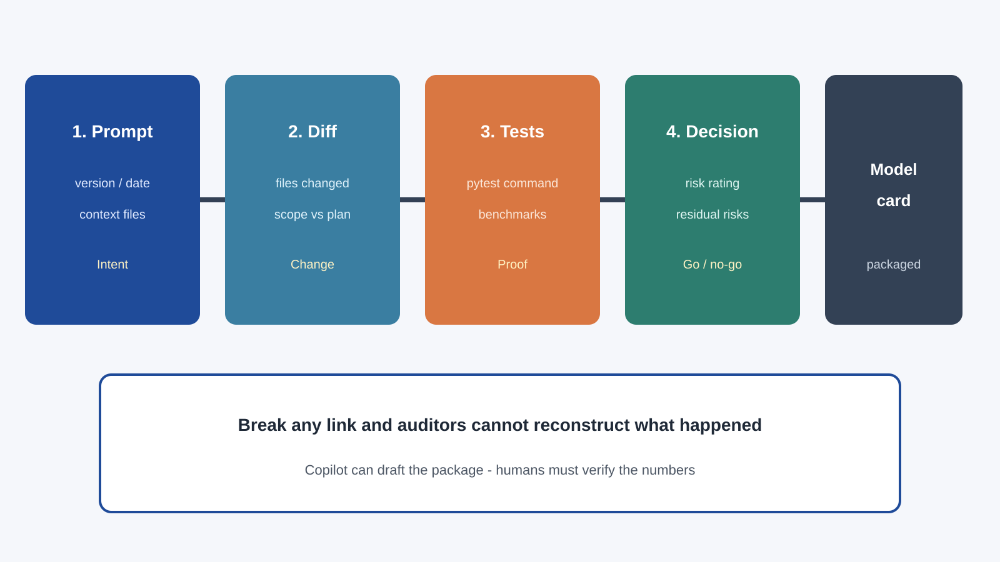

<!-- course-title: GitHub Copilot for Credit Analytics and Risk Modeling -->
<!-- course-theme: roi-alt-theme -->

<!-- layout: title -->


GitHub Copilot for Credit Analytics and Risk Modeling

# Chapter 4: Agentic Governance and Code Lifecycle

---

# Chapter 4: Objectives

- Run a plan-only prompt and approve one refactor step at a time
- Ask for pytest and assertions that protect grain and denominators
- Package the prompt, the diff, the tests, and the decision for model-risk review
- Draft model cards and docstrings from code, and leave unknown numbers as TODO

---

<!-- layout: navigation -->
# Chapter 4

- **Plan-First Execution**
- Tests and Assertions
- Evidence and Documentation

---

<!-- layout: title-image -->
# Agentic Work Is a Gated Loop



---

# The Only Prompt That Starts a Multi-Step Change

```text
Plan only. Do not edit files yet.
Return:
- ordered steps
- files each step may touch
- tests to run before the next step
- risks and assumptions

Stop. Wait for approval of step 1.
```

```text
Approved: execute step 1 only.
Edit the listed files, preserve metric definitions, run the targeted tests, stop.
```

> [!WARNING]
> “Improve the monitoring package” is not a plan. If the reply has no file list, do not approve it.

---

<!-- layout: 2-column -->
# Approve the Task or Send It Back

### Approve
- Named files
- A behavior you can test, such as “output grain stays month by risk_band”
- A stop after this batch

### Send back
- “Clean up everything”
- No acceptance test
- Extra files you did not list
- A style rewrite bundled with a formula change

---

# What “Preserve the Metric” Means

```python
# Before and after the refactor, this contract stays true:
# grain = perf_month x risk_band
# denominator = accounts where status != "charged_off"
# rate is in [0, 1]
def rollup_delinquency(frame):
    ...
```

- A refactor may move helpers. It may not change who is in the denominator
- Ask for a test that locks the grain and the exclusion before you approve the next batch

---

# Read This Before You Approve Step 2

- The diff touches only the files in step 1
- Targeted pytest output is in the reply, not a promise to run tests later
- Metric definitions are listed as unchanged
- New risks are explicit. “No issues” with no evidence is a fail

---

<!-- layout: navigation -->
# Chapter 4

- Plan-First Execution
- **Tests and Assertions**
- Evidence and Documentation

---

<!-- layout: 3-column -->
# Tests Worth Asking For

### Unit
- Empty frame, duplicate keys, null `exposure_amount`
- Charged-off accounts out of the denominator
- Fixtures are synthetic. No warehouse extract in the test file

### Regression
- A past bug, written as a test that failed before the fix
- The fix stays narrow enough that this test still names the bug

### Contract
- Required input columns
- Output grain and column names
- A rate outside `[0, 1]` fails loudly

---

<!-- layout: 2-column -->
# Fixtures You Can Read

### Use
- A handful of synthetic rows
- One charged-off account, one null exposure, one duplicate key
- Values small enough to compute the expected rate by hand

### Do not use
- A production extract pasted into the test
- A mock that skips the denominator so the test cannot fail
- Random rows with no expected value

---

# Pytest Prompt

```text
Create tests/test_risk_rollup.py with pytest and synthetic fixtures.
Cover:
- month by risk_band grain
- empty frame
- duplicate keys at the output grain
- null exposure_amount
- charged-off accounts excluded from the denominator
No network calls.
If a test shows a production bug, stop and describe it. Do not patch production in this turn.
```

---

<!-- layout: 2-column -->
# Put the Assertion Next to the Rate

### Unguarded
```python
return frame["dlq_30"].mean()
```
- Charged-off rows stay in the denominator
- An empty slice returns NaN and keeps going

### Guarded
```python
active = frame.loc[frame["status"] != "charged_off"]
if active.empty:
    raise ValueError("denominator is empty")
rate = float(active["dlq_30"].mean())
if not 0.0 <= rate <= 1.0:
    raise ValueError(f"rate out of range: {rate}")
```
- Ask Copilot to place each check beside the calculation
- A sentence in a docstring does not protect the metric

---

# A Red Test Stops the Agent

- Read the failure. Decide if the test or the code is wrong
- If the code is wrong, approve a minimal fix in a new step
- Do not let the same turn “make the tests pass” by weakening the assertion
- Chapter 1’s `/fix` habit still applies: paste the failure, demand a small diff

---

<!-- layout: navigation -->
# Chapter 4

- Plan-First Execution
- Tests and Assertions
- **Evidence and Documentation**

---

<!-- layout: title-image -->
# What Model Risk Needs to See



---

# A Package, Not a Longer Pull Request

| Piece | Example a reviewer can check |
| :--- | :--- |
| Prompt | 2026-04-02 plan prompt, files named, “do not edit yet” |
| Diff | `risk_rollup.py` and `test_risk_rollup.py` only |
| Tests | `pytest tests/test_risk_rollup.py` → 5 passed |
| Decision | Grain unchanged. Residual risk: prior-quarter stability not rerun. Not approved for cutoff use |

- If any cell is “see chat,” the package is incomplete
- The decision states what was not done. It does not say “validated” by default

---

<!-- layout: 2-column -->
# Model Card: Cite or Mark TODO

### Cite from code or test output
- Intended use, in your words, matched to the label in code
- Feature list actually read by the pipeline
- Metrics printed by the validation tests
- Links to those tests

### Mark TODO
- Any AUC, KS, or cutoff you did not run
- Limitations you have not reviewed
- Population differences the code does not show

> [!IMPORTANT]
> Unknown is a TODO. A fluent number with no run behind it is a finding, not a documentation win.

---

# Docstrings Without a Behavior Change

```text
Add docstrings to #file src/monitoring/risk_rollup.py.
Cover grain, denominator rules, and failure modes.
Do not change runtime behavior.
List anything you could not resolve from the code.
```

- If the reply edits a formula, reject it and resend with “docstrings only”
- Ambiguities belong in the list, not in a guessed sentence

---

# The Card Drifts When the Code Moves

- Regenerate the card from the current files after a metric or feature change
- Diff the card the way you diff the code
- A card that still describes last quarter’s features is worse than a short TODO
- Tests stay the source for numbers. The card only quotes them

---

# Chapter 4 Hands-On Lab

- Lab: Agentic Governance and Automated Code Cleanup
- Time: 30 minutes

---

# What You Learned

- Ran a plan-only prompt and approved one refactor step at a time
- Asked for pytest and assertions that protect grain and denominators
- Packaged the prompt, the diff, the tests, and the decision for model-risk review
- Drafted model cards and docstrings from code, and left unknown numbers as TODO

---

# Quiz 1 of 3

**Which practice actually controls risk when Copilot is editing multiple files?**

- A. One broad prompt, then a careful read at the end
- B. A plan with no edits, approval of one step, and tests before the next step
- C. Skip tests when the change “looks small”
- D. Approve because the new names are clearer

---

# Quiz 1: Answer

**Which practice actually controls risk when Copilot is editing multiple files?**

**Correct: B.** The gate is the plan, the single-step approval, and the test evidence.

- Reviewing a wide diff at the end is how metric changes hide inside renames
- Small-looking edits are how denominators move
- Clearer names are not an acceptance test

---

# Quiz 2 of 3

**What is an MRM evidence package for AI-assisted code for?**

- A. A longer pull request description
- B. A replacement for human review
- C. A trace from the prompt, to the diff, to the test result, to an explicit decision
- D. A way to keep implementation detail out of the review

---

# Quiz 2: Answer

**What is an MRM evidence package for AI-assisted code for?**

**Correct: C.** The package lets a reviewer see intent, change, proof, and what is still open.

- Length does not create traceability
- The package supports human review. It does not replace it
- Hiding the diff is the opposite of the point

---

<!-- layout: 2-column -->
# Quiz 3 of 3: Discussion

### Prompt
Copilot drafted a model card and a pytest suite. The metrics section is still TODO, and one docstring mentions an AUC that is not in the test output.

### Discuss
- What does a human have to finish before this goes to model risk?
- Which tests need to be green first?
- How do you keep the card from drifting away from the code?

---

<!-- layout: 2-column -->
# Quiz 3: Discussion Points

**Copilot drafted a model card and a pytest suite. The metrics section is still TODO, and one docstring mentions an AUC that is not in the test output.**

### Strong Answers Mention
- Humans fill intended use, limitations, and any real metrics from a run
- Split, denominator, and schema tests green before handoff
- Delete the invented AUC. TODO is acceptable. A fake number is not
- Regenerate or diff the card when features or metrics change

### Watch For
- Shipping TODOs as if they were results
- Leaving an unsourced AUC in a docstring because it “reads well”
- A card with no link to the tests

---

<!-- layout: stacked -->
# Questions and Answers

Questions?


