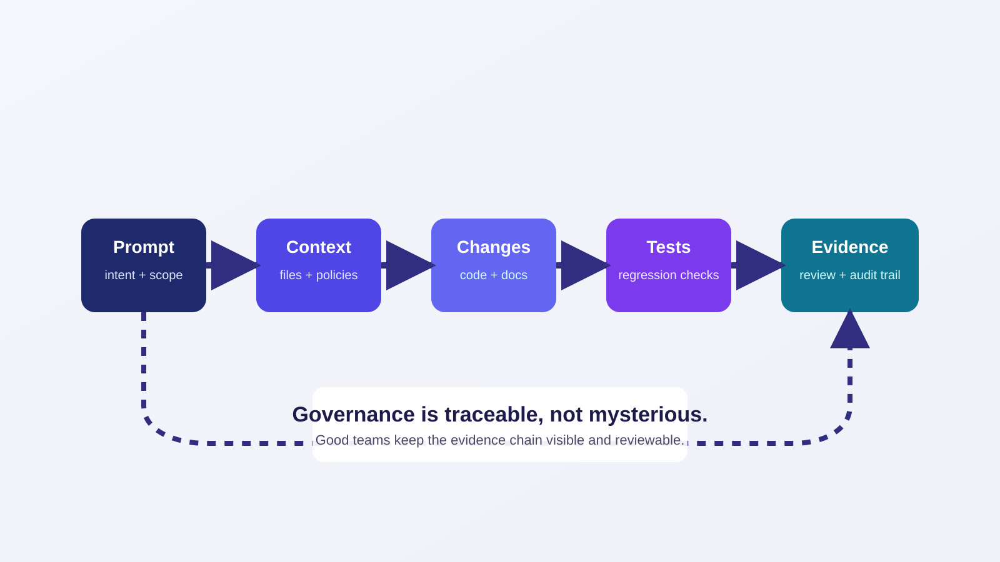

<!-- course-title: GitHub Copilot for Credit Analytics and Risk Modeling -->
<!-- course-theme: roi-theme -->

<!-- layout: title -->


GitHub Copilot for Credit Analytics and Risk Modeling

# Chapter 4: Agentic Governance and Code Lifecycle

---

# Chapter 4: Objectives

- Configure Copilot workflows for plan-first, approval-driven execution in analytics repositories
- Use agentic task patterns to refactor, test, and document code with bounded risk
- Produce governance evidence that ties prompts, changes, tests, and reviewer decisions together
- Operationalize reusable skills and instruction files for consistent team-level quality

---

<!-- layout: navigation -->
# Chapter 4

- Agentic Workflows and Task Decomposition
- Refactoring and Test Generation at Scale
- Governance Evidence and Traceability
- Documentation Automation and Handoff

---

<!-- layout: stacked -->
# Agentic Workflow Core Principle

- Agentic workflows should be constrained systems, not open-ended automation
- Every task starts with plan, scope, and acceptance criteria
- Every execution step ends with test evidence and approval checkpoint



---

<!-- layout: 2-column -->
# Plan-First Prompt Pattern

### Prompt
```text
Plan only.
Do not edit files yet.
Return:
1) step-by-step approach
2) files to change
3) tests to run
4) risk notes
```

### Why It Works
- Creates shared expectations
- Surfaces risky assumptions early
- Makes approval explicit

---

# Approval-Driven Execution Prompt

```text
Approved: execute Step 1 only.
Constraints:
- Edit only listed files.
- Preserve business logic.
- Run targeted tests.
- Return diff summary and test results.
Stop and wait for approval.
```

---

<!-- layout: 3-column -->
# Task Decomposition by Change Type

### Bug Fix
- Reproduce
- Isolate root cause
- Add regression test

### Refactor
- Plan extraction steps
- Preserve behavior
- Verify parity

### Enhancement
- Define acceptance criteria
- Implement incrementally
- Validate against baseline

---

<!-- layout: 2-column -->
# Good vs Weak Agentic Tasks

### Good
- Named files
- Explicit quality gates
- Bounded scope
- Clear stop points

### Weak
- “Improve everything”
- No acceptance criteria
- No test requirements
- No approval checkpoints

---

<!-- layout: navigation -->
# Chapter 4

- Agentic Workflows and Task Decomposition
- Refactoring and Test Generation at Scale
- Governance Evidence and Traceability
- Documentation Automation and Handoff

---

# Refactoring at Scale with Copilot

- Scale comes from repeatable prompts and guardrails, not larger one-shot prompts
- Use the same plan and approval templates across teams
- Keep refactor batches small enough to review quickly

---

<!-- layout: 2-column -->
# Refactor Batch Template

### Scope Block
- Target files
- Preserved behaviors
- Excluded areas

### Verification Block
- Tests to run
- Benchmarks to compare
- Regression criteria

---

# Refactor Prompt Example

```text
Refactor batch 2 of 4.
Scope:
- src/monitoring/risk_rollup.py
- src/monitoring/shared_utils.py
Preserve:
- output schema and metric definitions

Actions:
- Extract duplicated logic into helper functions.
- Add unit tests for helper edge cases.
- Keep API signatures unchanged.

Return:
- File-by-file summary
- Test outcomes
- Remaining risks
```

---

<!-- layout: 3-column -->
# Test Generation Prompt Families

### Unit Tests
- Core function behavior
- Null and boundary handling
- Error-path checks

### Regression Tests
- Known bug reproductions
- Fix verification
- Non-regression assertions

### Contract Tests
- Input schema compliance
- Output schema stability
- Backward compatibility

---

<!-- layout: 2-column -->
# Test Coverage Upgrade Prompt

### Prompt
```text
Analyze existing tests and add missing coverage for:
- denominator edge cases
- segment sparsity behavior
- invalid date-window inputs
Do not rewrite existing passing tests.
```

### Review Questions
- Are new tests meaningful?
- Do tests fail before fix and pass after?
- Are brittle assertions avoided?

---

# Assertion Injection Prompt

- Use Copilot to add defensive assertions for analytics-critical invariants
- Assertions should fail loudly and explain clearly

```text
Add assertions to verify:
- required columns exist
- no negative exposure values
- unique keys at output grain
Raise informative errors with actionable messages.
```

---

<!-- layout: navigation -->
# Chapter 4

- Agentic Workflows and Task Decomposition
- Refactoring and Test Generation at Scale
- Governance Evidence and Traceability
- Documentation Automation and Handoff

---

# Governance Evidence: Required Artifacts

- Approval decisions must be backed by reproducible evidence
- Prompt used
- Context files referenced
- Code diff summary
- Test and benchmark outcomes
- Reviewer decision and rationale

---

<!-- layout: 2-column -->
# Governance Mapping: Website and Repository

### GitHub Surface
- Organization and enterprise enablement decisions
- Policy and access context for Copilot usage
- Central governance communication to teams

### Repository Surface
- `.github/copilot-instructions.md` rules
- `AGENTS.md` operating constraints
- Pull request evidence and approval records

---

# What to Verify Before Team Rollout

- Confirm policy and workflow alignment before scaling usage
- Team can explain where policy is defined and where implementation is enforced
- Reviewers can trace generated changes back to prompt intent and approval outcomes

```text
Rollout gate:
1) Access and policy confirmed
2) Repository instructions active
3) Approval checklist adopted
4) Evidence template in use
```

---

<!-- layout: 2-column -->
# Evidence Capture Template

### Development Evidence
- Prompt version identifier
- Planned scope versus actual scope
- Assumptions and open questions

### Validation Evidence
- Test command and results
- Coverage delta
- Benchmark reconciliation summary

---

<!-- layout: 3-column -->
# Traceability by Audience

### Engineer
- What changed
- Why it changed
- How it was tested

### Reviewer
- Risk summary
- Unresolved assumptions
- Approval recommendation

### Auditor
- Evidence chain completeness
- Reproducibility status
- Governance sign-offs

---

# Pull Request Governance Prompt

```text
Draft a pull request governance summary with:
- scope of change
- assumptions made
- test evidence
- benchmark comparison
- residual risks
- approval recommendation
```

---

<!-- layout: 2-column -->
# Risk-Rating Prompt for Review

### Prompt
```text
Review this change and classify risk as low, medium, or high.
Use:
- business logic impact
- test coverage quality
- scope breadth
- rollback complexity
Provide rationale in 5 bullets.
```

### Use Case
- Standardizes reviewer language
- Speeds triage for busy leads
- Improves consistency across teams

---

<!-- layout: navigation -->
# Chapter 4

- Agentic Workflows and Task Decomposition
- Refactoring and Test Generation at Scale
- Governance Evidence and Traceability
- Documentation Automation and Handoff
---

# Documentation Automation: Practical Pattern

- Copilot drafts first versions, humans own final accuracy
- Use structured templates for predictable documentation outputs
- Link narrative statements to code and validation artifacts

---

<!-- layout: 2-column -->
# Documentation Prompt Template

### Request
```text
Generate a technical summary document with:
- purpose
- inputs and outputs
- key assumptions
- validation results
- limitations and follow-up actions
```

### Constraints
- Cite source files
- Reference metric tables
- Avoid claims not supported by evidence

---

<!-- layout: card-layout -->
# Documentation Pack for Handoff

### Technical Summary
- Architecture, dependencies, interfaces, and operational behavior.

### Validation Summary
- Metrics, thresholds, outcomes, and caveats.

### Governance Summary
- Prompt lineage, review decisions, and residual risk notes.

### Runbook Notes
- Execution steps, monitoring points, and recovery actions.

---

# Skill-Driven Standardization

- Skills operationalize proven workflows into reusable assets
- Capture successful plan and approval patterns as skills
- Train teams to invoke skills before ad-hoc prompting

---

<!-- layout: 2-column -->
# Build a Team Skill in This Repository

### Folder Structure
```text
.agents/skills/model-review-gate/
  SKILL.md
  examples/
    approval-prompt.md
```

### SKILL.md Should Define
- When to use
- Required inputs
- Output format
- Quality gates and failure modes

---

<!-- layout: 3-column -->
# Skill Lifecycle Management

### Create
- Start from one recurring workflow
- Define measurable outputs
- Pilot with one team

### Evaluate
- Track rework reduction
- Collect reviewer feedback
- Score output reliability

### Evolve
- Version updates in git
- Retire weak patterns
- Publish release notes

---

# Configuration Files That Shape Behavior

- Copilot behavior becomes predictable when repository guidance is explicit
- `.github/copilot-instructions.md`: coding and review expectations
- `AGENTS.md`: cross-agent operating guidance in the repository
- `.agents/skills/*`: reusable skill playbooks and templates

---

<!-- layout: 2-column -->
# Specialized Agents and MCP in Governance

### Specialized Agents
- Model review agents validate assumptions and governance checks
- Refactor agents handle narrow implementation tasks
- Documentation agents package evidence for handoff and review

### MCP and External Context
- MCP enables tool-based access to repo context, data checks, and supporting systems
- Keep each agent scoped to the task, not to the entire engineering org
- Pair tool access with explicit review gates and approval requirements

---

<!-- layout: 2-column -->
# Team Rollout Sequence

### Week 1 to 2
- Standardize instruction files
- Launch two high-value skills
- Train reviewers on approval prompts

### Week 3 to 6
- Scale to additional squads
- Monitor quality metrics
- Tune prompts and skills from findings

---

# Chapter 4 Hands-On Lab

- Lab: Agentic Governance and Automated Code Cleanup
- Time: 30 minutes

---

# What You Learned

- Configured Copilot workflows for plan-first, approval-driven execution in analytics repositories
- Used agentic task patterns to refactor, test, and document code with bounded risk
- Produced governance evidence that ties prompts, changes, tests, and reviewer decisions together
- Operationalized reusable skills and instruction files for consistent team-level quality

---

<!-- layout: navigation -->
# Chapter 4 Knowledge Check

- Quiz 1
- Quiz 2
- Quiz 3 Discussion

---

# Quiz 1 of 3

Which practice best controls risk in agentic Copilot workflows?

- A. Run one broad prompt and review afterward
- B. Use plan-only prompt, stepwise approvals, and test gates between steps
- C. Skip tests if changes look small
- D. Approve based on cleaner code style

---

# Quiz 1: Answer

Which practice best controls risk in agentic Copilot workflows?

**Correct: B.** Plan-first and approval gates make automation reviewable and safer.

- Scope stays bounded
- Risks are surfaced early
- Evidence is captured at each step

---

# Quiz 2 of 3

What is the most important purpose of a governance evidence package?

- A. Make pull requests longer
- B. Replace all human code review
- C. Connect prompt intent, code change, validation results, and approval decision
- D. Hide implementation details from auditors

---

<!-- layout: 2-column -->
# Quiz 2: Answer

### Correct Choice
- **C.** Connect prompt intent, code change, validation results, and approval decision.
- This creates a complete traceable record.

### Why It Works
- Supports reviewer confidence
- Supports audit readiness
- Improves reproducibility of outcomes

---

<!-- layout: 2-column -->
# Quiz 3 of 3: Discussion

### Prompt
- Your team has solid prompt templates but inconsistent approval quality.
- What process changes would you implement first?

### Discuss
- Which approval checklist items are mandatory?
- How should reviewer decisions be documented?
- Which metrics indicate approval quality improvement?

---

<!-- layout: 2-column -->
# Quiz 3: Discussion Points

### Strong Answers Mention
- Standard approval checklist and evidence template
- Required test and benchmark summaries
- Explicit residual-risk statement in pull request
- Reviewer calibration sessions across teams

### Watch For
- Approval based on style or speed only
- Missing linkage between prompts and outcomes
- No owner for skills and instruction updates

---

<!-- layout: stacked -->
# Questions and Answers

Questions?


