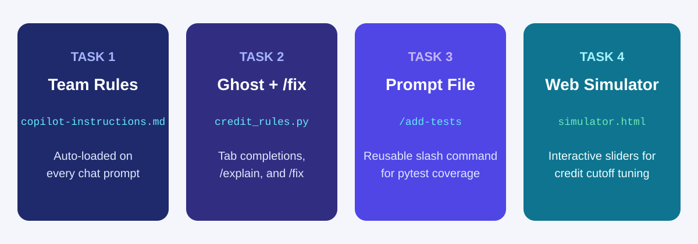
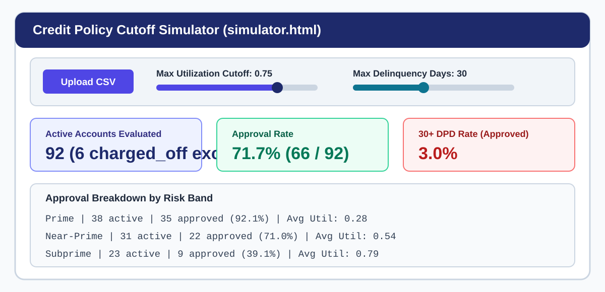

# Effective Prompting and Context Engineering

## Time Required

30 minutes

## Overview

In this lab, you start from an empty folder in Visual Studio Code and configure GitHub Copilot so it follows your team’s credit analytics standards automatically. You create a repository instruction file, drive inline ghost text completions, audit and repair a flawed calculation with `/explain` and `/fix`, build a custom `/add-tests` prompt file, and use Agent mode to generate an interactive, browser-based Credit Policy Cutoff Simulator.

### You learn how to:
- Configure `.github/copilot-instructions.md` so Copilot applies team coding and credit domain rules on every chat.
- Generate Python credit helpers using comment-driven ghost text and repair a buggy function using `/explain` and `/fix`.
- Create a reusable `.github/prompts/add-tests.prompt.md` file and run it from the `/` command menu in Copilot Chat.
- Prompt Copilot in Agent mode to generate synthetic credit data and an interactive HTML Credit Policy Cutoff Simulator.

## Scenario

Your credit analytics team uses Python and `pytest` to evaluate account populations and test underwriting cutoffs. Until now, every analyst has pasted different rules into Copilot Chat, and several scripts accidentally included `charged_off` accounts in delinquency rate denominators or crashed on blank `utilization` rows. You want to standardize how Copilot behaves in your workspace and build an interactive policy simulator using synthetic data only.



## Lab Instructions

### Task 1: Create your workspace and team `.github/copilot-instructions.md`

In this task, you open a fresh folder in VS Code, create `.github/copilot-instructions.md` with your team’s standing rules, and verify that Copilot applies those rules automatically without you repeating them in the prompt.

1. Open Visual Studio Code.

2. Create a new empty folder named `lab1-copilot-basics` anywhere on your computer, and open it via **File** > **Open Folder**.

3. Open the VS Code integrated terminal (**Terminal** > **New Terminal**) and create the `.github` directory:

```bash
mkdir -p .github
```

4. Create a new file directly inside the `.github` folder at `.github/copilot-instructions.md` and paste the following team instructions:

```markdown
# Credit Analytics Team Copilot Instructions

## Coding Standards
- Use Python 3, pandas, numpy, and pytest for all analytical code.
- Include type hints and a concise docstring on every function.

## Data and Domain Guardrails
- Never generate or request real customer PII, names, or Social Security numbers.
- Exclude rows where status == 'charged_off' from all delinquency rate denominators.
- Treat delinquency_days > 365 (such as 9999) as a data error flag, not a valid delinquency observation.

## Verification Rules
- When generating tests, always include cases for an empty DataFrame, missing utilization values, and delinquency_days = 9999.
- State assumptions before modifying multiple files.
```

5. Save `.github/copilot-instructions.md`.

6. Open Copilot Chat from the Copilot icon in the top title bar. Confirm that `</> Agent` is active at the bottom of the chat input box.


7. Test that Copilot reads `.github/copilot-instructions.md` automatically by pasting this short prompt into Chat (notice that you do not mention `charged_off` or `9999` in the prompt):

```text
Without creating any files yet, tell me what denominator rule and what delinquency_days error rule you will apply when writing code in this workspace.
```

> [!NOTE]
> Copilot’s reply should explicitly state that it will exclude `status == 'charged_off'` from rate denominators and treat `delinquency_days > 365` (such as `9999`) as a data error, proving that `.github/copilot-instructions.md` is active in your session.

### Task 2: Drive inline ghost text and fix a deliberate bug with `/explain` and `/fix`

In this task, you use comment-driven inline ghost text (`Tab`) to generate two credit helper functions, then use `/explain` and `/fix` to diagnose and repair a buggy portfolio rate function.

1. In the VS Code Explorer pane, create a new file named `credit_rules.py` in the root of `lab1-copilot-basics`.

2. Paste the following imports, function headers, and numbered comments into `credit_rules.py`:

```python
import numpy as np
import pandas as pd


def calc_utilization(balance: float, credit_limit: float) -> float:
    # Return balance / credit_limit rounded to 4 decimals; return np.nan if credit_limit <= 0 or inputs are null


def assign_delinquency_bucket(dpd: int) -> str:
    # Return 'Error' if dpd < 0 or dpd > 365, 'Current' if dpd == 0, '1-29 DPD' if 1 <= dpd <= 29, and '30+ DPD' if dpd >= 30
```

3. Place your cursor on the blank line below the comment inside `calc_utilization`, press `Enter` or add 4 spaces of indentation, and wait a moment for Copilot’s gray ghost text to appear.

4. Read the suggested code and press `Tab` to accept it.

5. Repeat the same step inside `assign_delinquency_bucket`: place your cursor below the comment, wait for the gray ghost text, read it, and press `Tab` to accept it.

> [!TIP]
> If you only want to accept the first word or phrase of an inline suggestion, press `Cmd+Right` on macOS or `Ctrl+Right` on Windows.

6. Now paste the following deliberately flawed function at the bottom of `credit_rules.py` and save the file:

```python
def compute_30dpd_rate(df: pd.DataFrame) -> float:
    bad_rows = df[df["delinquency_days"] >= 30]
    return len(bad_rows) / len(df)
```

7. Highlight the `compute_30dpd_rate` function in the editor, then send the following prompt in Copilot Chat:

```text
/explain Check this selected function against our team rules in .github/copilot-instructions.md. What bugs or rule violations will happen on an empty DataFrame, charged_off rows, or delinquency_days = 9999?
```

8. Read Copilot’s explanation. Confirm it flags three problems: `ZeroDivisionError` on an empty DataFrame, `charged_off` accounts left in the denominator, and `delinquency_days = 9999` counted as a valid `30+ DPD` account.

9. Keep `compute_30dpd_rate` selected in the editor and run `/fix` in Copilot Chat with a strict scope constraint:

```text
/fix Update only compute_30dpd_rate so it excludes status == 'charged_off' and delinquency_days > 365 from both numerator and denominator, and returns np.nan when no active valid rows remain. Do not modify calc_utilization or assign_delinquency_bucket.
```

10. Review the diff in `credit_rules.py` and click **Keep** (or **Accept**) only after verifying that the first two functions were not changed.

### Task 3: Create and run a reusable `.github/prompts/add-tests.prompt.md` slash command

In this task, you create a reusable prompt file so anyone on the team can generate standardized `pytest` unit tests by typing `/add-tests` in Copilot Chat.

1. In the VS Code terminal, create the `.github/prompts` directory:

```bash
mkdir -p .github/prompts
```

2. Create a new file inside `.github/prompts/` at `.github/prompts/add-tests.prompt.md` and paste the following reusable prompt template:

```markdown
# Prompt File: .github/prompts/add-tests.prompt.md

Create or update a pytest test file in tests/ for the specified Python file:
1. Build synthetic test inputs only (never use real customer data).
2. Write unit tests for every function in the target file.
3. Explicitly test:
   - Normal inputs across Prime, Near-Prime, and Subprime accounts
   - An empty DataFrame or zero active accounts (asserting np.nan rather than ZeroDivisionError)
   - Exclusion of rows where status == 'charged_off'
   - Exclusion or flagging of rows where delinquency_days = 9999
4. Do not modify the production source file.
```

3. Save `.github/prompts/add-tests.prompt.md`.

4. In Copilot Chat, run your new `/add-tests` command on `credit_rules.py`:

```text
/add-tests credit_rules.py
```

5. Once Copilot creates the test file, run this command in the VS Code terminal to create a virtual environment, install `pytest`, `pandas`, and `numpy`, and execute the test suite:

```bash
python3 -m venv .venv && source .venv/bin/activate && pip install -q pytest pandas numpy && python -m pytest -v
```

> [!NOTE]
> Using `python -m pytest -v` inside `.venv` ensures `pytest` is installed cleanly and automatically adds your workspace root to Python’s import path even when tests live inside `tests/`. On Windows PowerShell, activate with `.venv\Scripts\Activate.ps1`.

### Task 4: Build an interactive Credit Policy Cutoff Simulator (`simulator.html`)

In this task, you use Copilot Agent mode to generate a synthetic 100-row credit dataset and a single-file browser application (`simulator.html`) that lets analysts test underwriting cutoffs with live sliders.

1. In Copilot Chat (`</> Agent` in **Interactive** mode), paste the following prompt and press `Enter`:

```text
Create two files in this workspace:

1. generate_sample_accounts.py
- Uses pandas and numpy (with random seed 42) to create sample_accounts.csv with 100 synthetic credit accounts.
- Columns: account_id (ACC-1001 to ACC-1100), risk_band ('Prime', 'Near-Prime', 'Subprime'), status ('active' for 92 rows, 'charged_off' for 8 rows), balance (USD between 200 and 15000), credit_limit (USD between 1000 and 20000), utilization (balance / credit_limit rounded to 4 decimals, with 4 rows left blank), and delinquency_days (0, 15, 30, 60, or 90, plus 2 rows set to 9999).

2. simulator.html
- A self-contained, single-file HTML/CSS/JavaScript web application that opens directly in any browser with no server required.
- Includes an "Upload sample_accounts.csv" file input button.
- Automatically filters out rows where status == 'charged_off' or delinquency_days > 365, and shows a banner noting how many rows were excluded by team policy.
- Includes two interactive range sliders:
  a) Max Utilization Cutoff (0.10 to 1.00, step 0.05, default 0.75)
  b) Max Delinquency Days Cutoff (0 to 90, step 15, default 30)
- As the user drags either slider, immediately recalculates and displays:
  - KPI cards for Active Valid Accounts, Approval Rate (%), and 30+ DPD Bad Rate (%) among Approved Accounts
  - A clean summary table by risk_band showing Active Count, Approved Count, Approval Rate (%), Mean Balance, and Approved 30+ DPD Rate (%)
  - A horizontal CSS bar chart comparing Approval Rate (%) across Prime, Near-Prime, and Subprime
```

2. Allow Copilot to create both files, then run the data generator in your VS Code terminal:

```bash
python generate_sample_accounts.py
```

3. Confirm that `sample_accounts.csv` and `simulator.html` appear in the VS Code Explorer pane.

4. Right-click `simulator.html` in the Explorer pane, choose **Reveal in Finder** (macOS) or **Reveal in File Explorer** (Windows), and double-click `simulator.html` to open it in your web browser.

5. Click **Upload** (or **Choose File**), select `sample_accounts.csv`, and drag the **Max Utilization Cutoff** and **Max Delinquency Days Cutoff** sliders to watch the approval rates and bad rates update in real time.



### Bonus Task 5: Add a declined-accounts CSV export with Inline Chat

Use Inline Chat (`Cmd+I` on macOS or `Ctrl+I` on Windows) to add a new feature to `simulator.html` without regenerating the whole page.

1. Open `simulator.html` in the VS Code editor and highlight the controls or summary table section.

2. Press `Cmd+I` (macOS) or `Ctrl+I` (Windows) - or right-click and select **Copilot** > **Editor Inline Chat** - and ask Copilot to add a **Download Declined Accounts CSV** button that exports the currently declined accounts (along with a `decline_reason` column) as a `.csv` file.

3. Accept the inline diff, refresh `simulator.html` in your browser, upload `sample_accounts.csv`, and test the new download button.

## Congratulations!

In this lab, you have:
- Configured `.github/copilot-instructions.md` so Copilot applied team coding and credit domain rules on every chat.
- Generated Python credit helpers using comment-driven ghost text and repaired a buggy function using `/explain` and `/fix`.
- Created a reusable `.github/prompts/add-tests.prompt.md` file and ran it from the `/` command menu in Copilot Chat.
- Prompted Copilot in Agent mode to generate synthetic credit data and an interactive HTML Credit Policy Cutoff Simulator.
