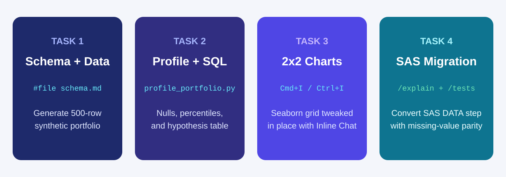
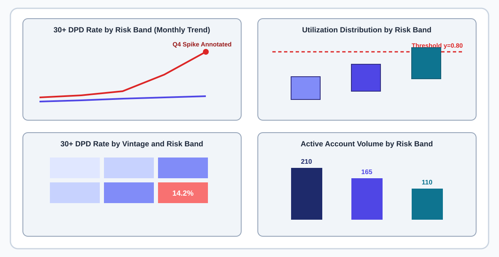
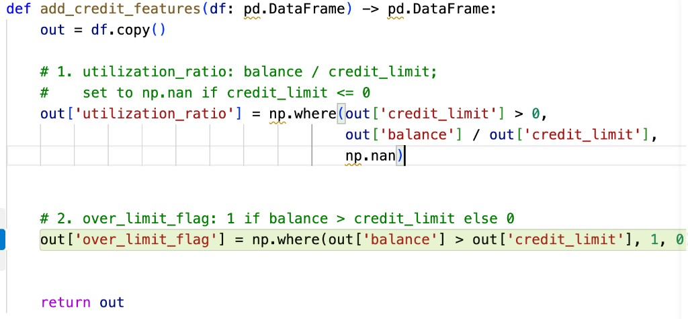

# Copilot-Assisted Data Profiling and Hypothesis Generation

## Time Required

30 minutes

## Overview

In this lab, you start from an empty folder in Visual Studio Code and use `#file` schema context so GitHub Copilot generates accurate Python data profiling scripts, multi-panel `seaborn` visualizations, SQL queries, and SAS-to-Python translations without inventing column names. You also practice refining chart code in place with Inline Chat (`Cmd+I` or `Ctrl+I`) and building feature engineering functions with comment-driven ghost text.

### You learn how to:
- Attach `#file schema.md` in Copilot Chat to generate a synthetic multi-month credit portfolio and a `pandas` profiling script.
- Generate a 2x2 `matplotlib` and `seaborn` diagnostic figure and refine axes and threshold lines in place with Inline Chat (`Cmd+I` or `Ctrl+I`).
- Feed `#file schema.sql` to Copilot to generate CTE-based SQL queries and translate a legacy SAS `DATA` step into Python using `/explain` and `/tests`.
- Engineer credit risk features using comment-driven inline ghost text completions.

## Scenario

Your credit portfolio’s 30-day delinquency rate jumped in Q4. Before anyone jumps to conclusions, you need Copilot to help you profile the dataset for missing values and error codes, visualize delinquency trends and vintage cohorts across risk bands, translate a legacy SAS roll-rate block into `pandas`, and document three testable hypotheses backed by data checks.



## Lab Instructions

### Task 1: Create `schema.md` and generate a synthetic multi-month credit portfolio

In this task, you open an empty folder in VS Code, define your table schema in `schema.md`, and prompt Copilot to generate a 500-row synthetic credit dataset with planted data quality anomalies and a Q4 delinquency spike.

1. Open Visual Studio Code.

2. Create a new empty folder named `lab2-profiling` on your computer and open it via **File** > **Open Folder**.

3. Create a new file named `schema.md` in `lab2-profiling` and paste the following schema definition:

```markdown
# Credit Portfolio Schema (portfolio_history.csv)

- `account_id` (string): identifier formatted ACC-2001 to ACC-2500
- `vintage_quarter` (string): origination quarter ('2025-Q1', '2025-Q2', '2025-Q3', '2025-Q4')
- `perf_month` (string): reporting month ('2025-07', '2025-08', '2025-09', '2025-10', '2025-11', '2025-12')
- `risk_band` (string): 'Prime', 'Near-Prime', or 'Subprime'
- `status` (string): 'active' or 'charged_off'
- `balance` (float): current balance in USD (0 to 20000)
- `credit_limit` (float): credit limit in USD (1000 to 25000)
- `utilization` (float): ratio balance / credit_limit (0.0 to 1.2; may contain nulls)
- `dpd` (int): days past due (0, 15, 30, 60, 90, or 9999 for data error)
```

4. Save `schema.md`.

5. Open Copilot Chat (`</> Agent` in **Interactive** mode), attach `#file schema.md`, and run this prompt:

```text
Using #file schema.md, create generate_portfolio.py using pandas and numpy (seed 42) that writes 500 rows to portfolio_history.csv.
Plant these exact patterns in the synthetic data:
1. 18 rows in Near-Prime with missing (NaN) utilization values.
2. 6 rows with dpd = 9999 (data error code) and 25 rows with status = 'charged_off'.
3. A noticeable rise in 30+ DPD (dpd >= 30 and dpd <= 365) during perf_month '2025-11' and '2025-12' concentrated in the '2025-Q3' Near-Prime and Subprime cohorts.
```

6. Allow Copilot to create `generate_portfolio.py`, then run it in the VS Code terminal:

```bash
python generate_portfolio.py
```

> [!IMPORTANT]
> If `pandas`, `numpy`, `matplotlib`, or `seaborn` are not installed in your environment, run `pip install pandas numpy matplotlib seaborn pytest` in the terminal.

### Task 2: Generate a Python data profiler and hypothesis table from `#file schema.md`

In this task, you attach `#file schema.md` and prompt Copilot to build a portfolio profiling script that audits nulls, percentiles, and error codes and outputs a structured hypothesis table for the Q4 delinquency rise.

1. In Copilot Chat, attach `#file schema.md` and run the following prompt:

```text
Using #file schema.md, create profile_portfolio.py that loads portfolio_history.csv and prints four sections:
1. Null Audit: null count and null percentage by column and broken down by risk_band.
2. Anomaly Audit: count of rows with dpd > 365, utilization > 1.0, or status == 'charged_off', plus a duplicate check on (account_id, perf_month).
3. Distribution Summary: 5th, 50th, and 95th percentiles of balance and utilization for active, non-error rows.
4. Hypothesis Markdown Table: print and save to hypotheses.md a Markdown table with columns (Hypothesis | Data Signal Observed | Verification Check | Priority) containing 3 testable hypotheses explaining which risk_band and vintage_quarter drove the Q4 30+ DPD rise (excluding charged_off and dpd > 365 rows).
```

2. Run `profile_portfolio.py` in the VS Code terminal:

```bash
python profile_portfolio.py
```

3. Open the generated `hypotheses.md` file in VS Code and confirm that each row pairs a concrete data signal from `portfolio_history.csv` with a specific verification check.

> [!NOTE]
> Because `#file schema.md` was attached to your prompt, every column reference in `profile_portfolio.py` (`vintage_quarter`, `perf_month`, `risk_band`, `dpd`, `status`) matched your CSV on the first run.

### Task 3: Generate a 2x2 `seaborn` diagnostic figure and refine it with Inline Chat

In this task, you prompt Copilot Chat to generate a 4-panel chart (`diagnostics.png`), then use Inline Chat (`Cmd+I` or `Ctrl+I`) inside the editor to add a threshold reference line, rotate labels, and annotate the Q4 spike without rewriting the data preparation code.

1. In Copilot Chat, attach `#file schema.md` and send this prompt:

```text
Using #file schema.md, create plot_diagnostics.py using matplotlib and seaborn.
Load portfolio_history.csv, filter to status == 'active' and dpd <= 365, and create a 2x2 subplot figure (figsize 14x10):
- Top-left (ax[0, 0]): lineplot of monthly 30+ DPD rate (dpd >= 30) with x='perf_month', y='dlq_30_rate', and hue='risk_band'
- Top-right (ax[0, 1]): boxplot of utilization by risk_band (order=['Prime', 'Near-Prime', 'Subprime'])
- Bottom-left (ax[1, 0]): heatmap of 30+ DPD rate pivoted by vintage_quarter (rows) and risk_band (columns) with annot=True and fmt='.1%'
- Bottom-right (ax[1, 1]): bar chart of active account count by risk_band
Save the figure to diagnostics.png with dpi=150 and close the plot.
```

2. Run `plot_diagnostics.py` in the terminal and click `diagnostics.png` in the VS Code Explorer pane to view the 2x2 chart:

```bash
python plot_diagnostics.py
```

3. Open `plot_diagnostics.py` in the editor, highlight only the plotting code for the top-left and top-right subplots (`ax[0, 0]` and `ax[0, 1]`), and press `Cmd+I` (macOS) or `Ctrl+I` (Windows) to open Inline Chat.

4. Enter this surgical refinement prompt in Inline Chat:

```text
1. On the top-left lineplot, rotate x-axis labels 45 degrees and add a text annotation pointing to the 2025-12 peak.
2. On the top-right boxplot, add a red dashed horizontal line at y=0.80 labeled 'High Util Cutoff (0.80)'.
3. On the bottom-right bar chart, add exact account counts on top of each bar.
Keep the data loading and filtering code at the top of the file unchanged.
```

5. Review the inline diff in `plot_diagnostics.py`, click **Accept** (or **Keep**), and rerun `python plot_diagnostics.py` to see `diagnostics.png` update live in VS Code.



### Task 4: Generate SQL from `#file schema.sql`, migrate legacy SAS, and use comment-driven ghost text

In this task, you feed a SQL DDL file to Copilot, use `/explain` and `/tests` to safely translate a legacy SAS `DATA` step into `pandas`, and use comment-driven ghost text to engineer new credit features.

1. Create a file named `schema.sql` in `lab2-profiling` and paste this table definition:

```sql
CREATE TABLE credit_analytics.portfolio_history (
    account_id VARCHAR(32) NOT NULL,
    vintage_quarter VARCHAR(16) NOT NULL,
    perf_month VARCHAR(7) NOT NULL,
    risk_band VARCHAR(24) NOT NULL,
    status VARCHAR(24) NOT NULL,
    balance DECIMAL(12, 2),
    credit_limit DECIMAL(12, 2),
    utilization DECIMAL(6, 4),
    dpd INTEGER
);
```

2. In Copilot Chat, attach `#file schema.sql` and run this prompt to generate both a metric query and a companion grain-validation query:

```text
Using #file schema.sql, create delinquency_queries.sql in ANSI/Snowflake SQL containing:
1. A CTE query that filters to status != 'charged_off' and dpd <= 365, groups by perf_month and risk_band, computes active_accounts and dlq_30_rate, and uses LAG() to compute month_over_month_bp_change.
2. A companion validation query that checks for duplicate (account_id, perf_month) keys and counts null risk_band or utilization rows.
```

3. Next, create a file named `legacy_roll_rate.sas` and paste this legacy SAS block:

```sas
data roll_flags;
  set credit.portfolio_history;
  where status ne 'charged_off' and dpd <= 365;
  util_ratio = balance / credit_limit;
  if dpd >= 30 then dlq_30_flag = 1;
  else dlq_30_flag = 0;
  if utilization < 0.30 then util_tier = 'Low';
  else if utilization <= 0.75 then util_tier = 'Medium';
  else util_tier = 'High';
run;
```

4. In Copilot Chat, run `/explain` on `#file legacy_roll_rate.sas` before generating any Python code:

```text
/explain #file legacy_roll_rate.sas
Explain how SAS evaluates missing values (.) in 'if utilization < 0.30' versus how pandas evaluates NaN in '< 0.30', and how we must handle NaN in pandas to preserve exact SAS parity.
```

5. Read Copilot’s explanation (in SAS, missing `.` is less than `0.30` and lands in `'Low'`, whereas in `pandas` `NaN < 0.30` is `False` and would fall into the `else` `'High'` bucket unless handled explicitly!).

6. Now create `sas_migrated.py` using comment-driven ghost text and Chat: first paste these lines and numbered comments into `sas_migrated.py`:

```python
import numpy as np
import pandas as pd


def build_roll_flags(df: pd.DataFrame) -> pd.DataFrame:
    # 1. Filter to status != 'charged_off' and dpd <= 365 on a copy of df

    # 2. Compute util_ratio as balance / credit_limit (np.nan when credit_limit <= 0)

    # 3. Create dlq_30_flag: 1 when dpd >= 30 else 0 (treating NaN dpd as 0)

    # 4. Create util_tier: 'Missing' when utilization is NaN, 'Low' when < 0.30, 'Medium' when <= 0.75, else 'High'

    return out
```

7. Place your cursor under each numbered comment, wait for Copilot’s gray ghost text, and press `Tab` to complete each line.



8. Select `build_roll_flags` in `sas_migrated.py`, open Copilot Chat, and run `/tests` to create `test_sas_migrated.py` verifying that a row with `utilization = np.nan` is never misclassified as `'High'`. Run `pytest -v` in the terminal to confirm it passes.

### Bonus Task 5: Generate an interactive HTML Exploratory Data Report (`eda_report.html`)

Use Copilot Agent mode to combine your profiling summary, hypothesis table, and charts into a single interactive HTML report.

1. In Copilot Chat, attach `#file profile_portfolio.py`, `#file hypotheses.md`, and `#file schema.md`.

2. Prompt Copilot to create a Python script `build_html_report.py` that reads `portfolio_history.csv`, embeds `diagnostics.png` (as base64 or relative link) and the `hypotheses.md` table, and writes a self-contained `eda_report.html` page with interactive filter buttons for `All Bands`, `Prime`, `Near-Prime`, and `Subprime`.

3. Run `python build_html_report.py` and open `eda_report.html` in your browser.

## Congratulations!

In this lab, you have:
- Attached `#file schema.md` in Copilot Chat to generate a synthetic multi-month credit portfolio and a `pandas` profiling script.
- Generated a 2x2 `matplotlib` and `seaborn` diagnostic figure and refined axes and threshold lines in place with Inline Chat (`Cmd+I` or `Ctrl+I`).
- Fed `#file schema.sql` to Copilot to generate CTE-based SQL queries and translated a legacy SAS `DATA` step into Python using `/explain` and `/tests`.
- Engineered credit risk features using comment-driven inline ghost text completions.
