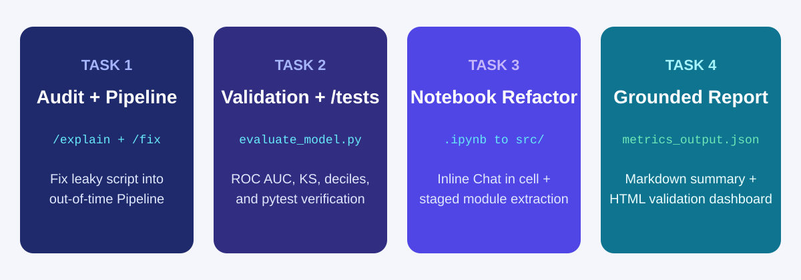
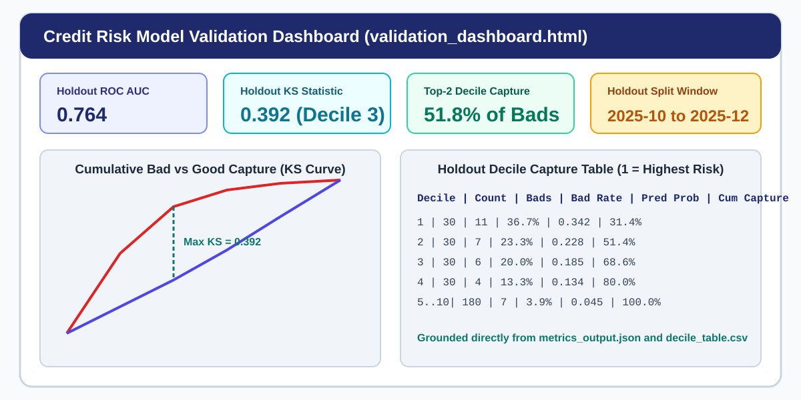

# AI-Assisted Model and Strategy Validation

## Time Required

30 minutes

## Overview

In this lab, you start from an empty folder in Visual Studio Code and use GitHub Copilot to audit a flawed credit risk model script for data leakage, rebuild it as an out-of-time `scikit-learn` `Pipeline` using `#file schema.md`, generate and test credit validation metrics (`ROC AUC`, `KS statistic`, and 10-bin decile capture tables), refactor a Jupyter notebook into reusable Python modules, and build an interactive HTML Model Validation Dashboard grounded in real output files.

### You learn how to:
- Audit a flawed model script for preprocessing leakage, target leakage, and random splits using `/explain`, then repair it with `/fix` and `#file schema.md`.
- Prompt Copilot to generate credit validation functions (`compute_ks` and `build_decile_table`) and verify their math with `/tests` in `pytest`.
- Use Inline Chat inside a Jupyter notebook (`.ipynb`) and extract notebook cells into a tested Python module.
- Ground Copilot with `#file metrics_output.json` and `#file decile_table.csv` to generate a zero-hallucination Markdown report and an interactive HTML Validation Dashboard.

## Scenario

A colleague used a generic AI prompt to draft a 60-day delinquency model and reported an unrealistically high ROC AUC of `0.99`. Before the model can be considered for underwriting strategy, you need to use Copilot to audit the script for leakage, rebuild it with an out-of-time split and `ColumnTransformer`, verify the validation metrics with unit tests, and produce a grounded validation summary and interactive dashboard.



## Lab Instructions

### Task 1: Create `schema.md` and audit a leaky model script with `/explain` and `/fix`

In this task, you open an empty folder in VS Code, create `schema.md` and a synthetic credit modeling dataset, audit an intentionally leaky script using `/explain`, and use `/fix` to convert it into a leak-free `scikit-learn` `Pipeline`.

1. Open Visual Studio Code.

2. Create a new empty folder named `lab3-validation` on your computer and open it via **File** > **Open Folder**.

3. Create a file named `schema.md` in `lab3-validation` and paste the following schema definition:

```markdown
# Credit Modeling Schema (modeling_data.csv)

- `account_id` (string): unique identifier (ACC-3001 to ACC-4000) - exclude from features
- `application_month` (string): origination month ('2025-01' through '2025-12') - use for time split only
- `risk_band` (string): 'Prime', 'Near-Prime', or 'Subprime' (known at application)
- `balance` (float): balance at application in USD
- `credit_limit` (float): credit limit at application in USD
- `utilization` (float): ratio 0.0 to 1.0 at application (contains ~40 nulls)
- `tenure_months` (int): months on book at application (1 to 120)
- `post_decision_dpd` (int): days past due measured 6 months AFTER decision - FORBIDDEN post-decision leak!
- `default_60d` (int): binary target (1 if 60+ DPD within 12 months, else 0)
```

4. Save `schema.md`.

5. Open Copilot Chat (`</> Agent` in **Interactive** mode), attach `#file schema.md`, and run this prompt to generate `make_modeling_data.py`:

```text
Using #file schema.md, create make_modeling_data.py using pandas and numpy (seed 42) that generates 1,000 rows in modeling_data.csv across application_month '2025-01' through '2025-12'.
- Include realistic relationships where higher utilization, lower tenure_months, and Subprime risk_band increase the probability of default_60d (overall bad rate around 12%).
- Set 40 random utilization values to NaN.
- Set post_decision_dpd strongly correlated with default_60d so it acts as a post-decision leak if accidentally included.
```

6. Run the generator script in your VS Code terminal:

```bash
python make_modeling_data.py
```

> [!IMPORTANT]
> If `scikit-learn` is not installed in your environment, run `pip install scikit-learn pandas numpy matplotlib seaborn pytest` in the terminal.

7. Next, create a file named `leaky_train.py` and paste this intentionally flawed script:

```python
import pandas as pd
from sklearn.linear_model import LogisticRegression
from sklearn.metrics import roc_auc_score
from sklearn.model_selection import train_test_split
from sklearn.preprocessing import StandardScaler

df = pd.read_csv("modeling_data.csv").dropna()
features = ["balance", "credit_limit", "utilization", "tenure_months", "post_decision_dpd"]

scaler = StandardScaler()
X_scaled = scaler.fit_transform(df[features])
X_train, X_test, y_train, y_test = train_test_split(
    X_scaled, df["default_60d"], test_size=0.25, random_state=42
)

clf = LogisticRegression().fit(X_train, y_train)
probs = clf.predict_proba(X_test)[:, 1]
print(f"Test ROC AUC: {roc_auc_score(y_test, probs):.4f}")
```

8. Run `python leaky_train.py` in the terminal and notice the artificially inflated ROC AUC caused by the leaks.

9. Select all lines in `leaky_train.py`, open Copilot Chat, attach `#file schema.md`, and run `/explain` to audit the code **before** making any edits:

```text
/explain Using #file schema.md, audit this script for:
1. Post-decision feature leakage
2. Preprocessing leakage (fit_transform before split)
3. Random split instead of out-of-time split on application_month
4. Silent row drops (.dropna())
List each bug clearly. Do not rewrite the code yet.
```

10. After reviewing Copilot’s audit list, use `/fix` (or prompt Agent mode) to create the clean pipeline in `train_pipeline.py`:

```text
Using #file schema.md, create train_pipeline.py that fixes all four issues from leaky_train.py:
1. Do not call .dropna() on the DataFrame.
2. Split out-of-time: train is application_month < '2025-10' and test (holdout) is application_month >= '2025-10'.
3. Use only decision-time features: ['balance', 'credit_limit', 'utilization', 'tenure_months', 'risk_band']. Explicitly exclude account_id, application_month, post_decision_dpd, and default_60d.
4. Build a scikit-learn Pipeline with a ColumnTransformer (SimpleImputer(strategy='median') + StandardScaler() for numeric columns; OneHotEncoder(handle_unknown='ignore') for risk_band) and LogisticRegression().
5. Fit on train only, predict probabilities on test, and print train count, test count, and holdout ROC AUC.
```

11. Run `python train_pipeline.py` in the terminal and observe the realistic, leak-free holdout ROC AUC.

### Task 2: Generate credit validation metrics (`KS`, `AUC`, decile table) and verify with `/tests`

In this task, you prompt Copilot to build `evaluate_model.py` with credit-specific validation functions (`compute_ks` and `build_decile_table`), save real holdout metrics to `metrics_output.json` and `decile_table.csv`, and verify the math with `/tests`.

1. In Copilot Chat, attach `#file schema.md` and `#file train_pipeline.py`, and run this prompt:

```text
Using #file train_pipeline.py and #file schema.md, create evaluate_model.py with:
1. compute_ks(y_true, y_prob) -> float:
   - Raises ValueError if inputs are empty, contain NaN, or have only one class in y_true.
   - Sorts by y_prob descending and returns the maximum absolute difference between cumulative bad capture rate and cumulative good capture rate.
2. build_decile_table(y_true, y_prob) -> pd.DataFrame:
   - Bins predictions into 10 equal-sized deciles (decile 1 = highest predicted risk).
   - Returns a DataFrame with columns: decile, account_count, bad_count, actual_bad_rate, mean_predicted_prob, cum_bad_capture_rate.
3. A main block that runs the out-of-time pipeline from train_pipeline.py, evaluates the holdout set (application_month >= '2025-10'), saves holdout metrics (train_rows, test_rows, roc_auc, ks, brier_score) to metrics_output.json, and saves the decile table to decile_table.csv.
```

2. Run `evaluate_model.py` in the terminal to produce `metrics_output.json` and `decile_table.csv`:

```bash
python evaluate_model.py
```

3. Open `evaluate_model.py`, select `compute_ks` and `build_decile_table`, and run `/tests` in Copilot Chat:

```text
/tests #file evaluate_model.py
Create test_evaluate_model.py using pytest to verify:
1. Perfect separation (all bads have y_prob = 0.95, all goods have y_prob = 0.05) produces compute_ks == 1.0.
2. build_decile_table returns exactly 10 rows, decile 1 has the highest mean_predicted_prob, and account_count.sum() == len(y_true).
3. compute_ks raises ValueError on empty arrays, NaN probabilities, or when y_true contains all zeros.
```

4. Run `pytest -v` in the VS Code terminal and confirm all validation unit tests pass.

### Task 3: Create and refactor a Jupyter Notebook (`.ipynb`) into a reusable module

In this task, you prompt Copilot to create an exploratory Jupyter notebook, use Inline Chat (`Cmd+I` or `Ctrl+I`) inside a notebook cell, and extract the notebook logic into a clean Python module one step at a time.

1. In Copilot Chat, attach `#file schema.md` and run this prompt:

```text
Using #file schema.md, create a 4-cell Jupyter notebook named strategy_experiment.ipynb that:
- Cell 1 (Markdown): Title and objective for credit utilization and balance-to-limit interaction features.
- Cell 2 (Code): Loads modeling_data.csv and computes two ad-hoc features inline: util_to_tenure = utilization / (tenure_months + 1) and high_util_subprime = ((utilization > 0.75) & (risk_band == 'Subprime')).astype(int).
- Cell 3 (Code): Computes a calibration table by risk_band comparing mean predicted probability to actual default_60d rate.
- Cell 4 (Code): Prints segment support counts and flags any segment with fewer than 50 accounts.
```

2. Open `strategy_experiment.ipynb` in VS Code. Click inside **Cell 2**, press `Cmd+I` (macOS) or `Ctrl+I` (Windows) to open Inline Chat right inside the notebook cell, and prompt:

```text
Fill missing utilization values with 0.0 before computing util_to_tenure so no NaN values are produced.
```

3. Accept the inline cell diff.

4. Next, instead of asking Copilot to convert the entire notebook at once, run a two-step extraction in Copilot Chat:

```text
Step 1 (Plan only): Read #file strategy_experiment.ipynb and propose a plan to extract the feature formulas from Cell 2 and the segment support table from Cell 3-4 into a reusable module strategy_helpers.py with type hints. Do not create files yet.
```

5. Review Copilot’s plan, then approve extraction and unit test creation:

```text
Approved: create strategy_helpers.py with add_strategy_features(df) and build_segment_calibration(df, y_prob), and add pytest tests in test_strategy_helpers.py.
```

6. Run `pytest -v` in the terminal to verify that both `test_evaluate_model.py` and `test_strategy_helpers.py` pass.

### Task 4: Generate a grounded `validation_summary.md` and interactive HTML Validation Dashboard

In this task, you attach your saved `metrics_output.json` and `decile_table.csv` files so Copilot generates a Markdown validation summary with zero hallucinated numbers, followed by an interactive HTML Validation Dashboard.

1. In Copilot Chat, attach `#file metrics_output.json`, `#file decile_table.csv`, and `#file train_pipeline.py`, and run this prompt:

```text
Using #file metrics_output.json, #file decile_table.csv, and #file train_pipeline.py, create validation_summary.md with:
1. Model Overview: target column, train/test split months, and exact feature list from train_pipeline.py.
2. Holdout Metrics Table: exact train_rows, test_rows, roc_auc, ks, and brier_score from metrics_output.json.
3. 10-Bin Decile Capture Table: formatted Markdown table using the exact rows from decile_table.csv.
4. Governance and Cutoff Sign-Off: mark production score cutoff, policy exceptions, and final approval status as TODO.

Rule: Cite only numbers present in metrics_output.json and decile_table.csv. Do not invent any metrics.
```

2. Open `validation_summary.md` and verify that the ROC AUC, KS, and decile numbers match `metrics_output.json` and `decile_table.csv` down to the last decimal.

3. Now prompt Copilot to build a visual HTML Validation Dashboard from those same two files:

```text
Using #file metrics_output.json and #file decile_table.csv, create validation_dashboard.html (a self-contained single-file HTML/CSS/JS dashboard that embeds the exact JSON and decile data from those two files so it opens directly in any browser):
1. KPI header cards showing Holdout ROC AUC, Holdout KS Statistic, Brier Score, and Train/Test Row Counts.
2. An interactive SVG or Canvas chart plotting Cumulative Bad Capture (%) and Cumulative Good Capture (%) across the 10 deciles, highlighting the maximum KS separation.
3. A styled 10-bin Decile Capture Table with visual progress bars for Actual Bad Rate (%) and Cumulative Bad Capture (%).
```

4. Open `validation_dashboard.html` in your browser (**Reveal in Finder** / **Reveal in File Explorer** and double-click) to inspect the interactive KS curve and decile capture table.



### Bonus Task 5: Add a decile cutoff slider to `validation_dashboard.html`

Use Inline Chat (`Cmd+I` or `Ctrl+I`) to let strategy analysts simulate approving Top-N deciles inside `validation_dashboard.html`.

1. Open `validation_dashboard.html` in VS Code and select the KPI or table section.

2. Press `Cmd+I` (macOS) or `Ctrl+I` (Windows) and ask Copilot to add a **Decline Top N Riskiest Deciles (1 to 5)** slider that highlights the declined decile rows in red and displays the resulting **Portfolio Approval Rate (%)** and **Share of Total Defaults Avoided (%)**.

3. Save the file, refresh your browser, and drag the decile slider to see the strategy trade-off in real time.

## Congratulations!

In this lab, you have:
- Audited a flawed model script for preprocessing leakage, target leakage, and random splits using `/explain`, then repaired it with `/fix` and `#file schema.md`.
- Prompted Copilot to generate credit validation functions (`compute_ks` and `build_decile_table`) and verified their math with `/tests` in `pytest`.
- Used Inline Chat inside a Jupyter notebook (`.ipynb`) and extracted notebook cells into a tested Python module.
- Grounded Copilot with `#file metrics_output.json` and `#file decile_table.csv` to generate a zero-hallucination Markdown report and an interactive HTML Validation Dashboard.
