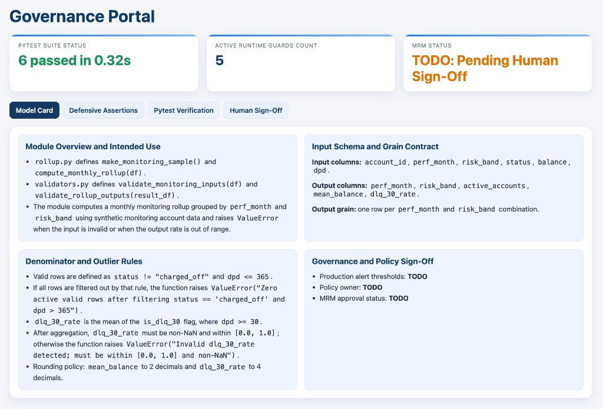

# Agentic Governance and Automated Code Cleanup

## Time Required

30 minutes

## Overview

In this lab, you use GitHub Copilot to refactor a slow, unguarded credit monitoring script into a modular, tested, and documented package ready for Model Risk Management (MRM) review. You vectorize loops with Inline Chat, modularize code using Agent `Plan` and `Interactive` modes, add docstrings and unit tests, and generate an interactive HTML Governance Portal.

### You learn how to:
- Use Inline Chat to vectorize `.iterrows()` loops and add runtime `ValueError` guards.
- Modularize legacy code step by step using Agent `Plan` and `Interactive` modes.
- Generate NumPy docstrings with `/doc` and build a parametrized `pytest` suite.
- Create a reusable `/mrm-evidence` prompt file and a `.github/skills/mrm-governance/` Agent Skill to generate a Model Card, audit log, and HTML Governance Portal.

## Scenario

You inherited a single-file credit portfolio monitoring script (`legacy_monitoring.py`) that uses nested `.iterrows()` loops, has zero runtime input or output guards, and lacks unit tests or documentation. Before the script can be scheduled for monthly Model Risk reporting, you need to use Copilot to vectorize and guard the calculations, split the script into clean modules one approved step at a time, lock behavior with `pytest`, and package the evidence into a Model Card and interactive Governance Portal.


## Lab Instructions

### Task 1: Generate a messy legacy script and refactor it with Inline Chat (`Cmd+I` or `Ctrl+I`)

In this task, you open an empty folder in VS Code, create a loop-heavy legacy monitoring script, and use Inline Chat (`Cmd+I` or `Ctrl+I`) to vectorize the calculation and add four defensive `ValueError` guards.

1. Open Visual Studio Code.

2. Create a new empty folder named `lab4-governance` on your computer and open it via **File** > **Open Folder**.

3. Create a file named `legacy_monitoring.py` in `lab4-governance` and paste this unguarded, loop-heavy script:

```python
import pandas as pd


def make_monitoring_sample() -> pd.DataFrame:
    data = [
        ("ACC-101", "2025-12", "Prime", "active", 1200.0, 0),
        ("ACC-102", "2025-12", "Prime", "active", 3400.0, 45),
        ("ACC-103", "2025-12", "Prime", "charged_off", 5000.0, 180),
        ("ACC-104", "2025-12", "Near-Prime", "active", 2800.0, 15),
        ("ACC-105", "2025-12", "Near-Prime", "active", 4100.0, 60),
        ("ACC-106", "2025-12", "Subprime", "active", 1900.0, 30),
        ("ACC-107", "2025-12", "Subprime", "active", 2200.0, 90),
        ("ACC-108", "2025-12", "Subprime", "active", 1500.0, 0),
    ]
    return pd.DataFrame(
        data,
        columns=["account_id", "perf_month", "risk_band", "status", "balance", "dpd"],
    )


def compute_monthly_rollup(df):
    rows = []
    for month in df["perf_month"].unique():
        for band in df["risk_band"].unique():
            sub = df[(df["perf_month"] == month) & (df["risk_band"] == band)]
            active_count = 0
            bad_count = 0
            total_bal = 0.0
            for _, row in sub.iterrows():
                if row["status"] != "charged_off" and row["dpd"] <= 365:
                    active_count += 1
                    total_bal += float(row["balance"])
                    if row["dpd"] >= 30:
                        bad_count += 1
            if active_count > 0:
                rows.append(
                    {
                        "perf_month": month,
                        "risk_band": band,
                        "active_accounts": active_count,
                        "mean_balance": round(total_bal / active_count, 2),
                        "dlq_30_rate": round(bad_count / active_count, 4),
                    }
                )
    return pd.DataFrame(rows)


if __name__ == "__main__":
    sample_df = make_monitoring_sample()
    print(compute_monthly_rollup(sample_df))
```

4. Run the command for your operating system in the VS Code terminal to create a virtual environment, install `pandas`, `numpy`, and `pytest`, and run `legacy_monitoring.py` so you can note the baseline output table (`Prime`, `Near-Prime`, and `Subprime` rates):

**macOS / Linux:**

```bash
python3 -m venv --clear .venv && .venv/bin/python -m pip install -q pandas numpy pytest && .venv/bin/python legacy_monitoring.py
```

**Windows (PowerShell):**

```powershell
python -m venv --clear .venv; .\.venv\Scripts\python -m pip install -q pandas numpy pytest; .\.venv\Scripts\python legacy_monitoring.py
```

5. In the editor, highlight only the `compute_monthly_rollup` function and press `Cmd+I` (macOS) or `Ctrl+I` (Windows) to open Inline Chat.

6. Paste the following prompt into Inline Chat:

```text
Refactor compute_monthly_rollup(df: pd.DataFrame) -> pd.DataFrame:
1. Add four defensive ValueError checks before computing rates:
   - Missing required columns: {'account_id', 'perf_month', 'risk_band', 'status', 'balance', 'dpd'}
   - Empty input DataFrame
   - Duplicate (account_id, perf_month) keys
   - Zero active valid rows remaining after filtering out status == 'charged_off' and dpd > 365
2. Replace the nested loops and iterrows() with vectorized pandas groupby operations at (perf_month, risk_band) grain.
3. Add a post-calculation ValueError check if any dlq_30_rate is NaN, below 0.0, or above 1.0.
4. Keep make_monitoring_sample() unchanged.
```

7. Inspect the inline diff in `legacy_monitoring.py`, click **Accept** (or **Keep**), and rerun `legacy_monitoring.py` to verify that the output numbers match your original run:

**macOS / Linux:**

```bash
.venv/bin/python legacy_monitoring.py
```

**Windows (PowerShell):**

```powershell
.\.venv\Scripts\python legacy_monitoring.py
```

### Task 2: Use Agent `Plan` and `Interactive` modes to modularize the codebase step by step

In this task, you switch the Copilot Chat Agent mode menu to **Plan** (`Plan first, execute when ready`) to review a multi-file refactoring plan before any files are created, then execute and verify one step at a time.

1. Open Copilot Chat and click the **speech bubble icon** at the bottom of the chat panel to open the **Agent mode** menu. Select **Plan** (`Plan first, execute when ready`) and confirm **Permissions** is set to **Manual**.


2. Attach `#file legacy_monitoring.py` and send this planning prompt:

```text
Read #file legacy_monitoring.py and propose a 2-step plan to modularize this script without changing any metric formulas:
- Step 1: Extract the four input/output ValueError guard helpers into validators.py (validate_monitoring_inputs and validate_rollup_outputs).
- Step 2: Update legacy_monitoring.py (or create rollup.py) so compute_monthly_rollup calls validators.py and preserves exact output column names and rounding.
List the exact files each step will create or modify and the verification command to run after each step.
```

3. Review the plan Copilot produces. Confirm that no extra files are listed and that metric formulas remain unchanged.

4. Switch the Agent mode menu back to **Interactive** (or click the execute button on the plan) and prompt Copilot to run **Step 1 only**:

```text
Execute Step 1 only: create validators.py with validate_monitoring_inputs(df) and validate_rollup_outputs(result_df). Stop after creating validators.py.
```

5. Click `validators.py` in the VS Code chat file list to review the code, then click **Keep**.

6. Now approve **Step 2**:

```text
Execute Step 2: create rollup.py containing make_monitoring_sample() and compute_monthly_rollup(df) that imports and calls validate_monitoring_inputs and validate_rollup_outputs from validators.py.
```

7. Review the diff in `rollup.py`, click **Keep**, and run `rollup.py` in the terminal to verify identical output:

**macOS / Linux:**

```bash
.venv/bin/python rollup.py
```

**Windows (PowerShell):**

```powershell
.\.venv\Scripts\python rollup.py
```

> [!IMPORTANT]
> Approving one step at a time keeps every diff small enough to inspect in 15 seconds and prevents formula changes from hiding inside file moves.

### Task 3: Add NumPy docstrings with `/doc` and expand `pytest` coverage

In this task, you use `/doc` in Inline Chat to document `rollup.py` and `validators.py` without changing runtime behavior, then build a comprehensive `pytest` suite and capture the test run output for MRM audit evidence.

1. Open `rollup.py` in the editor, select `compute_monthly_rollup`, press `Cmd+I` (macOS) or `Ctrl+I` (Windows), and run:

```text
/doc Add a NumPy-style docstring documenting the required input columns, the (perf_month, risk_band) output grain, the charged_off and dpd > 365 exclusion rule, and all ValueError conditions. Do not modify any executable code.
```

2. Inspect the inline diff to verify that only docstring lines were added, then click **Accept**.

3. Open Copilot Chat, attach `#file rollup.py` and `#file validators.py`, and run this prompt to create and save `test_rollup.py`:

```text
Using #file rollup.py and #file validators.py, create and save test_rollup.py using pytest with:
1. A @pytest.fixture returning the synthetic DataFrame from make_monitoring_sample().
2. A test verifying exact active_accounts, mean_balance, and dlq_30_rate values for Prime, Near-Prime, and Subprime, confirming that the charged_off row is excluded.
3. @pytest.mark.parametrize and pytest.raises(ValueError) tests covering:
   - Missing required column (e.g., dropping 'dpd')
   - Empty DataFrame
   - Duplicate (account_id, perf_month) rows
   - All rows having status == 'charged_off' (empty active denominator)
   - Invalid output rate outside [0.0, 1.0] passed to validate_rollup_outputs
```

4. Run `pytest` in the VS Code terminal and save the test output to `pytest_run.txt` so you can attach it as audit evidence in Task 4:

**macOS / Linux:**

```bash
.venv/bin/python -m pytest -v | tee pytest_run.txt
```

**Windows (PowerShell):**

```powershell
.\.venv\Scripts\python -m pytest -v | Tee-Object -FilePath pytest_run.txt
```

### Task 4: Create `/mrm-evidence` and an `mrm-governance` Agent Skill to generate the Model Card and Governance Portal

In this task, you create a reusable prompt file at `.github/prompts/mrm-evidence.prompt.md`, bundle a domain playbook and template inside an Agent Skill at `.github/skills/mrm-governance/`, and generate a Model Card, audit log, and interactive HTML Governance Portal.

1. In the VS Code Explorer pane, click the blank space at the bottom of the file list, click **New File**, type `.github/prompts/mrm-evidence.prompt.md`, and press `Enter` (VS Code creates the `.github/prompts` folder and file automatically on both macOS and Windows).

2. Paste the following reusable prompt template into `.github/prompts/mrm-evidence.prompt.md`:

```markdown
# Prompt File: .github/prompts/mrm-evidence.prompt.md

Using the specified source files, test file, and pytest run log, generate `AUDIT_EVIDENCE.md`:
- **Scope of Refactoring**: Functions modularized and vectorized.
- **Defensive Assertions Inventory**: Table of every `ValueError` guard in the codebase.
- **Pytest Verification Log**: Table of every unit test and the exact pass count from the pytest output log.
- **Reviewer Sign-Off Checklist**: Leave human reviewer name, date, and decision as `TODO`.

Rule: Cite only facts and test results present in the specified files. Do not invent metrics or mark the package as "Approved."
```

3. Save `.github/prompts/mrm-evidence.prompt.md`, then run `/mrm-evidence` in Copilot Chat with your workspace files:

```text
/mrm-evidence rollup.py validators.py test_rollup.py pytest_run.txt
```

4. Next, package a multi-file Agent Skill so Copilot automatically follows your team’s Model Card structure whenever someone asks for MRM governance deliverables. In the VS Code Explorer pane, click **New File**, type `.github/skills/mrm-governance/model-card-template.md`, press `Enter`, and paste this reference template:

```markdown
# Model Card: {{MODULE_NAME}}

## 1. Module Overview and Intended Use
- **Primary Function**:
- **Output Grain**:

## 2. Input Schema and Exclusion Rules
- **Required Columns**:
- **Charged-Off and Sentinel Exclusions**:

## 3. Runtime Guards and Test Verification
- **Defensive ValueError Guards**:
- **Pytest Suite Summary**:

## 4. Governance and Policy Sign-Off
- **Production Alert Threshold**: TODO (Human Policy Owner)
- **Model Risk Reviewer**: TODO (Human Reviewer)
- **Approval Status**: TODO: Pending Human Sign-Off
```

5. Save `model-card-template.md`. Now create `.github/skills/mrm-governance/SKILL.md` in the same folder and paste the Agent Skill definition (using `~~~~markdown` here so you can copy the YAML frontmatter cleanly):

~~~~markdown
---
name: mrm-governance
description: Generates grounded Model Risk Management (MRM) Model Cards and HTML Governance Portals from Python credit monitoring modules and pytest logs.
---

# MRM Governance Skill

When asked to generate a Model Card or MRM Governance Portal:
1. Read `./model-card-template.md` in this skill folder and use its exact section structure to write `MODEL_CARD.md`.
2. Populate technical fields strictly from the attached Python modules, test files, and `pytest_run.txt` log.
3. Never invent validation metrics or mark a model as Approved; keep all Section 4 sign-off fields set to `TODO`.
~~~~

6. Save `.github/skills/mrm-governance/SKILL.md`.

> [!NOTE]
> Unlike `.github/copilot-instructions.md` (which loads on every chat) or a `.prompt.md` file (which you invoke manually with `/` for a single prompt), Copilot reads the `description` in `SKILL.md` and loads the full skill playbook and its bundled `model-card-template.md` on demand when your request matches MRM governance.

7. In Copilot Chat (`</> Agent` in **Interactive** mode), prompt Copilot to generate `MODEL_CARD.md` and the interactive HTML Governance Portal (`governance_portal.html`):

```text
Using #file rollup.py, #file validators.py, #file test_rollup.py, #file pytest_run.txt, and #file AUDIT_EVIDENCE.md, follow our mrm-governance skill to:
1. Generate MODEL_CARD.md using the skill's model-card-template.md structure.
2. Create governance_portal.html (a self-contained single-file HTML/CSS/JS dashboard that opens directly in a browser) with:
   - Header status cards showing Pytest Suite Status (exact pass count from pytest_run.txt), Active Runtime Guards Count, and MRM Status ('TODO: Pending Human Sign-Off').
   - Tabs or side-by-side panels displaying the Grounded Model Card specification, the Defensive Assertions Inventory table, and the Pytest Verification table.
   - An interactive Human-in-the-Loop Sign-Off form where a reviewer can check off verification items, enter Reviewer Name and Policy Alert Threshold, and click "Export Signed MRM Evidence JSON" to download a timestamped JSON sign-off record.
```

8. Open `MODEL_CARD.md` to confirm it follows `model-card-template.md` with `TODO` sign-off fields, then open `governance_portal.html` in your browser (**Reveal in Finder** / **Reveal in File Explorer** and double-click) and test the **Export Signed MRM Evidence JSON** button.



### Bonus Task 5: Simulate a denominator regression and catch it with `pytest` and `/fix`

Test that your defensive test suite catches a silent denominator bug before it can reach production.

1. Open `rollup.py` and temporarily delete or comment out the `status != "charged_off"` filter inside `compute_monthly_rollup`.

2. Run `pytest` in the terminal and observe the red test failure pointing directly to the Prime delinquency rate mismatch:

**macOS / Linux:**

```bash
.venv/bin/python -m pytest -v
```

**Windows (PowerShell):**

```powershell
.\.venv\Scripts\python -m pytest -v
```

3. Select `compute_monthly_rollup` in `rollup.py`, open Copilot Chat, paste the `pytest` failure output with `/fix`, and verify that Copilot restores the `charged_off` exclusion and the test suite turns green again.

## Congratulations!

In this lab, you have:
- Used Inline Chat to vectorize `.iterrows()` loops and add runtime `ValueError` guards.
- Modularized legacy code step by step using Agent `Plan` and `Interactive` modes.
- Generated NumPy docstrings with `/doc` and built a parametrized `pytest` suite.
- Created a reusable `/mrm-evidence` prompt file and a `.github/skills/mrm-governance/` Agent Skill to generate a Model Card, audit log, and HTML Governance Portal.
