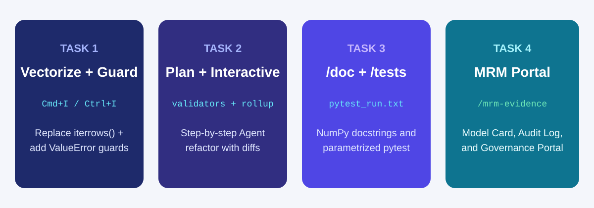
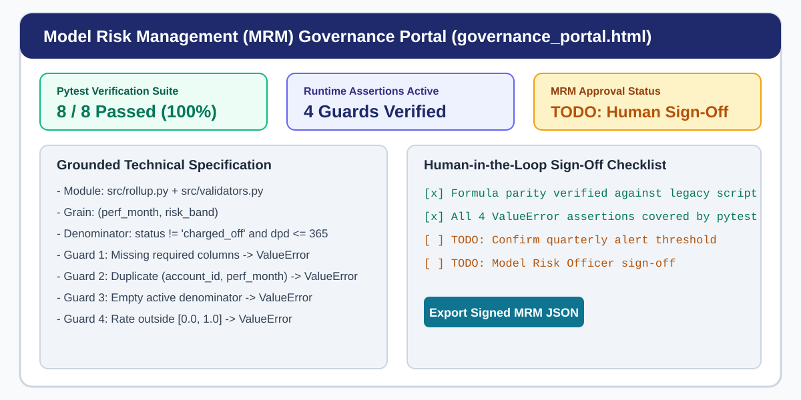

# Agentic Governance and Automated Code Cleanup

## Time Required

30 minutes

## Overview

In this lab, you start from an empty folder in Visual Studio Code and use GitHub Copilot to transform a slow, unguarded credit monitoring prototype into a modular, tested, and documented package ready for Model Risk Management (MRM) review. You use Inline Chat (`Cmd+I` or `Ctrl+I`) to vectorize `.iterrows()` loops and add defensive `ValueError` assertions, drive Copilot Agent mode using **Plan** and **Interactive** modes with human sign-off gates, document functions in place with `/doc`, and build a reusable `/mrm-evidence` prompt file that generates a Model Card, audit trail, and interactive HTML Governance Portal.

### You learn how to:
- Use Inline Chat (`Cmd+I` or `Ctrl+I`) to replace slow `.iterrows()` loops with vectorized `pandas` operations and add runtime `ValueError` assertions.
- Drive Copilot Agent mode safely using **Plan** mode (`Plan first, execute when ready`) and **Interactive** mode (`Keep` and `Undo` diff reviews) to modularize code step by step.
- Generate NumPy-style docstrings with `/doc` without altering executable code and build a parametrized `pytest` suite with `/tests`.
- Create a reusable `.github/prompts/mrm-evidence.prompt.md` file to generate grounded `MODEL_CARD.md` and `AUDIT_EVIDENCE.md` artifacts and an interactive HTML MRM Governance Portal.

## Scenario

You inherited a single-file credit portfolio monitoring script (`legacy_monitoring.py`) that uses nested `.iterrows()` loops, has zero runtime input or output guards, and lacks unit tests or documentation. Before the script can be scheduled for monthly Model Risk reporting, you need to use Copilot to vectorize and guard the calculations, split the script into clean modules one approved step at a time, lock behavior with `pytest`, and package the evidence into a Model Card and interactive Governance Portal.



## Lab Instructions

### Task 1: Generate a messy legacy script and refactor it with Inline Chat (`Cmd+I` or `Ctrl+I`)

In this task, you open an empty folder in VS Code, create a loop-heavy legacy monitoring script, and use Inline Chat (`Cmd+I` or `Ctrl+I`) to vectorize the calculation and add four defensive `ValueError` guards.

1. Open Visual Studio Code.

2. Create a new empty folder named `lab4-governance` on your computer and open it via **File** > **Open Folder**.

3. Create a file named `legacy_monitoring.py` in `lab4-governance` and paste this unguarded, loop-heavy script:

```python
import pandas as pd


def make_monitoring_sample() -> pd.DataFrame:
    data = [
        ("ACC-101", "2025-12", "Prime", "active", 1200.0, 0),
        ("ACC-102", "2025-12", "Prime", "active", 3400.0, 45),
        ("ACC-103", "2025-12", "Prime", "charged_off", 5000.0, 180),
        ("ACC-104", "2025-12", "Near-Prime", "active", 2800.0, 15),
        ("ACC-105", "2025-12", "Near-Prime", "active", 4100.0, 60),
        ("ACC-106", "2025-12", "Subprime", "active", 1900.0, 30),
        ("ACC-107", "2025-12", "Subprime", "active", 2200.0, 90),
        ("ACC-108", "2025-12", "Subprime", "active", 1500.0, 0),
    ]
    return pd.DataFrame(
        data,
        columns=["account_id", "perf_month", "risk_band", "status", "balance", "dpd"],
    )


def compute_monthly_rollup(df):
    rows = []
    for month in df["perf_month"].unique():
        for band in df["risk_band"].unique():
            sub = df[(df["perf_month"] == month) & (df["risk_band"] == band)]
            active_count = 0
            bad_count = 0
            total_bal = 0.0
            for _, row in sub.iterrows():
                if row["status"] != "charged_off" and row["dpd"] <= 365:
                    active_count += 1
                    total_bal += float(row["balance"])
                    if row["dpd"] >= 30:
                        bad_count += 1
            if active_count > 0:
                rows.append(
                    {
                        "perf_month": month,
                        "risk_band": band,
                        "active_accounts": active_count,
                        "mean_balance": round(total_bal / active_count, 2),
                        "dlq_30_rate": round(bad_count / active_count, 4),
                    }
                )
    return pd.DataFrame(rows)


if __name__ == "__main__":
    sample_df = make_monitoring_sample()
    print(compute_monthly_rollup(sample_df))
```

4. Run `python legacy_monitoring.py` in the VS Code terminal and note the output table (`Prime`, `Near-Prime`, and `Subprime` rates) so you can verify parity after refactoring.

5. In the editor, highlight only the `compute_monthly_rollup` function and press `Cmd+I` (macOS) or `Ctrl+I` (Windows) to open Inline Chat.

6. Paste the following prompt into Inline Chat:

```text
Refactor compute_monthly_rollup(df: pd.DataFrame) -> pd.DataFrame:
1. Add four defensive ValueError checks before computing rates:
   - Missing required columns: {'account_id', 'perf_month', 'risk_band', 'status', 'balance', 'dpd'}
   - Empty input DataFrame
   - Duplicate (account_id, perf_month) keys
   - Zero active valid rows remaining after filtering out status == 'charged_off' and dpd > 365
2. Replace the nested loops and iterrows() with vectorized pandas groupby operations at (perf_month, risk_band) grain.
3. Add a post-calculation ValueError check if any dlq_30_rate is NaN, below 0.0, or above 1.0.
4. Keep make_monitoring_sample() unchanged.
```

7. Inspect the inline diff in `legacy_monitoring.py`, click **Accept** (or **Keep**), and run `python legacy_monitoring.py` in the terminal to verify that the output numbers match your original run.

### Task 2: Use Agent `Plan` and `Interactive` modes to modularize the codebase step by step

In this task, you switch the Copilot Chat Agent mode menu to **Plan** (`Plan first, execute when ready`) to review a multi-file refactoring plan before any files are created, then execute and verify one step at a time.

1. Open Copilot Chat and click the **speech bubble icon** at the bottom of the chat panel to open the **Agent mode** menu. Select **Plan** (`Plan first, execute when ready`) and confirm **Permissions** is set to **Manual**.


2. Attach `#file legacy_monitoring.py` and send this planning prompt:

```text
Read #file legacy_monitoring.py and propose a 2-step plan to modularize this script without changing any metric formulas:
- Step 1: Extract the four input/output ValueError guard helpers into validators.py (validate_monitoring_inputs and validate_rollup_outputs).
- Step 2: Update legacy_monitoring.py (or create rollup.py) so compute_monthly_rollup calls validators.py and preserves exact output column names and rounding.
List the exact files each step will create or modify and the verification command to run after each step.
```

3. Review the plan Copilot produces. Confirm that no extra files are listed and that metric formulas remain unchanged.

4. Switch the Agent mode menu back to **Interactive** (or click the execute button on the plan) and prompt Copilot to run **Step 1 only**:

```text
Execute Step 1 only: create validators.py with validate_monitoring_inputs(df) and validate_rollup_outputs(result_df). Stop after creating validators.py.
```

5. Click `validators.py` in the VS Code chat file list to review the code, then click **Keep**.

6. Now approve **Step 2**:

```text
Execute Step 2: create rollup.py containing make_monitoring_sample() and compute_monthly_rollup(df) that imports and calls validate_monitoring_inputs and validate_rollup_outputs from validators.py.
```

7. Review the diff in `rollup.py`, click **Keep**, and run `python rollup.py` in the terminal to verify identical output.

> [!IMPORTANT]
> Approving one step at a time keeps every diff small enough to inspect in 15 seconds and prevents formula changes from hiding inside file moves.

### Task 3: Add NumPy docstrings with `/doc` and expand `pytest` coverage with `/tests`

In this task, you use `/doc` in Inline Chat to document `rollup.py` and `validators.py` without changing runtime behavior, then use `/tests` to build a comprehensive `pytest` suite and capture the test run output for MRM audit evidence.

1. Open `rollup.py` in the editor, select `compute_monthly_rollup`, press `Cmd+I` (macOS) or `Ctrl+I` (Windows), and run:

```text
/doc Add a NumPy-style docstring documenting the required input columns, the (perf_month, risk_band) output grain, the charged_off and dpd > 365 exclusion rule, and all ValueError conditions. Do not modify any executable code.
```

2. Inspect the inline diff to verify that only docstring lines were added, then click **Accept**.

3. Open Copilot Chat, attach `#file rollup.py` and `#file validators.py`, and run `/tests`:

```text
/tests #file rollup.py #file validators.py
Create test_rollup.py using pytest with:
1. A @pytest.fixture returning the synthetic DataFrame from make_monitoring_sample().
2. A test verifying exact active_accounts, mean_balance, and dlq_30_rate values for Prime, Near-Prime, and Subprime, confirming that the charged_off row is excluded.
3. @pytest.mark.parametrize and pytest.raises(ValueError) tests covering:
   - Missing required column (e.g., dropping 'dpd')
   - Empty DataFrame
   - Duplicate (account_id, perf_month) rows
   - All rows having status == 'charged_off' (empty active denominator)
   - Invalid output rate outside [0.0, 1.0] passed to validate_rollup_outputs
```

4. Run `pytest -v` in the VS Code terminal and save the test output to `pytest_run.txt` so you can attach it as audit evidence in Task 4:

```bash
pytest -v | tee pytest_run.txt
```

### Task 4: Create `/mrm-evidence` and generate a Model Card and MRM Governance Portal

In this task, you create a reusable prompt file at `.github/prompts/mrm-evidence.prompt.md`, run `/mrm-evidence` with your code, tests, and `pytest_run.txt` attached, and build an interactive HTML Governance Portal.

1. In the VS Code terminal, create the `.github/prompts` folder:

```bash
mkdir -p .github/prompts
```

2. Create `.github/prompts/mrm-evidence.prompt.md` and paste the following reusable prompt template:

```markdown
# Prompt File: .github/prompts/mrm-evidence.prompt.md

Using the attached code files, test file, and pytest terminal output, generate two files:

1. `MODEL_CARD.md`
   - **Module Overview and Intended Use**: Read from `rollup.py` and `validators.py`.
   - **Input Schema and Grain Contract**: Exact columns and `(perf_month, risk_band)` grain.
   - **Denominator and Outlier Rules**: Exact rules for `charged_off` and `dpd > 365`.
   - **Governance and Policy Sign-Off**: Mark production alert thresholds, policy owner, and MRM approval status as `TODO`.

2. `AUDIT_EVIDENCE.md`
   - **Scope of Refactoring**: Functions modularized and vectorized.
   - **Defensive Assertions Inventory**: Table of every `ValueError` guard in `validators.py`.
   - **Pytest Verification Log**: Table of every test in `test_rollup.py` and the exact pass count from `pytest_run.txt`.
   - **Reviewer Sign-Off Checklist**: Leave human reviewer name, date, and decision as `TODO`.

Rule: Cite only facts and test results present in the attached files. Do not invent metrics or mark the package as "Approved."
```

3. Save `.github/prompts/mrm-evidence.prompt.md`.

4. In Copilot Chat, type `/mrm-evidence` and attach your four workspace artifacts:

```text
/mrm-evidence #file rollup.py #file validators.py #file test_rollup.py #file pytest_run.txt
```

5. Open the generated `MODEL_CARD.md` and `AUDIT_EVIDENCE.md` files to confirm that all technical rules and test counts match your code and that policy sign-off fields are marked `TODO`.

6. Finally, prompt Copilot in Chat to build a single-file interactive HTML Governance Portal (`governance_portal.html`) from your evidence files:

```text
Using #file MODEL_CARD.md, #file AUDIT_EVIDENCE.md, and #file rollup.py, create governance_portal.html (a self-contained single-file HTML/CSS/JS dashboard that opens directly in a browser):
1. Header status cards showing Pytest Suite Status (exact pass count from pytest_run.txt), Active Runtime Guards Count, and MRM Status ('TODO: Pending Human Sign-Off').
2. Tabs or side-by-side panels displaying the Grounded Model Card specification, the Defensive Assertions Inventory table, and the Pytest Verification table.
3. An interactive Human-in-the-Loop Sign-Off form where a reviewer can check off verification items, enter Reviewer Name and Policy Alert Threshold, and click "Export Signed MRM Evidence JSON" to download a timestamped JSON sign-off record.
```

7. Open `governance_portal.html` in your browser (**Reveal in Finder** / **Reveal in File Explorer** and double-click), review the tabs, check the sign-off boxes, and test the **Export Signed MRM Evidence JSON** button.



### Bonus Task 5: Simulate a denominator regression and catch it with `pytest` and `/fix`

Test that your defensive test suite catches a silent denominator bug before it can reach production.

1. Open `rollup.py` and temporarily delete or comment out the `status != "charged_off"` filter inside `compute_monthly_rollup`.

2. Run `pytest -v` in the terminal and observe the red test failure pointing directly to the Prime delinquency rate mismatch.

3. Select `compute_monthly_rollup` in `rollup.py`, open Copilot Chat, paste the `pytest` failure output with `/fix`, and verify that Copilot restores the `charged_off` exclusion and `pytest -v` turns green again.

## Congratulations!

In this lab, you have:
- Used Inline Chat (`Cmd+I` or `Ctrl+I`) to replace slow `.iterrows()` loops with vectorized `pandas` operations and added runtime `ValueError` assertions.
- Driven Copilot Agent mode safely using **Plan** mode (`Plan first, execute when ready`) and **Interactive** mode (`Keep` and `Undo` diff reviews) to modularize code step by step.
- Generated NumPy-style docstrings with `/doc` without altering executable code and built a parametrized `pytest` suite with `/tests`.
- Created a reusable `.github/prompts/mrm-evidence.prompt.md` file to generate grounded `MODEL_CARD.md` and `AUDIT_EVIDENCE.md` artifacts and an interactive HTML MRM Governance Portal.
